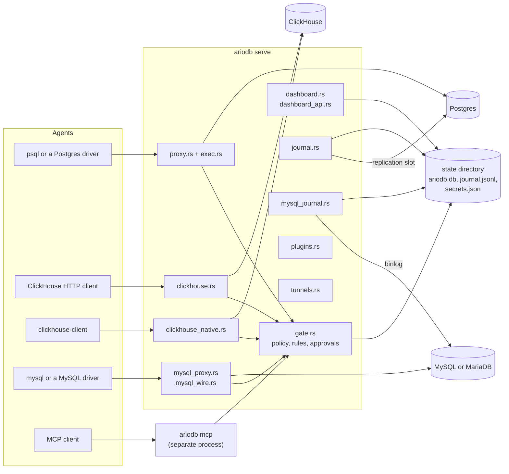
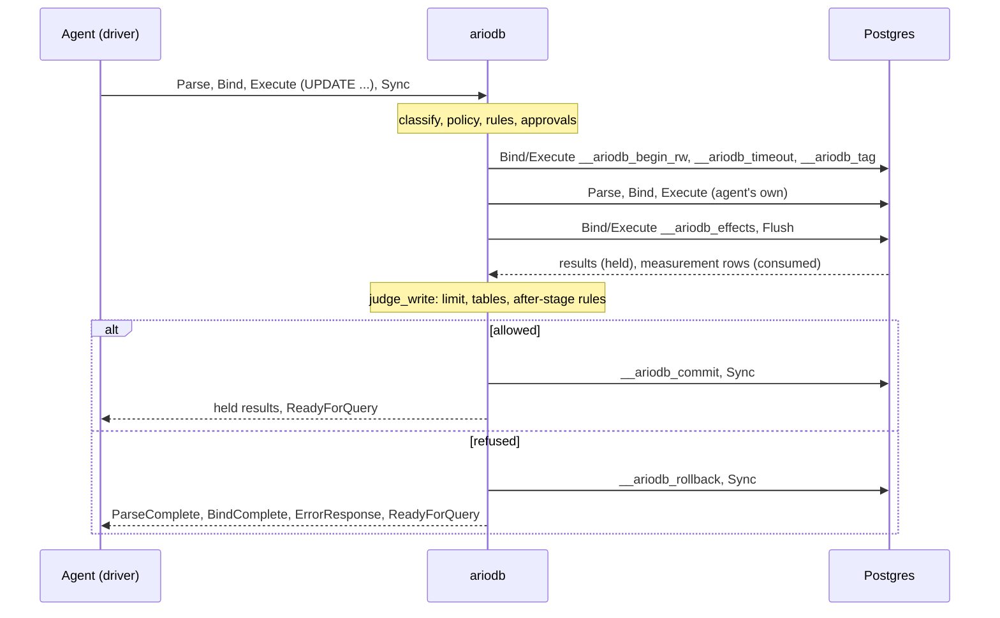

# Architecture

This page is for contributors and for operators who want to know how
ariodb works inside. It maps every source file to its job, follows a
statement through the Postgres wire proxy (simple and extended protocol),
the ClickHouse and MySQL paths and the MCP server, and then covers the decision
layer, approvals, the journal, undo, the decisions log, ariodb's own store,
the dashboard, plugins and model providers. It ends with the tests and how
to run them. Read the [overview](overview.md) first for the vocabulary.

## The shape of the program

ariodb is one Rust binary built on Tokio. `ariodb serve` runs several
listeners and background tasks in one process, all sharing one
`gate::State`: the current config and its compiled rules (swapped in place
on reload), the decisions log, and the SQLite store.



Processes coordinate through the state directory, not through each other:
an `ariodb mcp` process, an `ariodb approve` command and the dashboard all
see the same pending approvals because they share `ariodb.db`.

## Module map

Each file in [`src/`](../src) and its job.

**Entry point and configuration**

| File | Job |
|---|---|
| [`main.rs`](../src/main.rs) | The command line (clap), and `serve`: starts tunnels, plugins, the config watcher, decisions-log pruning, the ClickHouse listeners, the dashboard, the MySQL listener and journal, the Postgres journal and the Postgres proxy, and stops them on Ctrl-C or `SIGTERM`. `sessions` and `undo` read both journals and hand a MySQL session to `mysql_undo`. |
| [`config.rs`](../src/config.rs) | Reads and validates `ariodb.toml`, and resolves secrets: database URLs, credentials, agent tokens, connection targets through tunnels. The `[mysql]` section and `[agents.mysql]` (an `EngineAccess`, shared with ClickHouse) live here, with the `mysql_*` helpers for its passwords, the journal login, the address to dial, the TLS mode and the listener's TLS, and `engine_agent`, which checks a token and swaps in an agent's access for another engine. |
| [`secrets.rs`](../src/secrets.rs) | The encrypted secret store (`secrets.json`), XChaCha20-Poly1305 under a key from `ARIODB_MASTER_KEY` or `master.key`; also creates the state directory `0700`. |
| [`doctor.rs`](../src/doctor.rs) | `ariodb doctor`: per-login checks (TLS, read-only enforcement, write measurement, session tagging, table grants) and journal checks (`wal_level`, slot, publication, replica identity, stream), and the MySQL gateway checks (TLS, table-name case, `READ ONLY`, tagging, InnoDB's row count, tables). Also run once at startup for the summary line. |
| [`testing.rs`](../src/testing.rs) | `ariodb explain`, `ariodb test` and the dashboard's explain: judge a statement against the policy and before-stage rules without running it; load and replay fixtures. |

**Understanding SQL and deciding**

| File | Job |
|---|---|
| [`classify.rs`](../src/classify.rs) | Postgres SQL through Postgres's own parser (`pg_query`): kind, tables, functions, and the statement's text, looking inside `EXPLAIN ANALYZE`, `PREPARE`, `DECLARE`, `COPY (...)` and `WITH`. When in doubt, `Unknown`. |
| [`chsql.rs`](../src/chsql.rs) | ClickHouse SQL through a careful tokeniser: verb, tables, functions; refuses table functions that reach outside the server and more than one statement. |
| [`policy.rs`](../src/policy.rs) | The built-in, default-deny policy: access level, statement kinds, blocked functions, `COPY FROM STDIN`, the table list, catalogue reads. |
| [`rules.rs`](../src/rules.rs) | CEL rules: compiling, choosing the rules for an agent and stage, building the variables (`sql.*`, `agent.*`, `effects.*`, `plugin.*`) and combining matches. |
| [`gate.rs`](../src/gate.rs) | The decision layer every front door calls: `check` before a statement runs, `judge_write` after a write runs and before it commits. Also owns `State` and config hot reload. |
| [`approvals.rs`](../src/approvals.rs) | Holding a statement until its approvers agree: dashboard and CLI, Slack, webhooks, models and plugins. |
| [`llm.rs`](../src/llm.rs) | Model approvers: one interface over the Anthropic, OpenAI, Gemini, Azure OpenAI and OpenAI-compatible APIs. |
| [`plugins.rs`](../src/plugins.rs) | Starting, supervising and talking to plugins over JSON-RPC on stdin and stdout. |

<!-- TODO: the agent.credential rule fact, once merged. -->

**Postgres front door**

| File | Job |
|---|---|
| [`wire.rs`](../src/wire.rs) | The Postgres wire protocol, version 3: reading frames (capped at 1 MiB), building the messages ariodb sends, and parsing the few it must look inside. |
| [`proxy.rs`](../src/proxy.rs) | The listener agents connect to: TLS, token login, cancel requests, and the per-connection loop, including the extended protocol with hidden `__ariodb_*` statements. |
| [`exec.rs`](../src/exec.rs) | A `Session`: ariodb's own connection for one agent, its id, and running a simple-protocol query string (used by the proxy and the MCP server). |
| [`upstream.rs`](../src/upstream.rs) | ariodb's connection to the database: TLS, SCRAM and other authentication, relaying frames byte for byte; plus `tokio-postgres` clients for setup, the journal, doctor and undo. |
| [`tls.rs`](../src/tls.rs) | rustls on both sides: `disable`, `require` or `verify` towards the database, and certificate and key for listeners. |
| [`tunnels.rs`](../src/tunnels.rs) | Side processes such as `cloud-sql-proxy`: start, wait for the port, restart with backoff, stop. |
| [`mcp.rs`](../src/mcp.rs) | `ariodb mcp`: an MCP server on stdio offering one tool, `query`, through the same `Session` as the proxy. |

**ClickHouse front doors**

| File | Job |
|---|---|
| [`clickhouse.rs`](../src/clickhouse.rs) | The HTTP interface: authenticate the agent, classify and judge the statement, forward it with ariodb's own login and forced settings, stream the answer back. |
| [`clickhouse_native.rs`](../src/clickhouse_native.rs) | The native TCP protocol, for reads: terminate the handshake on both sides, judge each Query packet, relay replies byte for byte. |

**Recording and undoing**

| File | Job |
|---|---|
| [`journal.rs`](../src/journal.rs) | `ariodb setup`, and the journal: read the replication slot, assemble whole transactions, append them to `journal.jsonl`, then advance the slot. |
| [`pgoutput.rs`](../src/pgoutput.rs) | Decoding Postgres's `pgoutput` logical replication messages (protocol version 1, with logical messages). |
| [`undo.rs`](../src/undo.rs) | `ariodb sessions` and `ariodb undo`: summarise sessions, plan the inverse of one session's changes, detect conflicts, and apply in one transaction. |
| [`audit.rs`](../src/audit.rs) | The decisions log: the hash chain, retention, redaction, queries for the dashboard, `ariodb audit`, fixture export and the cursor audit-sink plugins read from. |
| [`store.rs`](../src/store.rs) | ariodb's SQLite database, `ariodb.db`: approvals, dashboard users and sessions (the decisions log lives in the same file). |

**Dashboard**

| File | Job |
|---|---|
| [`dashboard.rs`](../src/dashboard.rs) | The axum server: login, sessions, CSRF and origin checks, approvals, signed webhook links and Slack callbacks. |
| [`dashboard_api.rs`](../src/dashboard_api.rs) | The rest of the JSON API: overview, decisions, fixtures, sessions and undo, rules and explain, config editing, block-like-this, secrets, users, decisions-log check, plugins. |
| [`dashboard_files.rs`](../src/dashboard_files.rs) | Serves the React app from `dashboard/dist`, embedded in the binary with `rust-embed`. |

**Tests**

| File | Job |
|---|---|
| [`proptests.rs`](../src/proptests.rs) | Property tests for the classifiers, the replication decoder and the wire reader. Compiled only for `cargo test`. |
| [`tests/sim_undo.rs`](../tests/sim_undo.rs) | A seeded random workload for undo against a real database, driven by `scripts/sim-undo.sh`. |

**MySQL and MariaDB**

| File | Job |
|---|---|
| [`mysql_proxy.rs`](../src/mysql_proxy.rs) | The listener agents connect to: the handshake and token check, one server connection per agent, the per-command loop (queries, prepared statements, `KILL`, refused commands), reserved tables, ariodb's own transactions, holding a write's reply, and counting its rows from `innodb_trx`. |
| [`mysql_wire.rs`](../src/mysql_wire.rs) | The MySQL client/server protocol: packets, the handshake both ways, `caching_sha2_password` and `mysql_native_password` scrambles (and RSA for full authentication), following a reply to its end, and ariodb's own login to the server. |
| [`mysql_sql.rs`](../src/mysql_sql.rs) | MySQL SQL: a lexer that reads comments, strings and quoted names as the server does, cross-checked against sqlparser's MySQL dialect; kind, tables, functions and settings, scoped to `[mysql] database`. When in doubt, `Unknown`. |
| [`mysql_journal.rs`](../src/mysql_journal.rs) | `ariodb setup` and `doctor` for the binlog side, and the MySQL journal: read the binlog as a replica, tie transactions to sessions through the tag table, append to `mysql-journal.jsonl`, then save the position; prune old tags. |
| [`mysql_binlog.rs`](../src/mysql_binlog.rs) | Turning binlog row events into journal changes: column names from the binlog or `information_schema`, and every value recorded as text undo can turn back into the same value. |
| [`mysql_undo.rs`](../src/mysql_undo.rs) | Undo of a MySQL session: plan one step per row, find conflicts in the journal and the live rows, and apply in one tagged transaction with savepoints, foreign-key retries and cascade checks. |

## A statement through the Postgres proxy

### Connecting

[`proxy::handle`](../src/proxy.rs) runs once per agent connection:

1. **Startup and TLS.** A GSSAPI encryption request is declined. A TLS
   request is accepted when `[proxy] tls_cert` and `tls_key` are set, and
   declined otherwise; with `require_tls`, a plaintext startup is refused.
   A cancel request is handled here and the connection closed.
2. **Token login.** ariodb asks for a cleartext password, which is the
   agent's token, and compares it in constant time with the token for the
   agent named as the user. Unknown agents and wrong tokens get the same
   error.
3. **Session.** [`exec::Session::open`](../src/exec.rs) connects to the
   database as the agent's credential (or the gateway login) through
   [`upstream.rs`](../src/upstream.rs), with application name
   `ariodb:<agent>`, and gives the session an id such as `s-3f9c2a71d0`.
   Whether writes are tagged for the journal and whether they are measured
   (`write_check`) are fixed for the life of the session.
4. **Hidden statements.** [`prepare_internal`](../src/proxy.rs) parses
   ariodb's own named statements on the new connection:
   `__ariodb_begin_ro` (`BEGIN READ ONLY`), `__ariodb_begin_rw`,
   `__ariodb_timeout` (`set_config('statement_timeout', $1, true)`),
   `__ariodb_tag` (`pg_logical_emit_message`, when the journal is on),
   `__ariodb_effects` (the measurement query), `__ariodb_commit` and
   `__ariodb_rollback`.
5. **Hello.** ariodb replays the database's parameter status messages and
   gives the agent a backend key of its own. A later cancel request with
   that key is mapped to the real one, and also withdraws a statement
   waiting for approval.

A separate task then reads the agent's socket for the life of the
connection, so a disconnect is noticed even while a statement waits for
approval.

### The simple protocol

A `Query` message (what `psql` sends) goes to
[`Session::simple`](../src/exec.rs):

1. Classify the whole query string. A parse failure is refused.
2. `gate::check_detailed`: policy, before-stage rules, approvals. A refusal
   goes back as an `ERROR` with SQLSTATE `42501` and the message prefixed
   `ariodb:`, and nothing is sent to the database.
3. Begin: `BEGIN READ ONLY` for reads or `BEGIN` for writes, then
   `SET LOCAL statement_timeout`, then for writes the session tag.
4. Send the query. For reads, results stream to the agent as they arrive.
   For writes, every result frame is held. If the database asks for
   `COPY ... FROM STDIN` (which the classifier refuses, so this should not
   happen), ariodb aborts the copy.
5. For writes: run the measurement, then `gate::judge_write`. On success,
   `COMMIT` and release the held frames. On failure, `ROLLBACK` and send
   only the error: the agent never sees `UPDATE 599` for a write that was
   rolled back.
6. Record the decision in the decisions log.

### The extended protocol

Drivers that prepare statements send `Parse`, `Bind`, `Describe`,
`Execute` and `Close` messages and finish a batch with `Sync` (or `Flush`).
ariodb must not send a simple query in the middle of such a stream, so it
controls the transaction by slipping its hidden statements into the batch.
[`Connection::run_batch`](../src/proxy.rs) collects messages until `Sync`
or `Flush`, then:

0. **Refuses any message that names a `__ariodb*` statement or portal.**
   Otherwise an agent could close `__ariodb_rollback` and parse its own
   statement under that name.
1. **Understands the batch.** Each `Parse` is classified; `Bind` maps
   portals to statements; each `Execute` resolves its portal to statements
   parsed in this batch or remembered from earlier ones. An `Execute` of a
   portal ariodb has no record of is refused.
2. **Judges it.** Statements parsed but not executed are checked too, so a
   refused statement fails at `Parse`, as a driver expects. Then the
   executed statements go through `gate::check_detailed`.
3. **Builds the batch for the database.** Before the first `Execute` it
   inserts `Bind`/`Execute` of `__ariodb_begin_ro` or `__ariodb_begin_rw`,
   `__ariodb_timeout`, and for writes `__ariodb_tag`. Then the agent's own
   messages, unchanged.
4. **Sends, reads back, decides.** A read batch ends with
   `__ariodb_commit` and `Sync`, and its results stream to the agent. A
   write batch ends with `__ariodb_effects` and `Flush`, and every result is
   held. ariodb then judges the write and finishes with `__ariodb_commit` or
   `__ariodb_rollback` and `Sync`. On a rollback, the agent gets the
   responses from before its first `Execute` (`ParseComplete`,
   `BindComplete` and so on) followed by the error.
5. **Filters.** Responses to ariodb's hidden messages are consumed, never
   relayed. If a batch fails at the database, ariodb forgets the statement
   names the batch touched, since it can no longer be sure what the
   database kept; a later `Bind` to one of them is refused rather than
   judged as something it may no longer be.



The function-call protocol (`F`) is refused. Messages over 1 MiB are
drained and refused without being inspected.

### Measuring a write

The measurement is [`gate::EFFECTS_SQL`](../src/gate.rs): a query on
`pg_stat_xact_user_tables`, which counts inserted, updated and deleted rows
per table inside the current transaction, including rows changed by
triggers, cascades and functions. `judge_write` then:

1. compares the measurement with the row counts in the database's own
   command tags (`UPDATE 3`); a measurement short of the reported count
   cannot be trusted, so the write is rolled back;
2. rolls back if any changed table is not in the agent's list;
3. rolls back if the total is over the agent's limit;
4. evaluates after-stage rules over `effects.rows` and `effects.tables`,
   which may deny or hold the write for approval with its transaction (and
   row locks) still open.

With `write_check = "reported"` the measurement statement returns nothing,
and only the reported counts and the statement's own tables are used. See
[compatibility](compatibility.md).

## The MCP server

`ariodb mcp --agent <name>` ([`mcp.rs`](../src/mcp.rs)) is a separate
process that speaks MCP over stdin and stdout. It checks
`ARIODB_AGENT_TOKEN` against the agent's token, opens one `Session`, and
offers one tool, `query`, which runs through `Session::simple`, so the
policy, rules, approvals, measurement, tagging and decisions log are the
same as for the proxy. Results come back as text, at most 500 rows. Plugins
are started for approvers and facts; the audit sink is left to
`ariodb serve`. See [MCP](mcp.md).

## The ClickHouse paths

ClickHouse has no transactions, so ariodb cannot measure or roll back a
ClickHouse write. Both paths judge each statement before it runs and rely
on ClickHouse's own `readonly = 2` setting to stop hidden writes in reads.

**HTTP** ([`clickhouse.rs`](../src/clickhouse.rs)), on
`[clickhouse] http_listen`:

1. The agent authenticates with its name and token (Basic auth,
   `X-ClickHouse-User` and `X-ClickHouse-Key`, or `user` and `password`
   parameters), and must have an `[agents.clickhouse]` block.
2. The statement (the `query` parameter or the body) is classified by
   [`chsql.rs`](../src/chsql.rs), table names are qualified with the
   session's database, and `gate::check_detailed` judges it.
3. ariodb forwards it with its own ClickHouse login, drops client settings
   other than formatting and query parameters, adds `readonly = 2` for
   reads and `max_execution_time` from `[limits]`, and always names the
   database. The answer is streamed back and the decision logged.
4. `INSERT` is the only write. It is judged before it runs, then sent; it
   cannot be rolled back or undone.

**Native protocol** ([`clickhouse_native.rs`](../src/clickhouse_native.rs)),
on `[clickhouse] native_listen`, for reads: ariodb terminates the handshake
on both sides (agent name and token in; ariodb's own login out), holds both
to a protocol revision it fully understands, then parses each Query packet,
judges it, and rebuilds it with `readonly = 2` and a time limit. After
that, server replies are relayed byte for byte. Native `INSERT` and
external tables are refused, because their data blocks would have to be
decoded to be relayed safely.

<!-- TODO: ClickHouse native INSERT, once merged (today it is refused). -->

See [ClickHouse](clickhouse.md) for configuration.

## The MySQL path

[`mysql_proxy::serve`](../src/mysql_proxy.rs) listens on
`[mysql] listen` and handles each agent connection:

1. **Handshake.** ariodb sends its own handshake (the server's version, a
   connection id of its own, TLS if configured), checks the agent's
   `caching_sha2_password` or `mysql_native_password` scramble against the
   token, and requires an `[agents.mysql]` block and, if a database is
   named, `[mysql] database`. Only then does it log in to the server as
   `[mysql] user`, with the agent's reply-shaping capabilities and a safe
   character set, and set the session's `sql_mode` and time limits.
2. **Commands.** A reader task watches the agent's socket throughout, so a
   disconnect is noticed while a statement waits for approval. Each
   `COM_QUERY` and `COM_STMT_PREPARE` is classified by
   [`mysql_sql.rs`](../src/mysql_sql.rs), scoped to the database, checked
   for reserved tables and for more than one statement, and judged by
   `gate::check_detailed`; prepares are judged without approvals, and every
   execute is judged in full. `KILL` is answered by ariodb, for the agent's
   own connections only.
3. **Running.** A read runs inside `START TRANSACTION READ ONLY` and its
   reply is relayed packet by packet as it arrives. A write runs inside
   `START TRANSACTION WITH CONSISTENT SNAPSHOT`, after a tag row in
   `[mysql] tag_table`; its reply is held while ariodb reads
   `trx_rows_modified` from `information_schema.innodb_trx` (spaced
   110 ms apart across connections, with a per-read marker that proves the
   list is fresh), then `gate::judge_write` judges the larger of that count
   and the reported one, with the tables the statement names. A pass
   commits and releases the reply; anything else rolls back.

The MySQL journal ([`mysql_journal.rs`](../src/mysql_journal.rs)) reads
the binlog with `[mysql] server_id`, keeps a transaction's changes under
the session its first-row tag names (and changes to protected tables by
anyone, without a session), appends whole transactions to
`mysql-journal.jsonl` and only then saves its position to
`mysql-binlog-position.json`. [`mysql_undo.rs`](../src/mysql_undo.rs)
plans and applies undo from that file with the journal login. See
[MySQL and MariaDB](mysql.md).

## The decision layer

[`gate.rs`](../src/gate.rs) is shared by every front door, so a rule or
policy change behaves the same everywhere.

`check_detailed(state, ctx, statements)`:

1. For each statement, [`policy::decide`](../src/policy.rs). Any refusal
   ends it. Any write makes the plan a checked write.
2. If a rule for this agent reads `plugin.<name>.*` facts, ask those
   plugins (and only those).
3. [`RuleSet::evaluate_with`](../src/rules.rs): every before-stage rule
   that applies to the agent is evaluated. Any matching `deny` wins;
   otherwise the highest-priority match (file order breaks ties) picks
   `allow` or `approve`. A condition that fails to evaluate counts as a
   deny.
4. For each distinct rule that asked for approval, `approvals::require`.
5. If the agent disconnected or cancelled while waiting, refuse.

The result is a `Plan` (`Read` or `Write`) and the name of the rule whose
approval let it through, for the decisions log.

The config is held behind a lock in `State` and replaced as a whole.
[`gate::watch_config`](../src/gate.rs) checks the file's modification time
every two seconds; a config that loads and compiles replaces the old one
for the next statement, and one that does not is logged and ignored.
Listen addresses, tunnels and plugins are read only at startup.

## Approvals

[`approvals::require`](../src/approvals.rs) asks each approver a rule
names, in order, and all must allow:

- **People** (`dashboard`, `slack`, `webhook`) share one mechanism: an
  approval row in `ariodb.db` with status `pending`. Slack gets a message
  (with buttons if interactive) and webhooks a signed POST. The waiting
  task polls the row every 300 ms until it is `allowed`, `denied` or
  expired, or until the agent goes away, in which case the request is
  withdrawn. Because the row is in SQLite, a decision made in the
  dashboard, with `ariodb approve`, through a signed webhook link or a Slack
  button reaches a statement waiting in any ariodb process.
- **Models** (`llm`) go through [`llm.rs`](../src/llm.rs), with a cache of
  answers keyed on approver, model, policy, agent, database, rule and SQL,
  and `llm_fail_mode` deciding what happens when the provider is down.
- **Plugins** go through [`plugins::ask`](../src/plugins.rs).

<!-- TODO: further approver channels, once merged. -->

Notifier plugins hear `approval_requested` and `approval_decided` events
for every approval. See [approvals](approvals.md).

## Model providers

[`llm.rs`](../src/llm.rs) gives every provider the same system prompt and
the same request: the policy, and the statement, agent, database and rule
as JSON data, with an instruction never to follow text inside it. Each
provider's request is built in its own shape (the Anthropic Messages API,
the OpenAI and Azure OpenAI Responses API, the Gemini Interactions API,
Chat Completions for OpenAI-compatible servers), asking for structured
output against one JSON schema, `{"decision": "allow" | "deny", "reason":
"..."}`. Answers are parsed strictly: a refusal, an empty or cut-short
answer, or anything but that one object is a deny.

Network errors, 408, 429 and 5xx are retried, three attempts in all, with
backoff that honours `Retry-After` up to 30 seconds. The HTTP client does
not follow redirects, so the API key and the statements only go to the
configured address. `base_url` must be `https` unless it is the local
machine. Configuration errors (a wrong key or model) always refuse.

## The journal and `pgoutput`

`ariodb setup` ([`journal::setup`](../src/journal.rs)) checks
`wal_level`, sets `REPLICA IDENTITY FULL` on the protected tables (so
updates and deletes carry the whole old row), creates or updates the
publication, and creates the `pgoutput` logical replication slot. On
Postgres 18 it also publishes stored generated columns.

`journal::run` then loops:

1. `pg_logical_slot_peek_binary_changes` reads up to 1,000 changes with
   `proto_version 1`, the publication, and `messages true`.
2. [`pgoutput::decode`](../src/pgoutput.rs) turns each into a message:
   `Begin`, `Relation` (table and column names), `Insert`, `Update`,
   `Delete`, `Truncate`, `Commit`, and logical messages.
3. Messages are assembled into whole transactions. The logical message with
   prefix `ariodb`, which ariodb writes at the start of every agent write
   transaction (`Session::begin`, or `__ariodb_tag` in the extended
   protocol), carries `{"session": ..., "agent": ...}`; transactions
   without one (changes made by anyone else) are recorded with no session,
   which is how undo later spots conflicts.
4. Finished transactions are appended to `journal.jsonl`, one JSON line
   each, and the file is synced to disk.
5. Only then is the slot advanced with `pg_replication_slot_advance`. A
   crash can therefore repeat a transaction but never lose one. A
   transaction read twice this way is appended twice; `read_all` does not
   remove the duplicate.

Connection failures are retried every few seconds, and each new error is
logged once. Because the slot holds WAL until ariodb reads it, a stopped
ariodb makes Postgres keep WAL; `ariodb doctor` reports how much.

The tag is also why the policy refuses `pg_logical_emit_message` to
agents: an agent that could write its own tag could forge which session a
change belongs to.

## Undo

[`undo.rs`](../src/undo.rs) works only from the journal and the live
database:

- `sessions` groups journal records by session (ignoring undo's own
  transactions, which are tagged `undo:<session>`, except to mark a session
  as undone).
- `plan` takes, for each row the session touched, its state before the
  session's first change and after its last, and produces one step per row:
  delete an inserted row, restore an updated one, re-insert a deleted one.
  It reads each table's primary key and column types from the database. A
  row someone else changed after the session is a conflict. Rows in tables
  without a primary key, and `TRUNCATE`, cannot be undone and block the
  plan.
- `apply` runs every step in one transaction (tagged, so the undo itself is
  journalled), each inside a savepoint. It retries steps that fail on a
  foreign key until no more progress is made, and refuses any step that
  would change rows the session never touched (a cascade or trigger),
  measured with `pg_stat_xact_user_tables`. Values are quoted so they mean
  the same whatever `standard_conforming_strings` is.

Undo connects with `ARIODB_ADMIN_URL`, or the gateway login. See
[undo](undo.md).

## The decisions log

[`audit.rs`](../src/audit.rs) writes one row per decision to the
`decisions` table in `ariodb.db`: time, session, agent, SQL (with literals
replaced by `$1`, `$2` ... when `redact_literals` is on), kind, tables,
outcome (`allowed`, `refused`, `rolled_back`, `failed`), rows, reason,
rule, latency, engine and database. Each row stores `prev`, the previous
row's hash, and `hash`, the SHA-256 of a JSON rendering of the row and
`prev`. Writers take an immediate SQLite lock, so the proxy and MCP
processes keep a single chain. `ariodb audit` recomputes the chain from the
oldest remaining row; pruning (hourly, by `retention_days`) removes the
oldest rows, which the check accepts. The chain is unkeyed: it catches
edits, not an attacker who can rewrite the whole file. See
[security model](security-model.md).

## The store

[`store.rs`](../src/store.rs) opens `ariodb.db` in WAL mode with a
five-second busy timeout, so several processes can share it. Its tables:

| Table | Holds | Written by |
|---|---|---|
| `approvals` | Every approval request and its outcome | `approvals.rs`, the dashboard, `ariodb approve` and `deny` |
| `dashboard_users` | User names and Argon2 password hashes | `ariodb dashboard-password`, the dashboard |
| `dashboard_sessions` | SHA-256 hashes of session tokens, with CSRF tokens and expiry | The dashboard |
| `decisions` | The decisions log (see above) | `audit.rs` |
| `plugin_cursors` | How far each audit-sink plugin has read | `plugins.rs` |

The rest of the state directory is `journal.jsonl`, `secrets.json` and
`master.key`.

## The dashboard

The back end is axum, in the same process as the proxy:

- [`dashboard.rs`](../src/dashboard.rs) builds the router and owns
  authentication: Argon2 password hashes, random session tokens in an
  `HttpOnly`, `SameSite=Strict` cookie (stored only as hashes), a CSRF token
  required in `x-ariodb-csrf` on every change, an `Origin` check, and login
  rate limits per address and per user. It also serves the approval
  endpoints, the signed webhook links (`/hooks/approvals/{id}`: GET shows
  the request, only POST decides) and Slack's interactivity callback
  (`/slack/actions`).
- [`dashboard_api.rs`](../src/dashboard_api.rs) serves the rest of
  `/api/*`.
- [`dashboard_files.rs`](../src/dashboard_files.rs) serves the front end
  from files embedded at build time, falling back to `index.html` for any
  other path so the app's router can take over.

<!-- TODO: OIDC single sign-on and dashboard roles, once merged. -->

The front end is a React app in [`dashboard/`](../dashboard) (Vite,
TypeScript, Tailwind CSS and shadcn/ui), with one file per page in
`dashboard/src/pages/`. Its built output in `dashboard/dist` is committed,
so `cargo build` needs no Node; `scripts/build-dashboard.sh` rebuilds it.
For live reloading, run ariodb with its dashboard on `127.0.0.1:8080` (for
example with `./scripts/demo.sh`), then `cd dashboard && npm run dev`; Vite
passes `/api` through to ariodb. See [dashboard](dashboard.md).

## Plugins

[`plugins.rs`](../src/plugins.rs) runs a `Host` with one supervisor task
per `[[plugins]]` entry:

- **Start.** The command runs with an environment of only `PATH`, `HOME`
  and what the config names (`pass_env`, `secret_env`, `env`), and must
  answer `initialize` within ten seconds, declaring its capabilities.
- **Supervise.** When a plugin exits, it is restarted with backoff from
  one second doubling to 30, reset after a minute of stable running. Lines
  are capped at 1 MiB; a plugin that sends a longer one is restarted.
  Stderr is relayed to ariodb's log with control characters removed.
- **Calls.** `approve` and `facts` are requests with a timeout, matched to
  answers by id; facts answers can be cached (`facts_cache_ms`). Any
  failure on a deciding path refuses the statement. `event` notifications
  go to notifiers. Audit sinks are fed by a task that polls the decisions
  log every 500 ms from the plugin's cursor and advances it on
  acknowledgement, so delivery is in order and at least once. Only
  `ariodb serve` feeds audit sinks.

`ariodb plugin list` and `ariodb plugin test <name>` exercise a plugin
without starting the proxy. The protocol is in [plugins](plugins.md).

## Tunnels

[`tunnels.rs`](../src/tunnels.rs) starts each `[[tunnels]]` command before
anything that needs it, waits until its `listen` port accepts a
connection, restarts it with backoff (one second doubling to 30) when it
exits, and stops it on shutdown. Connections that name a tunnel dial its
`listen` address but keep the real host name for TLS verification. One-off
commands (`setup`, `doctor`, `undo`, `mcp`) reuse a tunnel `serve` is
already running, or start their own.

## Tests

| Kind | Where | Needs |
|---|---|---|
| Unit tests | `#[cfg(test)] mod tests` in most modules | Nothing |
| Property tests | [`src/proptests.rs`](../src/proptests.rs) | Nothing |
| Undo simulation | [`tests/sim_undo.rs`](../tests/sim_undo.rs), via `scripts/sim-undo.sh` | Docker |
| End to end | `scripts/e2e*.sh` | Docker and a built binary |

**Unit and property tests:**

```bash
cargo test                          # all unit and property tests
PROPTEST_CASES=100000 cargo test proptests   # a longer hunt
```

The property tests throw random and generated input at the Postgres and
ClickHouse classifiers, the `pgoutput` decoder and the wire-protocol
reader. They check that nothing panics and that the guarantees the policy
relies on hold for every input: a write wrapped in `WITH`, `EXPLAIN
ANALYZE` or `PREPARE` is never a read, a write among reads is found, and a
ClickHouse table function that reaches outside the server is never a read.
A failing case is shrunk and its seed saved under `proptest-regressions/`.

`tests/sim_undo.rs` does nothing under a plain `cargo test`; it runs only
with the environment `sim-undo.sh` sets up.

**End-to-end scripts** start real databases in Docker and drive a real
ariodb with real clients. Build first (`cargo build`):

```bash
./scripts/e2e.sh                       # Postgres: the full suite, ending with undo
PG_IMAGE=postgres:18 ./scripts/e2e.sh  # another Postgres or Postgres-based image
./scripts/e2e-compat.sh cockroach      # YugabyteDB (yugabyte) or CockroachDB (cockroach)
./scripts/e2e-clickhouse.sh            # ClickHouse over HTTP and the native protocol
./scripts/e2e-mysql.sh                 # MySQL 8.4 through the MySQL listener
MYSQL_IMAGE=mariadb:11.4 ./scripts/e2e-mysql.sh           # the same against MariaDB
./scripts/e2e-mysql-journal.sh         # MySQL setup, doctor, the binlog journal and undo
MYSQL_IMAGE=mariadb:11.4 ./scripts/e2e-mysql-journal.sh
./scripts/e2e-plugins.sh               # the example plugin, and a broken one
./scripts/sim-undo.sh                  # seeded random agent and human writes, then undo
SIM_SEEDS="42 7" SIM_OPS=120 ./scripts/sim-undo.sh
```

Helpers used by the scripts:

- [`scripts/pg_raw.py`](../scripts/pg_raw.py): a minimal extended-protocol
  client, for message sequences no driver would send (closing someone
  else's statement, a batch that fails half way).
- [`scripts/pg_cancel.py`](../scripts/pg_cancel.py): sends a query and
  cancels it from a second connection, as `psql` does on Ctrl-C.
- [`scripts/mysql_raw.py`](../scripts/mysql_raw.py): a minimal MySQL
  client for what the `mysql` client does not send: prepared statements
  with parameters, `mysql_native_password` logins, `COM_RESET_CONNECTION`,
  and a query cancelled with `KILL QUERY` from a second connection.
- [`scripts/mock_services.py`](../scripts/mock_services.py): local stand-ins
  for Slack, a webhook receiver and the model providers' APIs, which check
  what ariodb sends.
- [`scripts/conn_limits.py`](../scripts/conn_limits.py): connection limits
  from the client side: a client that never finishes its startup, an agent
  over its own limit, a burst over a full listener, for Postgres, MySQL and
  HTTP.

The undo simulation brackets every write with a snapshot of the whole
database, predicts each undo from those snapshots alone, and fails with the
seed, the plan and the history of the rows involved when ariodb disagrees.
The same seed always produces the same workload.

`E2E_OFFSET` and `E2E_NAME` shift ports and container names so several
runs (for example from different worktrees) do not collide.

The scripts run on macOS with Docker Desktop and on Linux. Client
containers reach ariodb as `host.docker.internal`: Docker Desktop provides
the name, and on Linux the scripts run clients on the host's network with
the name pointing at `127.0.0.1`, where ariodb listens.

When you fix a security issue, add a test that fails without the fix, as
every item in the review in [SECURITY.md](../SECURITY.md) has.

## Next

- [Overview](overview.md): the concepts this page assumes.
- [Policy](policy.md) and [rules](rules.md): the decision layer from the
  user's side.
- [Plugins](plugins.md): the plugin protocol.
- [Security model](security-model.md): what the design defends against.
- [Testing policies](testing-policies.md): `ariodb test` and fixtures.
