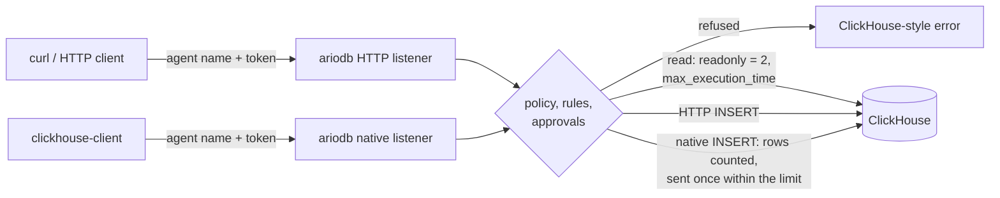

# ClickHouse

ariodb can sit in front of ClickHouse as well as Postgres. This page
covers the two listeners (ClickHouse's HTTP interface and its native
protocol), TLS on them, how agents log in, the `[agents.clickhouse]`
block, how reads are kept read-only, which settings and table functions
are refused, how table names are scoped to a database, inserts over both
protocols and how their rows are counted, the rules that apply, and the
limits you should know before giving an agent access.
It is for engineers putting ariodb between agents and a ClickHouse server.
The same [policy](policy.md), [rules](rules.md) and
[approvals](approvals.md) apply as for Postgres, with the differences set
out below.

## How it works

ariodb terminates each agent's connection, checks the statement, then
sends it to ClickHouse with **its own** ClickHouse login. Agents never see
that login's password.



Because ClickHouse has no transactions, the Postgres approach of running a
write and measuring it before commit is not available. Reads are protected
by ClickHouse's own read-only mode; writes are controlled by the policy,
rules and approvals before they run, and cannot be rolled back or undone.
Over the native protocol, ariodb also counts an insert's rows before any
reach ClickHouse, and refuses an insert over the row limit.

## Configuration

```toml
[clickhouse]
http_listen = "127.0.0.1:8124"          # HTTP interface for agents; "" (default) is off
http_url = "http://127.0.0.1:8123"      # the real HTTP interface (default)
native_listen = "127.0.0.1:9001"        # native protocol for agents; "" (default) is off
native_addr = "127.0.0.1:9000"          # the real native port (default)
user = "ariodb"                         # ariodb's own ClickHouse login; default "default"
password_env = "ARIODB_CLICKHOUSE_PASSWORD"   # or password_secret = "clickhouse-password"
accept_invalid_certificate = false      # for an https http_url with a private CA
# tls_cert = "/etc/ariodb/ch.crt"       # with tls_key: both listeners are TLS only
# tls_key = "/etc/ariodb/ch.key"
# tunnel = "ch"                         # a [[tunnels]] entry; must forward the port in use
```

| Key | Default | Meaning |
|---|---|---|
| `http_listen` | `""` (off) | Where agents send HTTP requests |
| `http_url` | `http://127.0.0.1:8123` | ClickHouse's HTTP interface; `https://` works |
| `native_listen` | `""` (off) | Where `clickhouse-client` and native drivers connect |
| `native_addr` | `127.0.0.1:9000` | ClickHouse's native port |
| `user` | `default` | The login ariodb uses for every agent's queries |
| `password_env`, `password_secret` | none (empty password) | Where that login's password comes from |
| `accept_invalid_certificate` | `false` | Skip certificate checks on an `https` `http_url` |
| `tls_cert`, `tls_key` | none | TLS for agents on both listeners |
| `tunnel` | none | Reach ClickHouse through a [tunnel](configuration.md) |

Listen addresses, the TLS certificate and key, and tunnels need a restart
to change; the rest reloads with the config. Agents must also have an
[`[agents.clickhouse]`](#giving-an-agent-clickhouse-access) block.

### A ClickHouse-only deployment

`[database]` is required even if agents only use ClickHouse, and every
agent must list at least one Postgres table. Switch the Postgres side off
so nothing tries to reach a Postgres server:

```toml
[database]
url = "postgres://unused@localhost/unused"   # required, never used with the lines below

[proxy]
listen = ""            # no Postgres proxy

[journal]
enabled = false        # no Postgres journal
dir = "/var/lib/ariodb"

[clickhouse]
http_listen = "127.0.0.1:8124"
native_listen = "127.0.0.1:9001"
user = "ariodb"
password_env = "ARIODB_CLICKHOUSE_PASSWORD"

[[agents]]
name = "analyst"
access = "read_only"
tables = ["unused"]                      # required; unused while the Postgres proxy is off
token_env = "ARIODB_TOKEN_ANALYST"

[agents.clickhouse]
access = "read_only"
tables = ["events", "analytics.page_views"]
```

## ariodb's ClickHouse login

Every agent's query runs as the one login in `[clickhouse] user`. Its
grants are the real boundary, exactly as the gateway role's are on
Postgres: ariodb checks the tables a statement names, and the grants stop
anything parsing cannot see. Grant it only what the agents behind it need:

```sql
CREATE USER ariodb IDENTIFIED WITH sha256_password BY 'not-a-real-password';
GRANT SELECT ON default.events TO ariodb;
GRANT SELECT ON analytics.page_views TO ariodb;
GRANT INSERT ON default.events TO ariodb;   -- only if some agent may insert
```

ariodb sets `readonly = 2` and `max_execution_time` on every read, so the
login must be allowed to change settings: do not give it a settings
profile with `readonly = 1`.

## Giving an agent ClickHouse access

ClickHouse access is separate from Postgres access. An agent without an
`[agents.clickhouse]` block cannot use ClickHouse at all ("this agent has
no ClickHouse access").

```toml
[[agents]]
name = "coding-agent"
access = "read_write"                 # Postgres access
tables = ["orders", "customers"]      # Postgres tables
token_env = "ARIODB_TOKEN_CODING_AGENT"

[agents.clickhouse]
access = "read_only"                  # read_only | read_write
tables = ["events", "analytics.page_views"]   # outside `default`, name the database
```

The agent uses the same name and token for both engines. Inside a rule,
`agent.access` is the agent's ClickHouse access when the statement came
through ClickHouse.

## How agents log in

### Over HTTP

Agents send ordinary ClickHouse HTTP requests to `http_listen`, with their
agent name and token in any of the forms ClickHouse accepts:

| Form | Example |
|---|---|
| HTTP Basic auth | `curl -u coding-agent:agent-token-local-test-only ...` |
| `X-ClickHouse-User` and `X-ClickHouse-Key` headers | `-H 'X-ClickHouse-User: coding-agent' -H 'X-ClickHouse-Key: ...'` |
| `user` and `password` URL parameters | `?user=coding-agent&password=...` |

Prefer Basic auth or the headers. A token in the URL can end up in proxy
and server logs.

```bash
# A read, with the SQL in the body:
curl -s -u coding-agent:agent-token-local-test-only \
  'http://127.0.0.1:8124/' --data-binary 'SELECT count() FROM events'

# The SQL in the query parameter, with query parameters and a format:
curl -s -u coding-agent:agent-token-local-test-only \
  'http://127.0.0.1:8124/?param_id=3&default_format=JSONEachRow' \
  --data-urlencode 'query=SELECT user FROM events WHERE id = {id:UInt32}' -G

# Health check, no login:
curl -s http://127.0.0.1:8124/ping
```

The statement is the `query` parameter if there is one, otherwise the
whole body of a `POST`. A failed login answers HTTP 401 with ClickHouse
error code 516; a refusal answers 403 with code 497 and a message such as:

```text
Code: 497. DB::Exception: ariodb: agent 'coding-agent' may not use table 'secrets'. (ARIODB)
```

### Over the native protocol

```bash
clickhouse-client --host 127.0.0.1 --port 9001 \
  --user coding-agent --password agent-token-local-test-only \
  --query 'SELECT count() FROM events'
```

ariodb completes the handshake with the client itself, then logs in to
ClickHouse with its own login at a protocol revision both sides
understand (capped at 54470), and relays the server's replies. Very old
clients that cannot send settings as strings are refused. Each query is
judged on its own, so `--multiquery` works: a refused statement returns an
error and the connection carries on. Inserts work too, with their rows
counted first; see [over the native protocol](#over-the-native-protocol).

## TLS

### On ariodb's listeners

With `tls_cert` and `tls_key` set, **both** listeners accept TLS only, as
ClickHouse's own secure ports do. Plain HTTP is no longer served on
`http_listen`.

```bash
curl -s -u coding-agent:agent-token-local-test-only \
  'https://ariodb.internal:8124/' --data-binary 'SELECT 1'

clickhouse-client --secure --host ariodb.internal --port 9001 \
  --user coding-agent --password agent-token-local-test-only --query 'SELECT 1'
```

A client has `[limits] handshake_timeout_ms` (ten seconds by default) to
complete the TLS handshake and log in; see
[configuration](configuration.md#limits) for the connection limits.

### From ariodb to ClickHouse

- **HTTP**: give `http_url` an `https://` address. Certificates are
  checked unless `accept_invalid_certificate = true`.
- **Native**: ariodb's connection to `native_addr` is **not encrypted**,
  and ariodb's ClickHouse password crosses it in the login. Keep
  `native_addr` on the same host or a private network, or carry it through
  a [tunnel](configuration.md) that encrypts.

## How reads stay read-only

Every read is sent with **`readonly = 2`**, so ClickHouse itself refuses
any write, DDL or attempt to switch read-only mode off, whatever the
statement turns out to do. Level 2 (rather than 1) still lets a query set
ordinary settings, which clients need for output formats.

Every statement also gets **`max_execution_time`**, from
`[limits] statement_timeout_ms` rounded up to whole seconds (at least 1).

### Settings that are dropped

Agents cannot pass settings that would loosen these.

- **HTTP**: only these URL parameters are passed on; everything else
  (including `readonly`, `allow_ddl`, `max_execution_time` and
  `session_id`) is dropped:
  `database`, `default_format`, `query_id`, `wait_end_of_query`,
  `compress`, `decompress`, `date_time_output_format`, and any parameter
  starting `param_`, `output_format_`, `input_format_` or `format_`. Of the
  request headers, only `Content-Type`, `Content-Encoding` and
  `Accept-Encoding` are passed on, and ariodb names the database itself.
- **Native**: the client's settings are passed on except `readonly`,
  `max_execution_time`, anything starting `allow_`, and anything starting
  `input_format_native_` (which would change how an insert's data blocks
  are read), which ariodb replaces or removes.
- **In the SQL**: a `SETTINGS` clause that mentions `readonly` or
  `allow_ddl` is refused ("queries may not change readonly or allow_ddl").
  `SET` and `USE` statements are refused.

`readonly = 2` still lets a query change most other settings, resource
limits among them; `max_execution_time` is the one ariodb always sets
itself. Use a settings profile with constraints on ariodb's login if you
need more.

## What is refused

ClickHouse's dialect is not Postgres's, so ariodb reads it with a careful
tokeniser rather than Postgres's parser, and refuses what it cannot place.
The full classification is in [policy](policy.md#clickhouse); in short:

- **One statement per request.** `SELECT 1; DROP TABLE events` is refused
  ("send one statement per request"). A trailing semicolon is fine.
- **Table functions that leave the server** are refused for every agent:
  `file`, `url`, `urlCluster`, `s3`, `s3Cluster`, `gcs`,
  `azureBlobStorage`, `azureBlobStorageCluster`, `hdfs`, `hdfsCluster`,
  `remote`, `remoteSecure`, `cluster`, `clusterAllReplicas`, `mysql`,
  `postgresql`, `mongodb`, `redis`, `jdbc`, `odbc`, `executable`, `sqlite`,
  `iceberg`, `icebergS3`, `deltaLake`, `hudi` and `input`. They can read
  the server's files or send data to other machines.
- **Other table functions** are refused unless they only make rows or wrap
  a query whose own tables are checked: `numbers`, `numbers_mt`, `zeros`,
  `zeros_mt`, `values`, `view`, `generateRandom`, `generate_series` and
  `format` are allowed. `merge`, `dictionary` and the rest read tables
  named in strings, which the allow-list cannot see.
- **`dictGet` and friends, and `joinGet`**, for the same reason.
- **Mutations and drops**: `DELETE`, `ALTER ... DELETE`, `ALTER ... UPDATE`,
  `DROP`, `TRUNCATE`, `DETACH`, `RENAME`, `EXCHANGE` are destructive;
  `CREATE`, `ALTER`, `ATTACH`, `OPTIMIZE`, `SYSTEM`, `GRANT`, `REVOKE`,
  `KILL` and `MOVE` are schema changes. Agents may run neither.
- **The `system` database** is off limits except for schema discovery:
  `system.tables`, `system.columns`, `system.databases`,
  `system.functions` and `information_schema` are readable by every agent;
  `system.query_log`, `system.users` and the rest are not.

## Database scoping

ClickHouse resolves an unqualified table name in the session's database,
which the agent chooses (the `database` URL parameter or
`X-ClickHouse-Database` header over HTTP, `--database` on the native
protocol; `default` if none). Allow-lists name tables in `default` without
a prefix, so ariodb qualifies names before judging them:

| Agent's database | Statement | Judged as |
|---|---|---|
| `default` | `SELECT * FROM events` | `events` |
| `analytics` | `SELECT * FROM page_views` | `analytics.page_views` |
| `hidden` | `SELECT * FROM events` | `hidden.events` (refused unless listed) |
| `default` | `SELECT * FROM default.events` | `default.events` |

ariodb always names the database to ClickHouse, so ClickHouse resolves the
name in the same database ariodb judged it in.

Note the last row: an explicitly qualified `default.events` is not the
same name as `events` in the allow-list. If agents write both forms, list
both:

```toml
[agents.clickhouse]
access = "read_only"
tables = ["events", "default.events"]
```

Table names are compared in lower case, although ClickHouse's are case
sensitive; avoid tables whose names differ only by case.

## Inserts

`INSERT` is the only write ClickHouse agents can run, and only agents whose
`[agents.clickhouse]` access is `read_write`, into tables on that block's
list. It works over both listeners.

### Over HTTP

```bash
curl -s -u coding-agent:agent-token-local-test-only \
  'http://127.0.0.1:8124/?query=INSERT%20INTO%20events%20FORMAT%20JSONEachRow' \
  --data-binary $'{"id":1001,"user":"user1001"}\n{"id":1002,"user":"user1002"}'
```

Put the `INSERT ... FORMAT` statement in the `query` parameter and the rows
in the body: ariodb judges the statement and passes the body through,
without reading it. Writes are sent without `readonly`, with
`max_execution_time` set. HTTP inserts are **not** counted against
`max_rows_per_write`; the decisions log records the `written_rows`
ClickHouse reports afterwards.

### Over the native protocol

```bash
clickhouse-client --host 127.0.0.1 --port 9001 \
  --user coding-agent --password agent-token-local-test-only \
  --query "INSERT INTO events VALUES (1001, 'user1001', 'view')"

clickhouse-client --host 127.0.0.1 --port 9001 \
  --user coding-agent --password agent-token-local-test-only \
  --query 'INSERT INTO events FORMAT CSV' < events.csv
```

`clickhouse-client` keeps the rows out of the statement it sends: it sends
`INSERT INTO events VALUES` or `INSERT INTO events FORMAT CSV`, then the
rows as data blocks, whether you wrote them inline or piped them in. ariodb
judges the statement like any other, then reads every data block, column
by column, and counts its rows:

- **Rows are counted against `max_rows_per_write`**: the agent's own, or
  `[limits] max_rows_per_write` (500 by default).
- **Nothing reaches ClickHouse until the last block has arrived.**
  ClickHouse writes each block as it receives it and cannot take one back,
  so ariodb holds the blocks and sends them only once the total is known to
  be within the limit.
- **An insert over the limit inserts nothing.** ariodb stops reading at the
  block that passes the limit, tells the client "nothing was inserted: the
  insert sends at least 75 rows; the limit is 50", and closes the
  connection. The decisions log records it as `rolled_back`, with the rows
  counted so far.
- **A successful insert is recorded as `allowed`** with its row count, and
  the connection carries on, so `--multiquery` can mix inserts and reads.
- **An insert the client cancels, or abandons by disconnecting, inserts
  nothing** and is recorded as `failed`.

ariodb holds at most 64 MiB of an insert's data (256 MiB once
decompressed); larger inserts are refused with nothing inserted. Send them
in parts. LZ4 and ZSTD compression (`clickhouse-client`'s
`--network_compression_method`) and uncompressed connections all work.

To count rows exactly, ariodb has to agree with ClickHouse about where each
block and each column ends, so it reads only columns of types it knows:
integers, floats, `Bool`, `Decimal`, `String`, `FixedString`, `Date`,
`Date32`, `DateTime`, `DateTime64`, `UUID`, `IPv4`, `IPv6`, `Enum8` and
`Enum16`, and `Nullable`, `Array`, `Map`, `Tuple`, `LowCardinality` and
`SimpleAggregateFunction` built from them. An insert into a column of any
other type (`JSON`, `Variant`, `Dynamic`, `AggregateFunction`, and
others), or one that uses a sparse serialisation, is refused with nothing
inserted; use the HTTP listener for those tables.

Some inserts would run before ariodb could count their rows, so the native
listener refuses them:

- `INSERT ... SELECT`, which ClickHouse runs as soon as the query arrives;
- a `SETTINGS` clause in an `INSERT`, which could change how the blocks are
  read;
- rows written into the statement itself, after `VALUES` or after the
  format name, as some drivers send them (ClickHouse would read them as
  data before any block arrived);
- `INSERT INTO FUNCTION` (one that names a table function reaching
  outside the server, such as `s3`, is refused by the policy first).

These answer "over the native protocol ariodb checks only INSERT ... VALUES
and INSERT ... FORMAT with the rows sent as data, which it counts before
they are inserted; other inserts would run before their rows could be
counted", and are recorded as `unsupported`. Run `INSERT ... SELECT`
through the HTTP listener, where it is judged but not counted. External
tables (`clickhouse-client --external`), and data packets outside a query,
are refused on the native listener too.

ariodb asks ClickHouse to describe the columns with type names as text
(`input_format_native_decode_types_in_binary_format = 0`) and drops any
client setting starting `input_format_native_`, so the blocks ClickHouse
reads are the ones ariodb counted.

### What applies to inserts

**ClickHouse writes cannot be rolled back or undone.** There is no
transaction to measure before commit and no journal. What does apply:

- the policy (the agent's access and tables, refused functions);
- before-stage [rules](rules.md) and any [approval](approvals.md) they ask
  for, which happens before the insert is sent;
- over the native protocol, the row limit, checked before anything is
  inserted.

What does **not** apply: the row limit over HTTP, the effect check, and
after-stage rules, which need a measured effect. Use a before-stage rule
with an approval for inserts that matter.

## Rules for ClickHouse

Rules see ClickHouse statements with `sql.engine == 'clickhouse'`, and
`sql.database` is the agent's ClickHouse database. A rule without an
engine test applies to both engines, so write engine-specific rules
explicitly:

```toml
[[rules]]
name = "clickhouse-reads-need-a-limit"
condition = '''sql.engine == 'clickhouse' && sql.kind == 'read' && 'events' in sql.tables && !sql.statement.matches('(?i)\\blimit\\b')'''
verdict = "deny"
reason = "reads of events on ClickHouse need a LIMIT"

[[rules]]
name = "clickhouse-inserts-need-a-human"
condition = "sql.engine == 'clickhouse' && sql.verb == 'insert'"
verdict = "approve"
approve = ["ops"]
```

The first condition is a TOML literal string (`'''...'''`), so the
backslashes reach CEL as written; see
[rules](rules.md#writing-conditions-in-toml) for why.

`sql.tables` holds the scoped names from the table above, so a rule that
looks for `'events' in sql.tables` does not match `hidden.events`. Check
ClickHouse statements with
`ariodb explain --engine clickhouse --agent <name> "<sql>"` (see
[testing policies](testing-policies.md)).

An approval holds the HTTP request or native query open while it waits,
so agents' client timeouts must be longer than the
[approval timeout](approvals.md).

## Decisions and doctor

Every ClickHouse request is recorded in the decisions log with
`engine = clickhouse`, under the session `ch-<agent name>`. Over HTTP, the
row count comes from ClickHouse's `X-ClickHouse-Summary` header
(`read_rows` for reads, `written_rows` for inserts). Over the native
protocol, an insert's entry has the rows ariodb counted (for one over the
limit, `rolled_back` with the rows counted before it stopped); reads have
no row count. A native insert the listener cannot carry (an
`INSERT ... SELECT`, a column type it cannot read, data too large to hold)
is recorded as `unsupported`, not `refused`, so that [exported
fixtures](testing-policies.md#recording-fixtures-from-real-decisions) do
not turn a transport limit into a policy expectation.

`ariodb doctor` checks Postgres only; it does not connect to ClickHouse.
Check a new ClickHouse setup by hand: a read through each listener, a
refused table, and an attempt to switch read-only off:

```bash
curl -s -u coding-agent:agent-token-local-test-only \
  'http://127.0.0.1:8124/?readonly=0' --data-binary 'SELECT count() FROM events'
# answers normally: the readonly parameter was dropped
curl -s -u coding-agent:agent-token-local-test-only \
  'http://127.0.0.1:8124/' --data-binary 'SELECT count() FROM events SETTINGS readonly = 0'
# Code: 497 ... queries may not change readonly or allow_ddl
```

## Tested versions

The end-to-end script, `scripts/e2e-clickhouse.sh`, runs against
ClickHouse 24.10 (`clickhouse/clickhouse-server:24.10-alpine`); set
`CH_IMAGE` to try another. Other versions are untested.

## Known limits

- Writes are `INSERT` only, and cannot be rolled back or undone. Over the
  native protocol the row limit applies before anything is inserted; over
  HTTP it does not.
- Native inserts must send their rows as data blocks (`INSERT ... VALUES`
  or `FORMAT`, as `clickhouse-client` does), into columns of the types
  ariodb can read, and at most 64 MiB at a time. `INSERT ... SELECT` and
  inserts with a `SETTINGS` clause work over HTTP only.
- All agents share ariodb's one ClickHouse login; there are no per-agent
  ClickHouse credentials.
- The connection from ariodb to ClickHouse's native port is unencrypted.
- One statement per request; no `SET`, `USE` or HTTP sessions
  (`session_id` is dropped), so temporary tables and session settings do
  not carry over between requests.
- `readonly = 2` lets queries change most settings other than read-only
  mode; ariodb only forces `max_execution_time`.
- The tokeniser errs towards refusing; unusual but valid SQL may be
  refused as unknown. `ariodb explain --engine clickhouse` shows why.
- Table names are compared in lower case.
- Agents may send their token as a URL parameter, which intermediaries may
  log; prefer Basic auth or headers.
- `ariodb doctor` does not check ClickHouse.

## Next

- [Policy](policy.md#clickhouse): how ClickHouse statements are
  classified.
- [Rules](rules.md): writing engine-specific rules.
- [Testing policies](testing-policies.md): `explain --engine clickhouse`
  and ClickHouse fixtures.
- [Configuration](configuration.md): `[clickhouse]` and `[[tunnels]]`.
- [Security model](security-model.md): what ariodb defends against.
