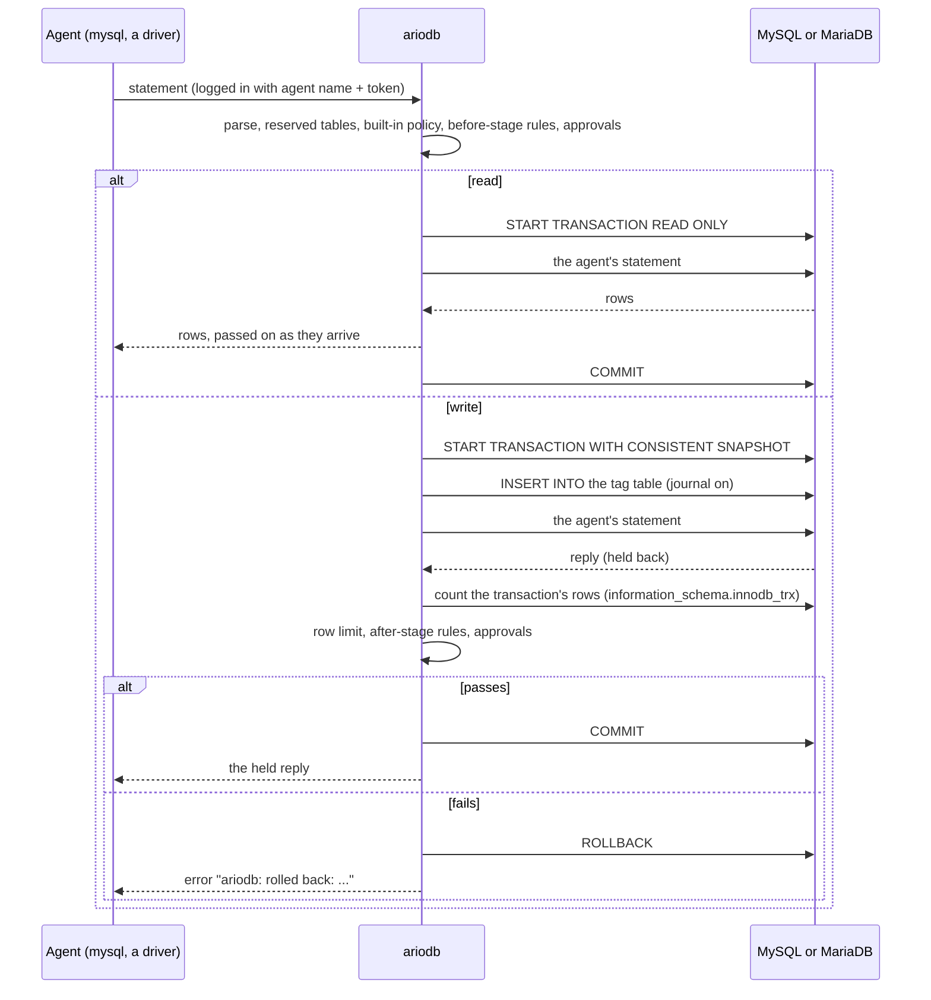
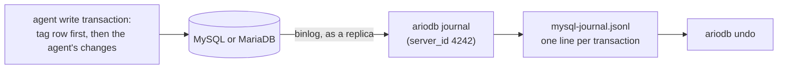

# MySQL and MariaDB

This page covers everything specific to running ariodb in front of MySQL
or MariaDB: which servers are tested, how agents connect with an ordinary
MySQL client, the `[mysql]` and `[agents.mysql]` configuration, the
gateway and journal logins and exactly what to grant them, the server
settings undo needs, how statements are judged (and what is refused), how
writes are checked before they commit, statement timeouts, cancelling,
the tag table and the change journal, undo, and how to read
`ariodb doctor`. It is written for the engineer putting ariodb in front of
a production MySQL or MariaDB server. The same [policy](policy.md),
[rules](rules.md) and [approvals](approvals.md) apply as for Postgres;
this page sets out how they work with MySQL, and where the guarantees are
weaker than on [Postgres](postgres.md).

## Which servers work

MySQL 8.4 and MariaDB 11.4 are tested with the end-to-end suites
`scripts/e2e-mysql.sh` (the proxy) and `scripts/e2e-mysql-journal.sh`
(setup, doctor, the journal and undo), using the `mysql:8.4` and
`mariadb:11.4` images.

| Server | Reads forced read-only | Writes checked before commit | Undo |
|---|---|---|---|
| MySQL 8.4 | yes | yes, with the [weaker check](#how-this-compares-with-postgres) | yes |
| MariaDB 11.4 | yes | yes, with the [weaker check](#how-this-compares-with-postgres) | yes |

Other versions are untested. The full table is in
[compatibility](compatibility.md). Whatever it says, run
[`ariodb doctor`](#reading-ariodb-doctor) against your own server: it
tests each guarantee directly.

Writes are only checked properly on InnoDB tables; see
[tables that are not InnoDB](#tables-that-are-not-innodb).

## How a statement travels through ariodb

An agent connects to ariodb with any MySQL client, using its agent name
and token. ariodb completes the handshake itself, then opens its own
connection to the server as the gateway login. Each statement is judged,
run in a transaction ariodb opens, and, for writes, counted before ariodb
decides whether to commit.



Each agent connection gets its own connection to the server, logged in as
`[mysql] user` in `[mysql] database`. There is no pooling and there are no
per-agent MySQL logins: every agent's queries run as the one gateway
login, so its grants are the real boundary. Plan `max_connections` for one
server connection per agent connection, plus the journal's two and any
`doctor`, `setup` or `undo` runs.

## Configuration

```toml
[mysql]
listen = "0.0.0.0:3307"                        # where agents connect; "" (default) is off
addr = "mysql.internal.example:3306"           # the real server
database = "app"                               # the database agents work in (required)
user = "ariodb_gw"                             # the gateway login
password_secret = "mysql-gateway-password"     # or password_env = "ARIODB_MYSQL_PASSWORD"
tls = "verify"                                 # disable | require | verify
ca_file = "/etc/ariodb/mysql-ca.pem"           # extra trusted CA, PEM
tls_cert = "/etc/ariodb/mysql-proxy.crt"       # TLS for agents
tls_key = "/etc/ariodb/mysql-proxy.key"
require_tls = true                             # refuse agents that do not use TLS
journal = true                                 # record changes from the binlog, for undo
journal_user = "ariodb_journal"                # the journal and undo login
journal_password_secret = "mysql-journal-password"
server_id = 4242                               # the replica id the journal reads the binlog with
tag_table = "ariodb.session_tags"              # where each write records its session
# tunnel = "mysql-bastion"                     # a [[tunnels]] entry to dial instead of addr

[[agents]]
name = "coding-agent"
access = "read_only"                  # Postgres access
tables = ["unused"]                   # Postgres tables; at least one is required
token_secret = "coding-agent-token"

[agents.mysql]
access = "read_write"                 # read_only | read_write
tables = ["orders", "customers", "reporting.daily"]
```

| Key | Default | Meaning |
|---|---|---|
| `listen` | `""` (off) | Where agents connect with a MySQL client. While it is empty, nothing else in `[mysql]` is used. |
| `addr` | `127.0.0.1:3306` | The real server, as `host:port`. |
| `database` | none | The database agents work in. Required when `listen` is set. Unqualified table names, in statements and in `[agents.mysql] tables`, mean tables here. |
| `user` | `ariodb` | The gateway login every agent's queries run as. Agents never see it. |
| `password_env`, `password_secret` | none (empty password) | Where the gateway password comes from. If both are set, the secret wins. |
| `tls` | `disable` for `localhost`, `127.*` and `[::1]`; `verify` for any other host | TLS to the server. See [TLS](#tls). |
| `ca_file` | none | An extra CA (PEM) trusted under `verify`, for a server with a private CA. Used by every MySQL connection ariodb makes. |
| `tls_cert`, `tls_key` | none | Certificate and key (PEM) for agents' connections. Set both or neither. |
| `require_tls` | `false` | Refuse agents that do not use TLS. Needs `tls_cert` and `tls_key`. |
| `tunnel` | none | Dial this [`[[tunnels]]`](configuration.md#tunnels) entry instead of `addr`. TLS is still checked against `addr`'s host name. |
| `journal` | `true` | Tag every write with its session and read the binlog, for undo. See [the journal](#the-tag-table-and-the-journal). |
| `journal_user` | `user`, with its password | The login the journal, `ariodb setup` and `ariodb undo` use. |
| `journal_password_env`, `journal_password_secret` | none (empty password) | Its password, when `journal_user` is set. |
| `server_id` | `4242` | The server id the journal registers with to read the binlog. Must not be 0 while the journal is on, and must differ from the server's and every real replica's. |
| `tag_table` | `ariodb.session_tags` | The table each write transaction records its session in. An unqualified name is in `database`. |

`listen`, `tls_cert`, `tls_key`, `journal`, `server_id` and the journal
login are read when `ariodb serve` starts. The server address, database,
gateway login and TLS settings apply to new agent connections after a
reload. Change `tag_table` only with a restart, since the journal keeps
reading the old one until then. Every key is also in
[configuration](configuration.md#mysql).

### Giving an agent MySQL access

MySQL access is separate from Postgres access. An agent without an
`[agents.mysql]` block cannot log in to the MySQL listener
(`access denied for agent '...': this agent has no MySQL access`).

| Key | Meaning |
|---|---|
| `access` | `read_only` or `read_write`. |
| `tables` | MySQL tables. Unqualified names mean `[mysql] database`; name tables in other databases as `database.table`. `["*"]` allows every table, except the [reserved ones](#reserved-tables). |

The agent uses the same name and token as for Postgres. An agent's MySQL
access, tables and row limit are read when it connects, so a change
applies from its next connection. Inside a rule, `agent.access` is the
agent's MySQL access, and `sql.engine` is `mysql`.

### A MySQL-only deployment

`[database]` is required even if agents only use MySQL, and every agent
must list at least one Postgres table. Switch the Postgres side off so
nothing tries to reach a Postgres server:

```toml
[database]
url = "postgres://unused@localhost/unused"   # required, never used with the lines below

[proxy]
listen = ""            # no Postgres proxy

[journal]
enabled = false        # no Postgres journal; the MySQL journal is [mysql] journal
dir = "/var/lib/ariodb"

[mysql]
listen = "0.0.0.0:3307"
addr = "mysql.internal.example:3306"
database = "app"
user = "ariodb_gw"
password_secret = "mysql-gateway-password"
journal_user = "ariodb_journal"
journal_password_secret = "mysql-journal-password"

[[agents]]
name = "support-bot"
access = "read_only"
tables = ["unused"]                      # required; unused while the Postgres proxy is off
token_secret = "support-bot-token"

[agents.mysql]
access = "read_only"
tables = ["orders"]
```

`[journal] dir` is still the state directory: the MySQL journal, the
decisions log and the secret store live there.

## Database logins and grants

ariodb uses two MySQL logins. Keeping them apart is what makes the server
itself the backstop for anything ariodb's parsing cannot see.

| Login | Configured by | Used for | Needs |
|---|---|---|---|
| Gateway | `[mysql] user` | Every agent's queries | Exactly the table grants agents need; `INSERT` on the tag table; `PROCESS` |
| Journal | `[mysql] journal_user` (falls back to the gateway) | `ariodb setup`, reading the binlog, pruning tags, undo | `REPLICATION SLAVE`, `REPLICATION CLIENT`; the tag table; the protected tables; `PROCESS` |

Replace `'%'` below with the host ariodb connects from.

### The gateway login

```sql
CREATE USER 'ariodb_gw'@'%' IDENTIFIED BY 'not-a-real-password';
-- The tables agents may use, and nothing more.
GRANT SELECT, INSERT, UPDATE, DELETE ON app.orders TO 'ariodb_gw'@'%';
GRANT SELECT, INSERT, UPDATE, DELETE ON app.customers TO 'ariodb_gw'@'%';
GRANT SELECT ON reporting.daily TO 'ariodb_gw'@'%';
-- Tagging each write with its session, for the journal.
GRANT INSERT ON ariodb.session_tags TO 'ariodb_gw'@'%';
-- Counting the rows a write changed, triggers and cascades included.
GRANT PROCESS ON *.* TO 'ariodb_gw'@'%';
```

`PROCESS` lets the login read `information_schema.innodb_trx`, which is
how ariodb counts a write's rows (see
[how writes are checked](#how-writes-are-checked-before-commit)). It also
lets the login see other sessions' statements, which is why agents may
never read the process list or InnoDB's transaction views, whatever their
tables say (see [reserved tables](#reserved-tables)).

Never give the gateway `SUPER`, `FILE`, `REPLICATION` privileges,
`CREATE USER`, `GRANT OPTION`, or `EXECUTE` on routines agents should not
call. ariodb checks the tables a statement *names*: a view, stored
function or trigger the gateway can use can reach tables the allow-list
never sees. The grants are the real boundary; ariodb's checks are a
second, independent one. See [security model](security-model.md).

Because every agent shares the gateway login, there is no MySQL
equivalent of Postgres's per-agent [`credential`](postgres.md#a-read-only-credential).
A `read_only` agent is held to reads by ariodb and by the server's
`READ ONLY` transactions, but its grants are the gateway's.

### The journal login

```sql
CREATE USER 'ariodb_journal'@'%' IDENTIFIED BY 'not-a-real-password';
-- Reading the binlog as a replica would.
GRANT REPLICATION SLAVE, REPLICATION CLIENT ON *.* TO 'ariodb_journal'@'%';
-- ariodb setup creates the tag table's database and table.
GRANT CREATE ON ariodb.* TO 'ariodb_journal'@'%';
-- Pruning old tags, and tagging undo's own transaction.
GRANT SELECT, INSERT, DELETE ON ariodb.session_tags TO 'ariodb_journal'@'%';
-- Undo writes the protected tables back.
GRANT SELECT, INSERT, UPDATE, DELETE ON app.orders TO 'ariodb_journal'@'%';
GRANT SELECT, INSERT, UPDATE, DELETE ON app.customers TO 'ariodb_journal'@'%';
-- Lets undo see what cascades and triggers change.
GRANT PROCESS ON *.* TO 'ariodb_journal'@'%';
```

The protected tables are every table a `read_write` agent lists in
`[agents.mysql] tables`; if one lists `"*"`, undo needs
`SELECT, INSERT, UPDATE, DELETE ON *.*`. You can skip the `CREATE` grant
by creating the tag table yourself:

```sql
CREATE DATABASE IF NOT EXISTS ariodb;
CREATE TABLE IF NOT EXISTS ariodb.session_tags (
  id BIGINT AUTO_INCREMENT PRIMARY KEY,
  session VARCHAR(64) NOT NULL,
  agent VARCHAR(255) NOT NULL,
  at TIMESTAMP(3) NOT NULL DEFAULT CURRENT_TIMESTAMP(3),
  KEY (at)
) ENGINE=InnoDB DEFAULT CHARSET=utf8mb4;
```

`ariodb setup` prints the grants for your config, with your logins and
tables filled in (it does not run them); see
[what `ariodb setup` does](#what-ariodb-setup-does).

## Server settings

### For undo: the binlog

The journal reads the binary log, so undo needs:

| Setting | Value | MySQL 8.4 default | MariaDB 11.4 default |
|---|---|---|---|
| `log_bin` | on | on | **off**: start with `--log-bin` |
| `binlog_format` | `ROW` | `ROW` | **`MIXED`**: start with `--binlog-format=ROW` |
| `binlog_row_image` | `FULL` | `FULL` | `FULL` |
| `binlog_row_metadata` | `FULL` (recommended) | `MINIMAL` | `NO_LOG` |
| `binlog_row_value_options` (MySQL) | not `PARTIAL_JSON` | `''` | not applicable |
| `log_bin_compress` (MariaDB) | `OFF` | not applicable | `OFF` |
| `server_id` | anything but `[mysql] server_id` | `1` | `1` |

A MariaDB server for ariodb therefore starts with:

```bash
mariadbd --log-bin --binlog-format=ROW --binlog-row-metadata=FULL --server-id=1
```

MySQL 8.4 works with its defaults. Set `binlog_row_metadata` to `FULL` on
both (`SET PERSIST binlog_row_metadata = 'FULL'` on MySQL): with it, the
binlog names every column. Without it, the journal takes column names
from `information_schema` when it reads a change, which is wrong if the
table changed shape in between (say, while ariodb was stopped); such
changes are recorded without column names and undo refuses them.
`ariodb doctor` warns while it is not `FULL`.

MySQL's binlog transaction compression
(`binlog_transaction_compression = ON`) is supported. MariaDB's
`log_bin_compress` is not.

**Keep binlogs longer than ariodb could be down.** The journal reads from
where it stopped; if that binlog file has been purged
(`binlog_expire_logs_seconds`, `PURGE BINARY LOGS`), the changes in it are
lost to undo, the journal stops with an error, and `doctor` fails.

### Table-name case

ariodb compares table names in lower case. On Linux, MySQL and MariaDB
default to `lower_case_table_names = 0`, where `Orders` and `orders` are
different tables. ariodb cannot tell them apart, so an allow-list entry
`orders` would also let an agent use `Orders`. `ariodb doctor` fails while
two tables in `[mysql] database` have names that differ only by case.
Rename them, or keep agents away from all of them.

### Things ariodb sets for itself

On every connection it opens for agents, ariodb sets:

- **`sql_mode`**: the server's own, without `ANSI_QUOTES`,
  `NO_BACKSLASH_ESCAPES` and the combination modes that include them
  (`ANSI`, `ORACLE`, `MSSQL`, `DB2`, `POSTGRESQL`, `MAXDB`), so the server
  reads quotes and backslashes the way ariodb's parser does. See
  [sql_mode and character sets](#sql_mode-and-character-sets).
- **The statement timeout**: `max_execution_time` on MySQL,
  `max_statement_time` on MariaDB, and `innodb_lock_wait_timeout`. See
  [statement timeouts](#statement-timeouts).
- **The character set**: the agent's, if it is one ariodb can read safely,
  otherwise `utf8mb4`.

These are set again after a `COM_RESET_CONNECTION`.

## Connecting agents

Agents log in with their agent name as the user and their token as the
password, in `[mysql] database` or with no database named:

```bash
mysql -h ariodb.internal -P 3307 -u coding-agent -p --ssl-mode=VERIFY_IDENTITY --ssl-ca=/etc/ssl/ariodb-ca.pem app
mariadb -h ariodb.internal -P 3307 -u coding-agent -p --ssl app
```

```python
import os
import pymysql

conn = pymysql.connect(host="ariodb.internal", port=3307, user="coding-agent",
                       password=os.environ["ARIODB_TOKEN"], database="app",
                       autocommit=True, ssl={"ca": "/etc/ssl/ariodb-ca.pem"})
```

- **Authentication.** ariodb offers `caching_sha2_password` and also
  accepts `mysql_native_password`. A client that asks for another plugin
  is switched to `caching_sha2_password`. ariodb knows the token, so it
  checks the client's scramble itself and always completes on the fast
  path: the token is never sent as cleartext, and no RSA key exchange or
  TLS is needed to log in. A scramble can still be attacked offline by
  someone who records it, so use long random tokens and TLS on any
  network.
- **The database.** A login naming any database but `[mysql] database` is
  refused (`agents may only use database 'app'`), as is `USE` of another
  database. Read tables in other databases by naming them in full
  (`reporting.daily`), if the agent's list allows them.
- **The version** agents see is the real server's.
- **Ten seconds to log in.** A client that has not finished the handshake
  by then is disconnected.
- **Connection ids are ariodb's own.** The id in the handshake (what the
  `mysql` client prints as "Your MySQL connection id is ...") is ariodb's,
  and `KILL` takes that id. `SELECT CONNECTION_ID()` returns the server's
  id for ariodb's connection, which `KILL` does not accept. See
  [cancelling](#cancelling-and-disconnects).

### Drivers that turn autocommit off

ariodb runs every statement in a transaction of its own and refuses
`SET autocommit = 0` (see [transactions](#no-agent-controlled-transactions)).
A driver that switches autocommit off when it connects fails to connect:

- **PyMySQL and mysqlclient** default to autocommit off. Pass
  `autocommit=True`.
- **SQLAlchemy** follows the driver: create the engine with
  `isolation_level="AUTOCOMMIT"`.
- **Connector/J (JDBC)** is in autocommit mode by default; leave it there.
- **Go's `go-sql-driver/mysql`** and **Node's `mysql2`** only open a
  transaction if you do.

## TLS

### Between agents and ariodb

```toml
[mysql]
tls_cert = "/etc/ariodb/mysql-proxy.crt"   # PEM certificate chain
tls_key = "/etc/ariodb/mysql-proxy.key"    # PEM private key
require_tls = true
```

- With a certificate and key, ariodb offers TLS in its handshake and an
  agent that asks for it gets it (`--ssl-mode=REQUIRED` or
  `VERIFY_IDENTITY`, MariaDB's `--ssl`).
- With `require_tls = true`, an agent that does not use TLS is refused
  with `ariodb: connections must use TLS (for example --ssl-mode=REQUIRED)`
  (error 3159).
- Without a certificate, TLS is not offered, and a client that insists on
  it fails to connect.
- `require_tls = true` without a certificate and key, or only one of the
  two, stops the MySQL listener from starting; `ariodb serve` logs
  `ariodb: MySQL proxy stopped: ...` and carries on with everything else.

### Between ariodb and the server

| `tls` | Encrypts | Checks the certificate | Use for |
|---|---|---|---|
| `disable` | no | no | A server on the same host. The default for `localhost`, `127.*` and `[::1]`. |
| `require` | yes | no: any certificate is accepted | Encryption where you cannot get the CA. Open to an active man in the middle. |
| `verify` | yes | yes: chain and host name | Everything else. The default for any other host. |

Under `verify`, a server whose certificate comes from a private CA (as on
Amazon RDS) needs that CA's bundle in `ca_file`. The proxy, `doctor`,
`setup`, the journal and `undo` all use it. Through a
[tunnel](configuration.md#tunnels), the certificate is still checked
against the host name in `addr`.

ariodb logs in to the server with `caching_sha2_password` or
`mysql_native_password` (and `mysql_clear_password`, only over TLS). Other
plugins, such as MariaDB's `ed25519` and `gssapi`, are not supported.

**What `disable` and `require` give up.** When the server's
`caching_sha2_password` cache does not hold the login (after a restart or
`FLUSH PRIVILEGES`), it asks for the password itself:

- With `tls = "disable"`, ariodb asks the server for its RSA public key
  and encrypts the password to it. The key is trusted as received, so an
  active man in the middle can hand ariodb its own key and read the
  password.
- With `tls = "require"`, ariodb sends the password inside TLS, but to
  whichever server answered, since the certificate is not checked.

Use `verify` for any server that is not on the same host.

## How statements are judged

ariodb reads MySQL SQL with two readers that must agree: a small lexer
that follows the server's own rules for comments, strings and quoted
names, and a full SQL parser. If they disagree about where a string or
quoted name starts, or about a comment, the statement is refused, so a
string can never hide SQL the server would run. When in doubt, a
statement is `unknown`, and unknown is refused. The kinds, and what each
access level may run, are in [policy](policy.md#mysql-and-mariadb); this
section covers what is particular to the MySQL listener.

Check any statement without running it:

```text
$ ariodb explain --engine mysql --agent coding-agent "SELECT * FROM secrets"
deny  (decided by: policy)  agent 'coding-agent' may not use table 'secrets'

$ ariodb explain --engine mysql --agent coding-agent "SELECT /*+ MAX_EXECUTION_TIME(100000) */ * FROM orders"
deny  (decided by: policy)  ariodb cannot check this statement: SET_VAR, MAX_EXECUTION_TIME and RESOURCE_GROUP hints change settings ariodb controls
```

`explain` judges the SQL only. The listener's own checks below (one
statement per query, reserved tables, `KILL`) are not part of it; see
[testing policies](testing-policies.md).

### One statement per query

ariodb never offers multi-statement support to clients, refuses a request
to turn it on, and refuses a query with more than one statement:
`send one statement at a time: this query has 2, and ariodb does not run
several statements in one query`. A trailing semicolon is fine. To change
several rows atomically, use one statement (a multi-table `UPDATE`, an
`INSERT ... SELECT`).

### Prepared statements

The binary protocol works (`COM_STMT_PREPARE`, `EXECUTE`, `CLOSE`,
`RESET`, `SEND_LONG_DATA`), so drivers that use server-side prepared
statements work unchanged.

- **At prepare**, the statement is classified and judged by the built-in
  policy and before-stage rules, so a statement that could never run is
  refused when it is prepared. Approvals wait for execute.
- **At every execute**, the whole check runs again, approvals included, in
  a transaction of its own.
- **Statement ids** are ariodb's own, mapped to the server's; an id the
  agent did not prepare on this connection is `unknown prepared statement`
  (error 1243).
- **Cursors** (an execute that asks for a cursor, then `COM_STMT_FETCH`)
  are refused: the cursor would outlive ariodb's transaction.
- **SQL-level** `PREPARE`, `EXECUTE` and `DEALLOCATE` are refused: the
  statement they run is hidden in a string or variable.

### No agent-controlled transactions

`BEGIN`, `START TRANSACTION`, `COMMIT`, `ROLLBACK`, `SAVEPOINT`,
`RELEASE`, `XA`, `LOCK TABLES`, `UNLOCK TABLES` and `SET autocommit = 0`
are refused: "ariodb runs every statement in its own transaction; send
statements without BEGIN or COMMIT". ariodb must own the transaction to
run reads read-only and to count a write before it commits.
`SET autocommit = 1` is allowed, and changes nothing.

### Protocol commands that are refused

| Command | Why |
|---|---|
| `COM_CHANGE_USER` | Agents keep the login they authenticated with |
| `COM_FIELD_LIST` | An old way to list columns; use `SHOW COLUMNS` |
| `COM_STMT_FETCH` | Cursors would outlive ariodb's transaction |
| `COM_SET_OPTION` turning multi-statements on | One statement per query |
| `COM_PROCESS_INFO`, `COM_PROCESS_KILL`, `COM_STATISTICS`, `COM_REFRESH`, `COM_SHUTDOWN`, `COM_DEBUG` | Server administration |
| `COM_BINLOG_DUMP`, `COM_BINLOG_DUMP_GTID`, `COM_REGISTER_SLAVE`, `COM_CLONE` | Replication and cloning |

`COM_PING`, `COM_QUIT`, `COM_RESET_CONNECTION` and `COM_INIT_DB` of
`[mysql] database` work.

**`LOAD DATA LOCAL`** is refused twice over: ariodb never offers clients
the local-file capability, and `LOAD` statements are refused. If the
server asks for a local file anyway, ariodb sends none, rolls back, and
refuses the statement.

### Statements that are refused

Besides destructive statements and schema changes (see
[policy](policy.md#mysql-and-mariadb)), these are refused because ariodb
cannot see what they do:

- **Executable comments**, `/*! ... */` and MariaDB's `/*M! ... */`: the
  server runs the SQL inside, which a parser treats as a comment.
- **Optimizer hints that change settings**: `SET_VAR`,
  `MAX_EXECUTION_TIME` and `RESOURCE_GROUP` in a `/*+ ... */` hint. They
  would lift ariodb's time limit or set variables the policy refuses for
  one statement. Other hints (`BKA`, `INDEX`, `JOIN_ORDER` and the rest)
  are allowed.
- **`SET STATEMENT ... FOR`** (MariaDB), for the same reason.
- **`CALL`, `DO`, `HANDLER`, `BEGIN NOT ATOMIC`**, SQL-level `PREPARE` and
  `EXECUTE`: they run code or read tables outside the usual checks.
- **`SELECT ... INTO OUTFILE` and `INTO DUMPFILE`**, which write files on
  the server, and `SELECT ... INTO` anything but user variables.
- **`LOAD DATA`, `LOAD XML`**, which read files.
- **Server control**: `FLUSH`, `RESET`, `PURGE`, `CHANGE`, `STOP`,
  `START` (other than a transaction), `INSTALL`, `UNINSTALL`, `SHUTDOWN`,
  `RESTART`, `CLONE`, `IMPORT`, `BINLOG`, `CACHE INDEX`, `HELP`,
  `GET DIAGNOSTICS`, `SIGNAL`, `RESIGNAL`, `BACKUP`, `LOCK INSTANCE`.
- **`SHOW`** other than the forms that describe structure or the agent's
  own session (`SHOW PROCESSLIST`, `SHOW GRANTS`, `SHOW GLOBAL STATUS`,
  `SHOW ENGINE ... STATUS`, binlog and replication `SHOW`s), and
  `EXPLAIN FOR CONNECTION`.
- **`USE`** as SQL: agents stay in `[mysql] database`. (The `mysql`
  client's `use app` command is sent as `COM_INIT_DB`, which works for
  `[mysql] database` itself.)
- **Text ariodb will not read**: statements that are not UTF-8, contain a
  NUL byte (escape it as `\0`), use a name with a dot inside its
  backticks, or chain more than 1,000 operators (use `IN (...)` for long
  lists).

### Session settings

Drivers send a few `SET` statements when they connect. Agents may set
these session variables, which change formatting, character sets and
client-side waits, not what data is reachable or how ariodb's checks work.
Setting them runs in a read-only transaction.

| Variable | Notes |
|---|---|
| `NAMES`, `CHARACTER SET`, `character_set_client` | Only `utf8mb4`, `utf8mb3`, `utf8`, `latin1`, `ascii` or `binary`; see below |
| `character_set_connection`, `character_set_results`, `collation_connection` | |
| `time_zone`, `lc_time_names` | |
| `autocommit` | Only to `1`, `ON` or `TRUE` |
| `transaction_isolation`, `tx_isolation`, and `SET TRANSACTION ISOLATION LEVEL` | Not `READ UNCOMMITTED`; see below |
| `sql_select_limit`, `group_concat_max_len` | |
| `net_read_timeout`, `net_write_timeout`, `wait_timeout`, `interactive_timeout` | |
| `sql_mode` | Only with modes that leave quoting alone; see below |
| User variables (`@name`) | The agent's own |

Every other variable is refused (`agents may not change the '...'
setting`), among them `sql_log_bin`, `foreign_key_checks` and
`unique_checks` (they would hide or allow changes), `max_execution_time`,
`max_statement_time` and `innodb_lock_wait_timeout` (ariodb's limits),
`transaction_read_only` and `SET TRANSACTION READ WRITE` (ariodb's
read-only transactions), `sql_safe_updates`, `SET PASSWORD`, `SET ROLE`,
and anything `GLOBAL`, `PERSIST` or `PERSIST_ONLY`. A value that is an
expression is checked like any other: `SET @x = (SELECT ... FROM secrets)`
needs `secrets` on the agent's list.

**`READ UNCOMMITTED` is refused.** It would let an agent read another
agent's write while ariodb is still judging it, and perhaps about to roll
it back. A request for it in `SET TRANSACTION ISOLATION LEVEL READ
UNCOMMITTED` or `SET transaction_isolation = 'READ-UNCOMMITTED'` is refused
with `agents may not read uncommitted data (READ UNCOMMITTED)`.

#### sql_mode and character sets

ariodb's parser assumes double quotes delimit strings and a backslash
escapes the next character in a string. Two `sql_mode` flags change that:
`ANSI_QUOTES` (double quotes become names) and `NO_BACKSLASH_ESCAPES`
(`\'` ends a string). Under either, a statement could mean one thing to
ariodb and another to the server, so:

- ariodb removes them, and the combination modes that include them, from
  every session it opens, whatever the server's global `sql_mode` says;
- `SET sql_mode` is allowed only to a quoted list of modes that leave
  quoting alone (`STRICT_TRANS_TABLES`, `TRADITIONAL`,
  `ONLY_FULL_GROUP_BY`, `NO_ZERO_DATE` and the like), and refused for
  anything else, including `DEFAULT` and expressions.

Character sets matter for the same reason. In GBK, Big5, Shift-JIS, CP932
and GB18030, a backslash or quote byte can be the second half of a
character. ariodb therefore logs in to the server with the agent's
character set only if it is `utf8mb4`, `utf8mb3`, `latin1`, `ascii` or
`binary`, and otherwise uses `utf8mb4`; and `SET NAMES` or
`SET character_set_client` to anything else is refused.

### Reserved tables

These are refused for every agent, whatever its `tables` say, `"*"`
included: `agents may not use table '...': it belongs to ariodb or to the
server`.

| Table | Why |
|---|---|
| The tag table (`[mysql] tag_table`) | A forged row could credit changes to another session in the journal |
| `information_schema.processlist` | Other sessions' statements, visible because the gateway has `PROCESS` |
| `information_schema.innodb_*` | InnoDB's transaction list, which ariodb counts writes from, and which a reader can keep from refreshing |
| `mysql.*`, `sys.*`, `performance_schema.*` | The server's own schemas |

Functions in `sys`, `mysql` and `performance_schema` are blocked for the
same reason; see [blocked functions](policy.md#mysql-and-mariadb).

### Size limits

| Limit | What happens |
|---|---|
| A command over 16 MiB | Read, discarded and refused: `command of N bytes is over the 16 MiB limit` (error 1153) |
| SQL text over 1 MiB | Refused: `statement over the 1 MiB inspection limit` |
| A write's reply over 64 MiB | Rolled back, since ariodb holds a write's reply until it is judged |

### What agents see when something is refused

Refusals are ordinary MySQL errors, so clients handle them like any other
failed statement. Every message starts `ariodb:`. The `mysql` client shows
them as, for example,
`ERROR 1142 (42000): ariodb: agent 'coding-agent' may not use table 'secrets'`.

| Situation | Error | SQLSTATE | Example message |
|---|---|---|---|
| Refused by the policy or a rule | 1142 | `42000` | `ariodb: agent 'support-bot' is read only` |
| Write rolled back after running | 1142 | `42000` | `ariodb: rolled back: the statement would change 120 rows (as counted by the database); the limit is 100` |
| Wrong token, unknown agent, no MySQL access | 1045 | `28000` | `ariodb: access denied for agent 'coding-agent': wrong token` |
| Another database at login, or `COM_INIT_DB` | 1044 | `42000` | `ariodb: agents may only use database 'app'` |
| TLS required but not used | 3159 | `HY000` | `ariodb: connections must use TLS (for example --ssl-mode=REQUIRED)` |
| Command over 16 MiB | 1153 | `08S01` | `ariodb: command of 20971520 bytes is over the 16 MiB limit` |
| Write cancelled with `KILL QUERY` | 1317 | `70100` | `ariodb: rolled back: the agent cancelled the statement` |
| `KILL` of a connection that is not the agent's | 1094 | `HY000` | `ariodb: unknown thread id: 12` |
| The write cannot be tagged for the journal | 1105 | `HY000` | `ariodb: cannot record the session for the journal: ...` |
| ariodb cannot reach the server | 1105 | `08S01` | `ariodb: cannot connect to MySQL: cannot reach MySQL at db.internal:3306: ...` |

Errors from the server itself (a duplicate key, a lock wait timeout)
reach the agent unchanged.

## How reads run

A statement the policy classes as a read (and an allowed `SET`) runs as:

```sql
START TRANSACTION READ ONLY;
-- the agent's statement
COMMIT;
```

`READ ONLY` is enforced by the server, so a write hidden where parsing
cannot see it (inside a stored function the gateway can call, for
example) fails with the server's own error, `Cannot execute statement in a
READ ONLY transaction` (error 1792). Rows are passed to the agent as they
arrive.

`SELECT ... FOR UPDATE`, `FOR SHARE` and `LOCK IN SHARE MODE` take row
locks, so they are writes and need write access.

## How writes are checked before commit

A write runs in a transaction ariodb holds open until it has decided:

```sql
START TRANSACTION WITH CONSISTENT SNAPSHOT;
INSERT INTO `ariodb`.`session_tags` (session, agent) VALUES ('s-...', 'coding-agent');  -- journal on
-- the agent's statement
SELECT trx_rows_modified, INSTR(trx_query, 'ariodb-count-<random>') > 0
  FROM information_schema.innodb_trx WHERE trx_mysql_thread_id = CONNECTION_ID() LIMIT 1;
COMMIT;   -- or ROLLBACK
```

The rows a write changed are the larger of two counts:

- **What the server reported**: the affected-rows count in its reply (the
  `Query OK, 3 rows affected` the `mysql` client prints).
- **InnoDB's count for the transaction**, `trx_rows_modified`, less
  ariodb's own tag row. InnoDB counts every row the transaction inserted,
  updated or deleted, so rows changed by triggers and foreign-key cascades
  are included.

ariodb then checks:

1. **The total is within the row limit** (`max_rows_per_write`, from the
   agent or `[limits]`; default 500). An update of 30 orders whose trigger
   writes three log rows for each counts as 120:
   `rolled back: the statement would change 120 rows (as counted by the database); the limit is 100`.
2. **After-stage rules** pass, judged on `effects.rows` (the count above)
   and `effects.tables` (the tables the write statement names). See
   [rules](rules.md).
3. **Any approval** an after-stage rule asks for is granted. While it
   waits, the transaction stays open and its row locks are held.

Until the decision, the write's reply is held back, so an agent never sees
`3 rows affected` for a write that was then rolled back. On MariaDB, the
rows of an `INSERT ... RETURNING` or `DELETE ... RETURNING` that failed are
never sent.

### The PROCESS privilege

Reading `information_schema.innodb_trx` needs `PROCESS`. Without it,
ariodb judges writes by the count the server reports, which leaves out
rows changed by triggers and cascades, and logs once:

```text
ariodb: cannot read information_schema.innodb_trx (...); MySQL writes are judged by the rows the server reports, which leave out triggers. Grant the PROCESS privilege to [mysql] user
```

`ariodb doctor` warns while the gateway lacks it. Any other failure to
read the count rolls the write back (`rolled back: cannot count the rows
it changed: ...`).

### The freshness marker

InnoDB serves `innodb_trx` from a cache, and refreshes the cache only when
nobody has read it for 100 ms. A stale cache would undercount a write. So:

- ariodb spaces its own reads of `innodb_trx` at least 110 ms apart,
  across every agent connection;
- each read carries a random marker in its own text, and its answer counts
  only if InnoDB shows that very query as the transaction's current
  statement, which proves the list was made while the read ran;
- the comparison is done on the server and the number read without
  relying on the agent's `character_set_results` or `sql_select_limit`.

If five reads in a row come back stale, the write is rolled back:
`rolled back: cannot count the rows it changed: InnoDB's transaction list
(information_schema.innodb_trx) stayed stale, as it does while another
client reads it more often than every 100 ms`. A monitoring tool that
polls `innodb_trx` that often will cause this for every write; poll it
less often.

The spacing also bounds throughput: a single ariodb counts at most about
nine writes a second across all its MySQL agents, each waiting its turn.

### How this compares with Postgres

On Postgres, ariodb measures, per table, every row the transaction
changed, and checks every changed table against the agent's list. On
MySQL the check is weaker:

| | Postgres | MySQL and MariaDB |
|---|---|---|
| Row limit | Rows changed in each table, summed | InnoDB's total for the transaction, or the server's reported count, whichever is larger |
| Rows changed by triggers and cascades | Counted | Counted (with `PROCESS`) |
| Tables changed by triggers and cascades | Seen, and checked against the agent's list | **Not seen**: only the tables the statement names are checked |
| `effects.tables` in after-stage rules | Every table changed | The tables the write statement names |
| Cross-check against the server's own count | Yes | The larger of the two is used |

So a trigger on `orders` that writes to `audit_log` is counted against
the row limit, but `audit_log` need not be on the agent's list, and an
after-stage rule on `'audit_log' in effects.tables` never matches. Keep
the gateway's grants tight: they are the only check on which tables
triggers and stored code reach.

### Tables that are not InnoDB

Only InnoDB tables can be checked before commit. A write to a MyISAM,
Aria, MEMORY or other non-transactional table takes effect at once and
stays when ariodb rolls back, and InnoDB does not count it. Reads of
those tables are still forced read-only. Give agents write access only to
InnoDB tables.

## Statement timeouts

```toml
[limits]
statement_timeout_ms = 5000   # default 5000
```

ariodb sets these on every connection it opens for agents:

| Server | Setting | Covers |
|---|---|---|
| MySQL | `max_execution_time = 5000` (milliseconds) | **Read-only `SELECT` statements only**: MySQL does not time out writes |
| MariaDB | `max_statement_time = 5` (seconds) | Every statement |
| Both | `innodb_lock_wait_timeout = 5` (seconds, rounded up, at least 1) | Waiting for a row lock |

On MySQL, then, a slow `UPDATE` is bounded only while it waits for locks;
once it has its locks it runs until it finishes or is cancelled. A
statement that times out fails with the server's own error, and a write
is rolled back.

Unlike on Postgres, agents cannot lift these limits: `SET` of
`max_execution_time`, `max_statement_time` or `innodb_lock_wait_timeout`
is refused, as are the `MAX_EXECUTION_TIME` and `SET_VAR` hints and
MariaDB's `SET STATEMENT ... FOR`.

Time waiting for approval is not counted. A before-stage approval happens
before the transaction opens; an after-stage one happens after the
statement finished, while the transaction is idle.

## Cancelling and disconnects

ariodb answers `KILL` itself, because the connection ids agents see are
ariodb's own:

- **`KILL QUERY <id>`** (what the `mysql` client sends on Ctrl-C) for one
  of the agent's own connections withdraws a statement that is waiting for
  [approval](approvals.md), stops a statement running on the server (ariodb
  sends `KILL QUERY` for its own server connection), and rolls back a
  write that has run but not yet committed: `rolled back: the agent
  cancelled the statement` (error 1317).
- **`KILL <id>`** or **`KILL CONNECTION <id>`** ends that connection of
  the agent's, and the server rolls back anything left open.
- **Other agents' connections** look the same as ones that do not exist:
  `unknown thread id: <id>`.
- Any other use of `KILL` (`KILL USER`, MariaDB's `KILL HARD`) is refused.

`KILL` is logged with kind `session`.

ariodb watches each agent's socket the whole time. An agent that
disconnects while its statement waits for approval withdraws it, and the
approval can no longer be granted. When an agent connection ends, ariodb
closes its server connection, and the server rolls back any transaction
still open.

## The tag table and the journal

Undo works from a journal of every row agents changed, with its before-
and after-images, tagged with the agent session that changed it. On MySQL
and MariaDB, the journal reads the binlog as a replica would.



**The tag table.** Every write transaction an agent makes starts with a
row in `[mysql] tag_table` naming its session and agent. When the journal
reads a transaction whose first row change is a tag, it records the
transaction's other changes under that session. Only the first row can be
a tag, so even a writer that could add rows to the tag table could not
take a transaction over. Agents cannot touch the tag table at all; see
[reserved tables](#reserved-tables).

**What is recorded.** Every change in a tagged transaction, whatever table
it touched, and every change by anyone to a protected table (one a
`read_write` agent lists), without a session. Undo uses those untagged
changes to spot rows someone else changed after the agent.

**Where.** `<state dir>/mysql-journal.jsonl`, one JSON line per committed
transaction, in the same format as the Postgres journal, and
`<state dir>/mysql-binlog-position.json`, where the journal has read up to.
The position moves past a transaction only once its line is on disk, so a
crash never loses a change. The journal starts from the server's position
when `ariodb setup` or `ariodb serve` first runs; it does not record
anything earlier.

**Housekeeping.** Every hour, the journal login deletes tag rows older
than a day. They only matter until the journal has read their
transactions.

### What `ariodb setup` does

Run it once, as the journal login, before the first `ariodb serve`. It is
safe to run again. With `[mysql] journal = false` it does nothing for
MySQL.

```text
$ ariodb setup
ok   the binlog is on
ok   binlog_format is ROW
ok   binlog_row_image is FULL
ok   binlog_row_metadata is FULL: the binlog names every column
ok   tag table ariodb.session_tags is ready
ok   the journal will record changes from binlog.000003:158

Grants ariodb needs (not run; run them as an administrator, with the right host instead of '%'):
  -- the gateway login, for agents' queries: tagging writes, and counting the rows a write changed
  GRANT INSERT ON `ariodb`.`session_tags` TO 'ariodb_gw'@'%';
  GRANT PROCESS ON *.* TO 'ariodb_gw'@'%';
  -- the journal login: reading the binlog, pruning tags, and undo
  GRANT REPLICATION SLAVE, REPLICATION CLIENT ON *.* TO 'ariodb_journal'@'%';
  GRANT SELECT, INSERT, DELETE ON `ariodb`.`session_tags` TO 'ariodb_journal'@'%';
  GRANT SELECT, INSERT, UPDATE, DELETE ON `app`.`orders` TO 'ariodb_journal'@'%';
  GRANT SELECT, INSERT, UPDATE, DELETE ON `app`.`customers` TO 'ariodb_journal'@'%';
  GRANT PROCESS ON *.* TO 'ariodb_journal'@'%';  -- lets undo see cascades and triggers
```

1. Checks the binlog settings in [the table above](#for-undo-the-binlog),
   and stops with the ones that must change.
2. Creates the tag table (and its database) if it does not exist.
3. Records the server's current binlog position as where the journal
   starts, unless it has already started.
4. Prints the grants for your logins and protected tables.

Unlike on Postgres, there is no publication or replica identity to
update when an agent gains write access to a new table: the binlog carries
every table. Grant the journal login what undo needs on the new table
(`setup` prints it), and restart `ariodb serve` so the journal also
records other people's changes to it, which undo uses to spot conflicts.

### How the journal runs

`ariodb serve` starts the journal when `[mysql] listen` is set and
`[mysql] journal` is on. It registers with `[mysql] server_id` and reads
the binlog stream, with heartbeats every five seconds; on any error it
reconnects with backoff (one second, doubling to a minute) and logs each
new error once, as `ariodb: MySQL journal: ...`.

**Only one reader per server id.** A server disconnects a replica when
another registers with the same id, so run exactly one `ariodb serve` per
`server_id`, and pick one no real replica uses.

### Running without the journal

```toml
[mysql]
journal = false
```

Writes are then not tagged, the binlog is not read, and the tag table and
the journal grants are not needed. Reads and checked writes still work;
undo does not.

## Undo

```bash
ariodb sessions                              # MySQL sessions are listed with Postgres ones
ariodb undo --session s-3f9c2a71d0           # show the plan
ariodb undo --session s-3f9c2a71d0 --apply   # carry it out, in one transaction
```

```text
$ ariodb undo --session s-3f9c2a71d0
undo plan for s-3f9c2a71d0: 3 steps
  re-insert deleted app.customers row (17)
  restore app.orders row (12)
  delete inserted app.orders row (1001)
  warning: deletes on app.customers may have changed rows in app.notes (ON DELETE CASCADE); MySQL does not write those to the binlog, so undo cannot restore them

nothing changed. Run again with --apply to undo.
```

MySQL undo follows the same rules as [Postgres undo](undo.md): one step
per row the session changed, taking it from what the session left back to
what was there before its first change, latest first, in one
transaction. The dashboard's sessions page plans and applies MySQL undo
too. Undo connects as the journal login.

### What it does

- **One transaction, tagged.** It starts with a tag row naming
  `undo:<session>`, so the journal records the undo itself, `sessions`
  marks the session `undone`, and a second undo is refused.
- **Values as typed parameters**, never spliced into SQL, in a session
  with `time_zone = '+00:00'` and a `sql_mode` that keeps re-inserted
  `AUTO_INCREMENT` ids (even 0) and zero dates.
- **Rows are locked and checked again** inside the transaction, before
  any step runs.
- **Foreign keys.** A step that fails on a foreign key is retried after
  the others, until no more progress is made.
- **Cascades and triggers.** On a table with triggers, or one that foreign
  keys cascade from, each step is measured with `innodb_trx`, and a step
  that would change rows the session never touched is refused. This needs
  `PROCESS` on the journal login; without it, undo refuses to touch such
  tables at all.

### Conflicts

A row is a conflict when the journal shows a later change to it by anyone
else, or when its live values are no longer exactly what the session left
(which also catches changes the journal has not read yet, or that never
reached the binlog). Strings are compared byte for byte, JSON as JSON, and
decimals at the column's own precision. Any conflict means nothing is
undone, unless you pass `--skip-conflicts`, which undoes the other rows
and leaves the conflicting ones alone.

### What it cannot do

Undo refuses the whole plan (`cannot undo: ...`) when it includes:

- a table **without a primary key**, or one that no longer exists, or a
  column that no longer exists;
- a value the binlog did not carry in full: a partial JSON update
  (`binlog_row_value_options = PARTIAL_JSON`), JSON holding MySQL-only
  scalar types, or a negative `TIME(1)` or `TIME(2)` value with a
  fraction;
- a change recorded without column names: the table changed shape before
  the journal read it, and `binlog_row_metadata` was not `FULL`.

It also does not restore:

- **rows changed by a foreign key's `ON DELETE` or `ON UPDATE` action**:
  MySQL and MariaDB do not write those to the binlog. The plan warns where
  the session's deletes or updates could have reached such rows;
- generated columns, which the server computes again;
- `AUTO_INCREMENT` counters and MariaDB sequences;
- anything outside the database that a trigger or stored code did.

### How values are recorded

Every value is recorded as text chosen so undo can turn it back into
exactly the value that was there:

| Column type | Recorded as |
|---|---|
| Integer types, `BIT` | The number in decimal, unsigned where the column is (`18446744073709551615`) |
| `YEAR` | Four digits (`2026`, `0000`) |
| `DECIMAL` | The exact decimal, with all its scale digits (`12.50`) |
| `FLOAT`, `DOUBLE` | The shortest decimal that reads back as the same binary value (`0.1`) |
| `DATE` | `YYYY-MM-DD` |
| `DATETIME(n)` | `YYYY-MM-DD HH:MM:SS` with `n` fraction digits |
| `TIMESTAMP(n)` | The same, in UTC |
| `TIME(n)` | `[-]HH:MM:SS` with `n` fraction digits; hours may exceed 24 |
| `CHAR`, `VARCHAR`, `TEXT` in `utf8mb3`, `utf8mb4` or `ascii` | The text itself |
| `ENUM`, `SET` | The member name; for `SET`, names joined by commas, in any character set |
| `JSON` (MySQL) | The document as JSON text |
| `BINARY`, `VARBINARY`, `BLOB`, spatial types, and text in any other character set | `\x` and the stored bytes in lower-case hex |

`NULL` is JSON `null`. A value the binlog did not carry in full is
recorded as `{"unchanged": true}`, and undo refuses a row that needs one.
MariaDB's `JSON` is `LONGTEXT`, so it is recorded as text.

## Reading `ariodb doctor`

`ariodb doctor` connects as the gateway login and the journal login and
tests, rather than assumes, each guarantee. Every check is read-only or
runs in a transaction that is rolled back; each login's checks are given
30 seconds. It exits 1 if any check fails (warnings do not fail it). With
`[proxy] listen = ""` and `[journal] enabled = false`, it checks MySQL
only.

On a healthy MySQL 8.4 with the journal on:

```text
$ ariodb doctor
mysql gateway: ariodb_gw@mysql.internal.example:3306/app
  ok    connected over TLS
  ok    MySQL 8.4.6
  ok    table names are case-sensitive here, and no two tables differ only by case
  ok    reads run in READ ONLY transactions, and the server enforces them
  ok    writes can be tagged with their session for the journal
  ok    writes are counted before commit, triggers and cascades included (a 1-row test write counted 1)
  ok    every agent table exists and this login can see it

mysql journal: ariodb_journal@mysql.internal.example:3306
  ok    connected
  ok    the binlog is on
  ok    binlog_format is ROW
  ok    binlog_row_image is FULL
  ok    binlog_row_metadata is FULL: the binlog names every column
  ok    tag table ariodb.session_tags exists
  ok    can list binlogs (REPLICATION CLIENT)
  ok    the journal has read the whole binlog
  ok    the binlog can be read (REPLICATION SLAVE)
  ok    undo can count rows a step changes, to refuse steps that cascade

what works here
  yes  MySQL reads, forced read-only
  yes  MySQL writes, checked before commit
  yes  MySQL undo of agent sessions
```

### What each check means

**Gateway** (`[mysql] user`):

| Line | What it tested | If it is not `ok` |
|---|---|---|
| `connected over TLS` | The session's TLS cipher | `warn connected without TLS`: set `[mysql] tls = "verify"`. On a local server, `ok connected (no TLS, local database)` |
| The server version | `VERSION()` | MariaDB shows as `MariaDB 11.4.x` |
| `table names are case-sensitive here...` | Only shown with `lower_case_table_names = 0`: no two tables in `[mysql] database` differ only by case | `FAIL tables whose names differ only by case (...)`: rename them, or keep agents away from all of them |
| `reads run in READ ONLY transactions...` | Tries to insert a tag row inside `START TRANSACTION READ ONLY` and expects error 1792 | `FAIL the server let a READ ONLY transaction insert a row`: reads are not protected. `warn ... enforcement could not be tested`: refused for another reason (for example, the tag table does not exist yet) |
| `writes can be tagged...` | Inserts a tag row in a rolled-back transaction (journal on) | `FAIL ... every write will fail while the journal is on`: run `ariodb setup`, or grant `INSERT` on the tag table, or set `[mysql] journal = false` |
| `writes are counted before commit...` | Reads `trx_rows_modified` after the test write | `warn ... cannot be read (...) GRANT PROCESS ON *.* to this login`: writes are judged by reported counts, without trigger and cascade rows |
| `every agent table exists...` | Each `[agents.mysql]` table is in `information_schema.TABLES` for this login | `warn agent 'x': MySQL table 'app.y' does not exist or this login cannot see it` |

**Journal** (only with `[mysql] journal = true`), as the journal login:

| Line | If it is not `ok` |
|---|---|
| `the binlog is on`, `binlog_format is ROW`, `binlog_row_image is FULL` | `FAIL`, with the setting or start-up flag to change |
| `binlog_row_metadata is FULL` | `warn`: column names come from `information_schema`; set it to `FULL` |
| `binlog_row_value_options`, `log_bin_compress` | Shown only as a `FAIL` when set to `PARTIAL_JSON` or `ON` |
| `[mysql] server_id` | Shown only as a `FAIL` when it is 0 or the server's own id |
| `tag table ... exists` | `FAIL ... run ariodb setup` |
| `can list binlogs (REPLICATION CLIENT)` | Grant `REPLICATION CLIENT` |
| `the journal has read the whole binlog` | `the journal is N bytes behind` (`ok`), or `warn ... is ariodb serve running?` when a binlog file behind. `FAIL ... that binlog is gone`: changes since were lost; move `mysql-binlog-position.json` aside to start from now. `warn the journal has not started` before the first `setup` or `serve` |
| `the binlog can be read (REPLICATION SLAVE)` | Grant `REPLICATION SLAVE`. The test reads as server id 0, so it never disconnects a running journal |
| `undo can count rows a step changes...` | `warn`: grant `PROCESS` to the journal login, or undo refuses tables with triggers or cascading foreign keys |

**What works here** sums it up, each MySQL line prefixed `MySQL`. Each
`no` line gives the first reason, for example
`no   MySQL undo of agent sessions: not set up (run ariodb setup)` or
`no   MySQL undo of agent sessions: the MySQL journal is off ([mysql] journal = false)`.
`writes` is also `no` when no agent has MySQL write access.

`ariodb serve` runs the same checks when it starts, logs every finding
that is not `ok` as `ariodb: <section>: <finding>`, and prints a one-line
summary such as `ariodb: MySQL: reads yes; checked writes yes; undo yes`
(after the Postgres summary, when Postgres is configured too).

## Limits

- **Tables changed by triggers and cascades are not checked** against the
  agent's list, and only InnoDB tables are counted and rolled back; see
  [how this compares with Postgres](#how-this-compares-with-postgres).
- **Without `PROCESS`**, rows changed by triggers and cascades are not
  counted either.
- **About nine checked writes a second** per ariodb, because counts are
  read at least 110 ms apart; and a client polling `innodb_trx` more often
  than every 100 ms makes every write roll back.
- **On MySQL, only `SELECT` statements time out**; writes are bounded
  only by `innodb_lock_wait_timeout`.
- **All agents share one gateway login.** There are no per-agent MySQL
  credentials.
- **One statement per query**; no agent-controlled transactions, cursors,
  `LOAD DATA LOCAL`, `CALL`, SQL-level `PREPARE`, executable comments, or
  `SET_VAR`, `MAX_EXECUTION_TIME` and `RESOURCE_GROUP` hints; commands up
  to 16 MiB and SQL up to 1 MiB.
- **Table names are compared in lower case**; with
  `lower_case_table_names = 0`, avoid tables whose names differ only by
  case (`doctor` checks `[mysql] database`).
- **A database named `public`** is treated like Postgres's `public`
  schema: `public.orders` matches an allow-list entry `orders`. Do not give
  the gateway login access to a database named `public`.
- **Agents stay in `[mysql] database`**; other databases' tables must be
  named in full.
- **Security of the server connection**: with `tls = "disable"` the
  server's RSA key is trusted as received, and with `tls = "require"` the
  password can reach an unverified server. Use `verify`.
- **Undo** cannot restore rows changed by foreign-key actions, tables
  without a primary key, or values the binlog does not carry in full, and
  needs the binlog kept for as long as ariodb might be down.
- **`ariodb mcp`** speaks to Postgres only.
- No connection pooling, connection limits or rate limits; put the
  listener behind network controls.

## Next

- [Policy](policy.md#mysql-and-mariadb): how MySQL statements are
  classified.
- [Rules](rules.md): engine-specific rules, and after-stage rules on a
  write's counted rows.
- [Undo](undo.md): sessions, undo plans and conflicts.
- [Configuration](configuration.md#mysql): `[mysql]` and
  `[agents.mysql]`.
- [Testing policies](testing-policies.md): `explain --engine mysql` and
  MySQL fixtures.
- [Compatibility](compatibility.md): tested servers in full.
- [Security model](security-model.md): what ariodb defends against.
