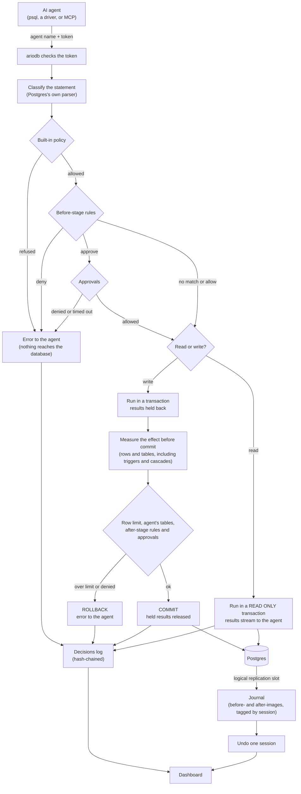

# Overview

This page explains what ariodb is, the problem it solves, and how a
statement travels from an AI agent to your database and back. It also sets
out the vocabulary the rest of the documentation uses, and what ariodb does
not do. Read it first if you are deciding whether to put ariodb in front of
a database, or before you follow the [quickstart](quickstart.md).

## What ariodb is

ariodb is a safety proxy that sits between AI agents and databases. Agents
connect to it as if it were Postgres (with `psql` or any Postgres driver),
as if it were ClickHouse, or through its MCP server. ariodb checks every
statement before it runs, runs reads in read-only transactions, measures
what every write actually changed before it commits, records every row an
agent changed, and lets a person undo one agent session later without
touching anyone else's work.

Agents can also connect as if it were MySQL or MariaDB, with the `mysql`
client or any MySQL driver. The same policy, rules, approvals, decisions
log and undo apply there, with a weaker write check: ariodb counts the
rows a MySQL write changed, triggers included, but only checks the tables
the statement names. See [MySQL and MariaDB](mysql.md).

It is a single Rust binary with an embedded web dashboard and a small
SQLite database for its own state. It is source-available under the
Sustainable Use License.

## The problem it solves

Giving an agent a database login is giving it everything that login can
do, at machine speed, with no one reading each statement. Three things go
wrong in practice:

- **Mistaken statements.** An agent misreads a task and runs
  `UPDATE orders SET status = 'void'` without the `WHERE` clause it meant,
  or deletes the wrong customer. Nothing about the statement looks unusual
  to the database.
- **Manipulated statements.** An agent reads text it should not trust (a
  support ticket, a web page, a row in the database itself) and that text
  tells it to export a table or drop one. This is prompt injection, and the
  agent's own judgement is the thing being attacked, so it cannot be the
  defence.
- **Runaway writes.** A loop that was meant to touch ten rows touches ten
  thousand, or a trigger or cascade quietly changes tables the agent never
  named.

Database grants help, but they are coarse: a role that may update `orders`
may update every row of it. ariodb adds the checks grants cannot express
(per-agent table lists, statement kinds, row limits measured after the
fact, human or model approval for particular statements) and a way back
when something gets through anyway.

## How it works, end to end

Step by step, for an agent connected to the Postgres proxy:

1. **The agent connects with a token.** It uses its agent name as the user
   name and its token as the password. The token is ariodb's, not the
   database's: the agent never sees a database password. ariodb then opens
   its own connection to the database as the gateway login (or the agent's
   credential, see below).
2. **The statement is classified.** ariodb parses the SQL with Postgres's
   own parser and decides what kind of statement it is (read, write,
   destructive, schema change, session setting, transaction control or
   unknown), which tables it names and which functions it calls. It looks
   inside `EXPLAIN ANALYZE`, `PREPARE`, `DECLARE`, `COPY (...)` and
   data-modifying `WITH` clauses. Anything it cannot see inside, such as a
   `DO` block, is unknown, and unknown is refused. Try it with
   [`ariodb classify`](cli.md).
3. **The built-in policy decides first.** It is default deny: the agent may
   only touch the tables listed for it, read-only agents may not write, and
   no agent may run destructive statements (`DROP`, `TRUNCATE`, `DELETE` or
   `UPDATE` without `WHERE`), schema changes, transaction control, most
   session settings, or functions that would get round ariodb's checks. See
   [policy](policy.md).
4. **Rules come next.** Rules are CEL conditions in the config file. They
   can refuse a statement or hold it for approval; they cannot allow what
   the built-in policy refused. See [rules](rules.md).
5. **Approvals hold a statement until someone agrees.** A rule with
   `verdict = "approve"` names approvers. Nothing reaches the database while
   the statement waits; a deny or a timeout refuses it. See
   [approvals](approvals.md).
6. **Reads are forced read-only.** ariodb wraps each read in a
   `READ ONLY` transaction with a statement timeout, so even a read that
   hides a write (a function with side effects, say) is refused by the
   database itself.
7. **Writes are measured before commit.** ariodb runs the write in a
   transaction, holds the results back from the agent, and asks the
   database which tables changed and by how many rows. That count includes
   rows changed by triggers, cascades and functions. If the write changed
   more rows than the agent's limit, touched a table the agent may not
   change, or an after-stage rule objects, ariodb rolls it back and the
   agent sees only the error. Otherwise it commits and releases the results.
8. **The journal records every committed change.** A logical replication
   slot feeds ariodb a stream of before- and after-images for the tables
   agents may write. Each agent write transaction carries a tag naming its
   session, so the journal knows who changed what.
9. **Undo reverses one session.** Given a session id, ariodb builds an undo
   plan from the journal, shows it, and applies it in one transaction. Rows
   someone else changed since are conflicts, never silently overwritten.
   See [undo](undo.md).
10. **Every decision is logged.** Each statement, verdict, deciding rule,
    row count and latency goes into a hash-chained decisions log in SQLite.
11. **The dashboard shows it all.** Approvals waiting, decisions, sessions
    and undo, rules, config and settings. See [dashboard](dashboard.md).

The ClickHouse proxies, the MySQL proxy and the MCP server go through the
same policy, rules, approvals and decisions log. ClickHouse has no
transactions, so its writes cannot be rolled back or undone; inserts over
its native protocol are counted against the row limit before any row
reaches ClickHouse. See [ClickHouse](clickhouse.md) and [MCP](mcp.md). MySQL writes are counted
before commit and journalled from the binlog; see
[MySQL and MariaDB](mysql.md).

## Key concepts

**Agent.** A named entry in `[[agents]]` in the config file: a program that
uses the database through ariodb. Each agent has an access level, a list of
tables and a token. Rules can apply to every agent or to named ones.

**Token.** The secret an agent proves itself with, sent as its password. It
comes from an environment variable (`token_env`) or the encrypted secret
store (`token_secret`). A token is never a database password: a leaked
token cannot log in to the database directly, though anyone who can reach
ariodb could use it as that agent, so keep tokens long, random and
secret.

**Gateway login.** The database role ariodb connects as to run agents'
queries, set in `[database]` or `ARIODB_DATABASE_URL`. Its grants are the
real limit on what any agent can reach, so give it only what agents need.
See [security model](security-model.md).

**Credential.** An extra database login in `[[credentials]]`, so an agent
can run as a different role from the gateway login. A read-only reporting
agent might run as a role that can only `SELECT`.

**`read_only` and `read_write` access.** A `read_only` agent may only run
reads. A `read_write` agent may also run writes (`INSERT`, `UPDATE`,
`DELETE` with a `WHERE`, `MERGE`), each one measured before commit. Neither
may run destructive statements or schema changes.

**Tables.** The tables an agent may use, listed per agent. Names ignore
case and a `public.` prefix; `"*"` means every table. Agents may always
read Postgres's catalogue (`pg_catalog`, `information_schema`) so they can
discover the schema. The tables that `read_write` agents list are the
*protected tables*: the ones `ariodb setup` prepares for the journal.

**Before and after stage.** A rule's stage says when it is judged. Before
stage (the default) judges the statement before it runs, from what it says.
After stage judges a write after it ran but before it commits, from what it
actually did (`effects.rows`, `effects.tables`).

**Approval.** A statement held by a rule until every listed approver
allows it: a person in the dashboard or the CLI, Slack, a webhook, a model
judging against a written policy, or a [plugin](plugins.md). People can
also be asked in Discord, Telegram, Microsoft Teams, Google Chat,
Mattermost, PagerDuty, Opsgenie or by email: the message carries signed
Approve and Deny links to a confirmation page in the dashboard. See
[approvals](approvals.md).

**Roles.** Dashboard users are viewers, approvers or admins. Viewers read
approvals, decisions, sessions and rules; approvers also decide approvals; admins
also change the config, undo sessions and manage users and secrets. People
can sign in with a local password or through an OpenID Connect provider
(Okta, Microsoft Entra ID, Google, Auth0, Keycloak and others), whose
groups decide their role. See [dashboard](dashboard.md#roles).

**Session.** One agent connection to the Postgres proxy (or one run of the
MCP server), with an id such as `s-3f9c2a71d0`. Every write in it is tagged
with that id. Sessions are the unit of undo.

**Journal.** `journal.jsonl` in the state directory: one line per
committed transaction on a protected table, with the session that made it
and full before- and after-images, read from a Postgres logical replication
slot.

**Undo.** Reversing exactly what one session changed: inserts deleted,
updates restored, deletes re-inserted, newest first, in one transaction.
`ariodb sessions` lists sessions; `ariodb undo --session <id>` shows the
plan, and `--apply` carries it out.

**Decisions log.** Every statement an agent sent and what ariodb decided,
in `ariodb.db` in the state directory. Each entry carries the hash of the
one before, so `ariodb audit` notices edits. Retention and redaction of
literal values are configurable.

**State directory.** `[journal] dir` (`.ariodb` by default): the journal,
`ariodb.db` (decisions, approvals, dashboard users), the encrypted secret
store and, unless `ARIODB_MASTER_KEY` is set, its key. ariodb creates it
with mode `0700`.

## What ariodb does not do

- **It does not replace database grants.** The table list is checked
  against the tables a statement names. A view or function the gateway
  login may use can reach tables the list does not name. Least-privilege
  roles are still the boundary.
- **It cannot see traffic that bypasses it.** If an agent can reach the
  database directly, ariodb protects nothing. Firewall the database so
  agents can reach it only through ariodb.
- **It does not undo effects outside the database.** Emails sent, payments
  taken or webhooks fired by triggers stay done.
- **It does not undo ClickHouse writes** or rows in tables without a
  primary key, and it does not rewind sequences.
- **It does not let agents manage transactions.** Each query string (or
  extended-protocol batch up to `Sync`) runs in its own transaction;
  `BEGIN`, `COMMIT` and savepoints from agents are refused.
- **It does not relay `COPY ... FROM STDIN`, `DO`, `CALL`, `EXECUTE` or
  `FETCH`.** Use `INSERT` and plain queries.
- **It does not guard other tools.** Kubernetes, HTTP APIs, shells and file
  systems an agent can reach are out of scope.
- **A model approver is not a security boundary on its own.** It can be
  persuaded by text inside the SQL it judges. Use it to save people time,
  not as the only check on risky rules.
- **It does not limit connections or rate-limit tokens.** Put the listeners
  behind network controls and use long random tokens.

The full threat model, with accepted risks, is in the
[security model](security-model.md) and [SECURITY.md](../SECURITY.md).

## Next

- [Quickstart](quickstart.md): try the demo, then set ariodb up against a
  local Postgres.
- [Installation](installation.md): build from source and run as a service.
- [Architecture](architecture.md): how the code is organised.
- [Policy](policy.md) and [rules](rules.md): what agents may do.
- [Security model](security-model.md): what ariodb defends against, and
  what it does not.
