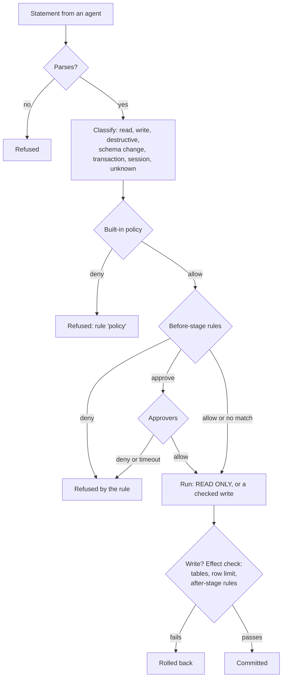

# The built-in policy

Before any rule runs, every statement passes ariodb's built-in policy. It
is fixed in the code, applies to every agent, and cannot be widened by
configuration: rules can refuse more or hold a statement for approval, but
never allow what the policy refuses. This page sets out exactly what the
policy decides, statement kind by statement kind, and why: what each
access level may do, which statements are always refused, which session
settings are allowed, which functions are blocked, how the table
allow-list matches names, and how ClickHouse and MySQL differ. It is for anyone
writing an agent's configuration or reviewing what an agent can do.

## Where the policy sits



The policy answers two questions for each statement: may this agent run
it at all, and if so, must it run read-only or as a checked write? It
only looks at the SQL. What a write actually changed is judged afterwards,
by the effect check described in [Postgres](postgres.md#how-writes-are-checked-before-commit).

Decisions the policy makes are recorded with the rule name `policy`, which
is also what you write in a [test fixture](testing-policies.md) to expect
one.

## When in doubt, refuse

ariodb parses Postgres SQL with Postgres's own parser (libpg_query), so it
reads a statement the way the server will. Three cases are refused
outright:

- **SQL that does not parse.** `cannot parse SQL: ...`.
- **Statements whose effect ariodb cannot see**, classed as `unknown`:
  `DO` blocks, `CALL`, `EXECUTE` of a prepared statement made outside
  ariodb, `FETCH`, and any statement type ariodb does not handle yet
  (`LISTEN`, `NOTIFY`, `DEALLOCATE`, `CHECKPOINT` and others). The message
  is `ariodb cannot check this statement: ...`.
- **A wrapped query ariodb cannot read back.** For `PREPARE` and
  `DECLARE CURSOR`, ariodb prints the inner query back to SQL and reads it
  again to find its tables and functions; if that fails, the statement is
  refused.

There is no setting to let unchecked statements through. A top-level
`on_failure = "open"` is refused when the config loads.

## Statement kinds

`ariodb classify "<sql>"` shows the kind ariodb gives a statement, the
tables it found and why (see [testing policies](testing-policies.md)).

```text
$ ariodb classify "WITH gone AS (DELETE FROM orders WHERE id < 5 RETURNING id) SELECT count(*) FROM gone"
write                tables: orders                   delete (inside a WITH clause)
```

| Kind | Examples | `read_only` agent | `read_write` agent |
|---|---|---|---|
| `read` | `SELECT`, `SHOW`, `EXPLAIN` (without `ANALYZE`), `COPY ... TO STDOUT`, `DECLARE CURSOR` over a read | Allowed, in a `READ ONLY` transaction | Allowed, in a `READ ONLY` transaction |
| `write` | `INSERT`, `UPDATE`/`DELETE` with a `WHERE`, `MERGE`, `SELECT ... FOR UPDATE`, a data-modifying `WITH`, `EXPLAIN ANALYZE` of a write | Refused: `agent '...' is read only` | Allowed, as a checked write |
| `destructive` | `DROP ...`, `TRUNCATE`, `UPDATE` or `DELETE` without `WHERE`, `COPY ... PROGRAM`, `COPY` to or from a server file | Refused | Refused |
| `schema_change` | `CREATE`, `ALTER`, `GRANT`, `COMMENT`, `VACUUM`, `LOCK`, `SELECT ... INTO`, and the rest | Refused | Refused |
| `transaction` | `BEGIN`, `COMMIT`, `ROLLBACK`, `SAVEPOINT` | Refused | Refused |
| `session` | `SET`, `RESET`, `DISCARD` | Only the [allowed settings](#session-settings) | Only the allowed settings |
| `unknown` | `DO`, `CALL`, `EXECUTE`, `FETCH`, anything unrecognised | Refused | Refused |

The kind names in this table are the values rules see in `sql.kind`.
`ariodb classify` prints three of them in words: `schema change`,
`transaction control` and `session setting`.

A query string with several statements is classified statement by
statement; every one must be allowed, and they run together, as a checked
write if any of them is a write.

### Reads

A read runs inside `BEGIN READ ONLY`, which Postgres enforces. That is the
backstop for anything parsing cannot see: a function that writes, called
from a `SELECT`, fails with Postgres's own read-only error.

`EXPLAIN` without `ANALYZE` only plans, so it is a read whatever it
explains (its tables are still checked against the allow-list).
`DECLARE CURSOR` over a read is allowed, but cursors cannot be read
because `FETCH` is refused.

### Writes, and wrappers ariodb looks inside

ariodb judges what actually runs, not the outermost keyword. A wrapper
takes the kind of the worst statement inside it:

| Wrapper | Example | Kind |
|---|---|---|
| `EXPLAIN ANALYZE` (any spelling: `(ANALYZE)`, `(ANALYZE true)`) | `EXPLAIN ANALYZE DELETE FROM users` | `destructive`: `ANALYZE` runs the statement |
| `EXPLAIN (ANALYZE off)` | `EXPLAIN (ANALYZE off) DELETE FROM users` | `read`: it only plans |
| `PREPARE` | `PREPARE p AS DELETE FROM users` | `destructive` |
| `DECLARE CURSOR` | `DECLARE c CURSOR FOR SELECT * FROM secrets` | `read`, with `secrets` checked |
| `COPY (query)` | `COPY (DELETE FROM users WHERE id = 1 RETURNING *) TO STDOUT` | `write` |
| Data-modifying `WITH` | `WITH gone AS (DELETE FROM users RETURNING id) SELECT count(*) FROM gone` | `destructive` (no `WHERE`) |

`SELECT ... FOR UPDATE` and `FOR SHARE` lock rows, so they are writes and
need write access.

### Destructive statements

Never allowed for any agent, whatever the rules say: `destructive
statements are never allowed for agents: ...`.

- `DROP` of anything (tables, databases, roles, schemas, subscriptions and
  the rest) and `TRUNCATE`: undo cannot reverse them.
- `UPDATE` or `DELETE` **without a `WHERE` clause**, at any depth: these
  change every row and are the most common agent mistake.
- `COPY ... PROGRAM` (runs a shell command on the database server) and
  `COPY` to or from a server file.

A `WHERE` clause that matches every row (`DELETE FROM orders WHERE true`)
is a `write`, not destructive: the policy reads the SQL, not the data. The
row limit is what catches it, after it runs and before it commits.

### Schema changes

`CREATE` (tables, indexes, views, functions, triggers, sequences, types,
schemas, extensions, roles, policies, publications), `ALTER` of any of
those, `GRANT` and `REVOKE`, `COMMENT`, `REFRESH MATERIALIZED VIEW`,
`ALTER SYSTEM`, `VACUUM`, `REINDEX`, `CLUSTER`, `LOCK` and `SELECT ...
INTO` are refused: `schema changes are not allowed for agents; make them on
a branch and review`. Schema changes cannot be undone from the journal and
can change what every other check means (a new trigger, a new view, a
changed grant). Make them through your normal migration process.

### Transactions

`BEGIN`, `START TRANSACTION`, `COMMIT`, `ROLLBACK`, `SAVEPOINT`, `RELEASE`
and `PREPARE TRANSACTION` are refused: `ariodb runs every statement in its
own transaction; send statements without BEGIN or COMMIT`. ariodb must own
the transaction to run reads read-only and to measure a write before
commit. Send statements that belong together in one query string or one
extended-protocol batch; see [Postgres](postgres.md#no-agent-controlled-transactions).

### Session settings

Drivers send a few `SET` commands when they connect, and refusing them
would break the connection. These settings only change how results are
formatted or how long to wait, not what data is reachable, so they are
allowed (and run read-only):

| Setting | Why drivers send it |
|---|---|
| `application_name` | Naming the connection |
| `client_encoding` | Text encoding |
| `datestyle`, `intervalstyle`, `timezone` (and `SET TIME ZONE`) | Date and time formatting |
| `extra_float_digits` | Float precision (JDBC and others) |
| `bytea_output` | Binary formatting |
| `standard_conforming_strings` | String literal parsing |
| `client_min_messages` | Notice verbosity |
| `statement_timeout`, `lock_timeout` | Waiting limits |

Every other setting is refused (`agents may not change the '...'
setting`), as are `RESET ALL` and `DISCARD`. **`search_path` is
deliberately not allowed**: it changes which table an unqualified name
means, so the allow-list would judge one table while Postgres used
another. For the same reason the `set_config` function is
[blocked](#blocked-functions).

`statement_timeout` and `lock_timeout` are on the list because drivers set
them, which also lets an agent lift ariodb's statement timeout for its own
statements. [Postgres](postgres.md#statement-timeouts) has a rule that
refuses this if you need the timeout to be a ceiling.

## Blocked functions

Some built-in Postgres functions are refused for every agent, whatever the
rules say, because they defeat ariodb's own checks rather than merely
reach data: `the function '...' is never allowed for agents: it would get
round ariodb's checks`. The match ignores the schema
(`pg_catalog.set_config` is `set_config`) and looks inside wrappers,
subqueries and `WITH` clauses.

| Function | Why it is blocked |
|---|---|
| `set_config` | Changes settings for the rest of the session, which would undo the refusal of `SET search_path` |
| `dblink` and every `dblink*` function | Runs SQL on another connection that ariodb never sees, outside the read-only transaction and the effect check |
| `query_to_xml`, `query_to_xmlschema`, `query_to_xml_and_xmlschema`, `cursor_to_xml`, `cursor_to_xmlschema` | Run a query given as a string, so its tables never reach the allow-list |
| `table_to_xml`, `table_to_xmlschema`, `table_to_xml_and_xmlschema`, `schema_to_xml`, `schema_to_xmlschema`, `schema_to_xml_and_xmlschema`, `database_to_xml`, `database_to_xmlschema`, `database_to_xml_and_xmlschema` | Read whole tables, schemas or databases named in a string |
| `ts_stat` | Runs a query given as a string |
| `lo_*` (`lo_import`, `lo_export`, `lo_get`, `lo_put`, ...), `loread`, `lowrite` | Large objects live outside the tables the effect check measures, and `lo_import`/`lo_export` touch server files |
| `pg_logical_emit_message` | Would forge the session tag the journal and undo rely on (ariodb itself uses it to tag writes) |
| `pg_logical_slot_*`, `pg_replication_*`, and anything containing `replication_slot` | Would read, advance or drop replication slots, including the journal's own |
| `pg_terminate_backend`, `pg_cancel_backend` | Would end or cancel other sessions on the shared gateway login, including other agents' |

What is **not** blocked: functions that read server files
(`pg_read_file`, `pg_read_binary_file`, `pg_ls_dir`, `pg_stat_file`).
Whether those work is a privilege question: they need superuser or the
`pg_read_server_files` family of roles, which the gateway role should not
have. Add a rule as well if you want a second check:

```toml
[[rules]]
name = "no-file-functions"
# Matches pg_read_file and pg_catalog.pg_read_file alike.
condition = "sql.functions.exists(f, f.matches('(^|[.])pg_(read_file|read_binary_file|ls_dir|stat_file)$'))"
verdict = "deny"
reason = "functions that read server files are off-limits"
```

Match function names the way this rule does, not with a plain list: a
statement that calls `pg_catalog.pg_read_file(...)` puts the qualified
name in `sql.functions`, so `'pg_read_file' in sql.functions` would not
see it. See [rules](rules.md#facts-a-condition-can-read).

Functions you write yourself are not inspected: ariodb sees the call, not
the body. Revoke `EXECUTE` on functions agents should not call; see
[security model](security-model.md).

## COPY

`COPY ... FROM STDIN` is refused (`COPY ... FROM STDIN is not supported
through ariodb; use INSERT`). The rows arrive in a sub-protocol after the
statement, so ariodb would be judging rows it has not seen. `COPY ... TO
STDOUT` and `COPY (query) TO STDOUT` are reads. `COPY` to or from a file on
the server, or through `PROGRAM`, is destructive.

## Table allow-lists

Each agent may only use the tables its `tables` list names:

```toml
[[agents]]
name = "coding-agent"
access = "read_write"
tables = ["orders", "customers", "billing.invoices"]
token_env = "ARIODB_TOKEN_CODING_AGENT"
```

Every table a statement names must be on the list, including tables it
only reads (the source of an `INSERT ... SELECT`, a table in a subquery,
a table inside `EXPLAIN` or `PREPARE`): `agent '...' may not use table
'...'`. `["*"]` allows every table.

### How names are matched

Names are normalised the same way on both sides before comparing:

- **Lower case.** `Orders`, `ORDERS` and `orders` are the same.
- **`public.` is dropped.** `public.orders` and `orders` are the same.
- **Other schemas stay.** `billing.invoices` must be listed as
  `billing.invoices`.
- A database prefix is ignored, as Postgres ignores it
  (`app.public.orders` is `orders`).

Limits that follow from this:

- A quoted mixed-case table (`"Orders"`) is matched as `orders`. Avoid
  tables whose names differ only by case.
- Unqualified names are judged as `public.<name>`, so the gateway role's
  `search_path` must make them mean that. See
  [Postgres](postgres.md#the-gateway-role).
- CTE names (`WITH recent AS (...) SELECT * FROM recent`) are not tables
  and are not checked; the tables inside the CTE are.

### Tables are checked twice for writes

For a checked write, the tables are checked once before it runs (the
names in the SQL) and again before commit, against every table the
transaction actually changed. A trigger or cascade that writes to a table
not on the list rolls the write back. See
[Postgres](postgres.md#how-writes-are-checked-before-commit). On MySQL and
MariaDB only the first check is possible; see
[below](#mysql-and-mariadb).

### The catalogue

Agents and their tools need to discover the schema, so every agent may
**read** Postgres's catalogue without listing it:

- anything in `pg_catalog.` or `information_schema.`;
- any unqualified name beginning `pg_` (`pg_class`, `pg_stat_activity`),
  because Postgres always searches `pg_catalog` first.

This is for reads only: writing to a catalogue table is refused unless it
is on the list. One consequence: a user table named `pg_something` in
`public` is treated as catalogue and readable by every agent, so do not
name tables that way.

## The row limit

```toml
[limits]
max_rows_per_write = 500   # default 500, at least 1

[[agents]]
name = "coding-agent"
max_rows_per_write = 100   # overrides [limits] for this agent
```

The limit is applied to what a write actually changed, measured before
commit and summed across every table (triggers and cascades included). A
write over the limit is rolled back. It is part of the built-in checks, so
rules cannot raise it; an after-stage rule can hold a smaller write for
approval (see [rules](rules.md#require-approval-for-writes-over-n-rows)).

## ClickHouse

ClickHouse SQL is read with a tokeniser rather than Postgres's parser, and
errs towards refusing. The same access levels, allow-lists and kinds
apply. See [ClickHouse](clickhouse.md) for how statements are run.

| Kind | ClickHouse statements |
|---|---|
| `read` | `SELECT`, `WITH ... SELECT`, `SHOW`, `DESCRIBE`/`DESC`, `EXISTS`, `EXPLAIN` |
| `write` | `INSERT`. Over the native protocol, only `INSERT ... VALUES` and `INSERT ... FORMAT` with the rows sent as data, which ariodb counts against the row limit (see [ClickHouse](clickhouse.md#inserts)) |
| `destructive` | `DELETE`, `ALTER ... DELETE`, `ALTER ... UPDATE`, `DROP`, `TRUNCATE`, `DETACH`, `RENAME`, `EXCHANGE`, and any statement using a table function that leaves the server |
| `schema_change` | `CREATE`, `ALTER`, `ATTACH`, `OPTIMIZE`, `SYSTEM`, `GRANT`, `REVOKE`, `KILL`, `MOVE` |
| `session` | `SET`, `USE`: always refused |
| `unknown` | Anything else; table functions other than the row-making ones; `dictGet*` and `joinGet`; a `SETTINGS` clause naming `readonly` or `allow_ddl` |

Also:

- **One statement per request.** More is refused.
- **Table functions that reach outside the server** (`file`, `url`, `s3`,
  `remote`, `mysql`, `postgresql`, `executable` and the others listed in
  [ClickHouse](clickhouse.md#what-is-refused)) make a statement
  destructive, so no agent can run it.
- **Only row-making table functions are allowed**: `numbers`,
  `numbers_mt`, `zeros`, `zeros_mt`, `values`, `view`, `generateRandom`,
  `generate_series`, `format`. `merge`, `dictionary` and the rest read
  tables named in strings, which the allow-list cannot see, so they are
  `unknown` and refused.
- **Tables are found** after `FROM`, `JOIN`, `INTO`, `TABLE`, `UPDATE`,
  `DESCRIBE`, in comma-separated `FROM` lists at any depth, and after `IN`
  (`x IN secrets` reads `secrets`).
- **Names are scoped to the session's database**: in database `hidden`,
  `events` is judged as `hidden.events`. Allow-lists name tables in
  `default` without a prefix. See
  [ClickHouse](clickhouse.md#database-scoping).
- **The catalogue** readable without listing is `system.tables`,
  `system.columns`, `system.databases`, `system.functions` and
  `information_schema.*`. Nothing else in `system`.
- **The Postgres blocked-function list does not apply**; the table
  function rules above do that job.

## MySQL and MariaDB

MySQL SQL is read by a lexer that follows the server's own rules for
comments, strings and quoted names, together with a full SQL parser; if
the two disagree about the quoting or the comments in a statement, it is
refused. The same access levels, allow-lists and kinds apply, judged
against the agent's `[agents.mysql]` block. See
[MySQL and MariaDB](mysql.md#how-statements-are-judged) for how statements
are run and what the listener itself refuses.

| Kind | MySQL and MariaDB statements |
|---|---|
| `read` | `SELECT`, `WITH ... SELECT`, `TABLE`, `VALUES`, `SELECT ... INTO @variable`; `DESCRIBE`, `DESC` and `EXPLAIN` of a table; `EXPLAIN` of a statement (it only plans); `EXPLAIN ANALYZE` and MariaDB's `ANALYZE` of a read; the `SHOW` forms listed below |
| `write` | `INSERT` (with `ON DUPLICATE KEY UPDATE` or `SELECT`), `REPLACE`, `UPDATE` and `DELETE` with a `WHERE` (multi-table forms included), `WITH ... UPDATE` or `DELETE`, `SELECT ... FOR UPDATE`, `FOR SHARE` and `LOCK IN SHARE MODE`, `EXPLAIN ANALYZE` or `ANALYZE` of a write |
| `destructive` | `DROP`, `TRUNCATE`, `UPDATE` or `DELETE` without `WHERE` (also inside `EXPLAIN ANALYZE`) |
| `schema_change` | `CREATE` (temporary tables included), `ALTER`, `RENAME`, `GRANT`, `REVOKE`, `ANALYZE TABLE`, `OPTIMIZE`, `REPAIR`, `CHECK`, `CHECKSUM` |
| `transaction` | `BEGIN`, `START TRANSACTION`, `COMMIT`, `ROLLBACK`, `SAVEPOINT`, `RELEASE`, `XA`, `LOCK TABLES`, `UNLOCK TABLES`, `SET autocommit = 0` |
| `session` | `SET` (only the allowed variables below); `USE` and `KILL`, which the policy refuses and the listener handles itself |
| `unknown` | `CALL`, `DO`, `HANDLER`, `LOAD`, SQL-level `PREPARE`, `EXECUTE` and `DEALLOCATE`, `BEGIN NOT ATOMIC`, `SET STATEMENT ... FOR`, `SELECT ... INTO OUTFILE` or `DUMPFILE` (or `INTO` anything but user variables), executable comments (`/*! ... */`, `/*M! ... */`), `SET_VAR`, `MAX_EXECUTION_TIME` and `RESOURCE_GROUP` hints, `EXPLAIN FOR CONNECTION`, server control (`FLUSH`, `RESET`, `PURGE`, `CHANGE`, `STOP`, `START` other than a transaction, `INSTALL`, `UNINSTALL`, `SHUTDOWN`, `RESTART`, `CLONE`, `LOCK INSTANCE` and the like), any other `SHOW`, `sql_mode` or character-set changes that would alter quoting |

SQL that ariodb cannot read at all (an unknown first word, a NUL byte, a
name with a dot inside its backticks, more than 1,000 chained operators)
is refused as `cannot parse SQL: ...`. Statements that are not UTF-8 are
refused before they are read.

**`SHOW` forms agents may use**, all reads: `SHOW [FULL] TABLES [FROM db]`,
`SHOW [FULL] COLUMNS` (or `FIELDS`) and `SHOW INDEX` (or `INDEXES`, `KEYS`)
`FROM` a table (whose name is checked), `SHOW CREATE TABLE` (checked),
`SHOW DATABASES`, `SHOW COLLATION`, `SHOW CHARACTER SET`,
`SHOW [STORAGE] ENGINES`, `SHOW [SESSION] VARIABLES` and `STATUS`,
`SHOW WARNINGS` and `SHOW ERRORS` (with `LIMIT` and `COUNT(*)`), each with
an optional `LIKE` or `WHERE`. `SHOW PROCESSLIST`, `SHOW GRANTS`,
`SHOW GLOBAL ...`, `SHOW ENGINE ... STATUS` and the binlog and replication
forms are refused: they describe other sessions or the server.

### Session variables

| Allowed | Notes |
|---|---|
| `NAMES`, `CHARACTER SET`, `character_set_client` | Only `utf8mb4`, `utf8mb3`, `utf8`, `latin1`, `ascii`, `binary` |
| `character_set_connection`, `character_set_results`, `collation_connection`, `time_zone`, `lc_time_names` | Formatting |
| `autocommit` | Only to `1`, `ON` or `TRUE`; turning it off is transaction control |
| `transaction_isolation`, `tx_isolation`, `SET TRANSACTION ISOLATION LEVEL` | `READ UNCOMMITTED` is refused |
| `sql_select_limit`, `group_concat_max_len` | |
| `net_read_timeout`, `net_write_timeout`, `wait_timeout`, `interactive_timeout` | Client-side waits |
| `sql_mode` | Only a quoted list of modes that leave quoting alone; never `ANSI_QUOTES`, `NO_BACKSLASH_ESCAPES` or the modes that include them |
| `@user_variables` | The agent's own |

Everything else is refused (`agents may not change the '...' setting`),
including `sql_log_bin`, `foreign_key_checks`, `unique_checks`,
`max_execution_time`, `max_statement_time`, `innodb_lock_wait_timeout`,
`transaction_read_only`, `sql_safe_updates`, `SET PASSWORD`, `SET ROLE`,
and anything `GLOBAL`, `PERSIST` or `PERSIST_ONLY`. Unlike Postgres's
`statement_timeout`, ariodb's MySQL time limits cannot be changed by
agents.

### Blocked functions

Refused for every agent, whatever the rules say:

| Function | Why it is blocked |
|---|---|
| `load_file` | Reads files on the server |
| `sys_exec`, `sys_eval`, `sys_get`, `sys_set`, and every `lib_mysqludf_*` function | The lib_mysqludf_sys functions run shell commands or reach the server's environment |
| `get_lock`, `release_lock`, `release_all_locks`, `is_free_lock`, `is_used_lock` | Named locks outlive the statement and reach other sessions on the shared gateway login |
| `master_pos_wait`, `source_pos_wait`, `wait_for_executed_gtid_set`, `wait_until_sql_thread_after_gtids`, `master_gtid_wait` | Wait on replication |
| Any function in `sys`, `mysql` or `performance_schema` | Read what the catalogue rule keeps from agents |

MariaDB's `NEXTVAL(s)`, `LASTVAL(s)` and `SETVAL(s, n)` name a sequence,
which is checked as a table against the agent's list.

### Table names

- **Scoped to `[mysql] database`.** `orders` and `app.orders` are the same
  table when `[mysql] database = "app"`; a table in another database must
  be listed as `database.table`.
- **Lower case**, as for Postgres. With `lower_case_table_names = 0`,
  avoid tables whose names differ only by case; `ariodb doctor` checks.
- **Reserved tables** are refused for every agent, `"*"` included: the tag
  table, `information_schema.processlist`, `information_schema.innodb_*`,
  and everything in `mysql`, `sys` and `performance_schema`. See
  [reserved tables](mysql.md#reserved-tables).
- **The catalogue** readable without listing is these
  `information_schema` views: `tables`, `columns`, `schemata`,
  `statistics`, `key_column_usage`, `table_constraints`,
  `referential_constraints`, `views`, `routines`, `character_sets`,
  `collations`, `engines` and `columns_extensions`. Other
  `information_schema` views (`user_privileges` and the rest) need
  listing.
- **Tables are checked once, before the write runs.** A trigger or stored
  code that writes to another table is counted against the row limit but
  not checked against the list, so keep the gateway login's grants tight.
  See [MySQL and MariaDB](mysql.md#how-this-compares-with-postgres).
- **The Postgres blocked-function list does not apply**; the MySQL list
  above does.

## What rules can and cannot change

[Rules](rules.md) run only on statements the policy has allowed. So:

- A rule can **refuse** an allowed statement, or **hold it for approval**.
- A rule **cannot allow** anything the policy refused: there is no rule
  that lets an agent run `TRUNCATE`, `SET search_path` or `dblink`, or
  read a table that is not on its list.
- A rule condition such as `sql.kind == 'destructive'` never matches,
  because destructive statements never reach the rules.
- An `allow` verdict only matters against other rules: it outranks a
  lower-priority `approve`.

## Next

- [Rules](rules.md): refusing or holding statements the policy allows.
- [Testing policies](testing-policies.md): `classify`, `explain` and
  fixtures in CI.
- [Postgres](postgres.md): how reads and checked writes run.
- [ClickHouse](clickhouse.md): the ClickHouse listeners.
- [Security model](security-model.md): what the policy does not cover.
