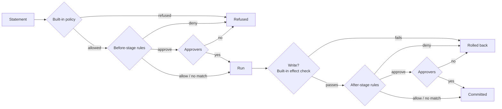

# Rules

Rules are conditions in CEL, the Common Expression Language, that sit on
top of the [built-in policy](policy.md). A rule can refuse a statement the
policy allows, or hold it until a person, a model or a plugin
[approves](approvals.md) it, either before it runs or after a write has
run but before it commits. This page covers the two stages, the three
verdicts and how rules combine, scoping rules to agents, every fact a
condition can read, the functions available, what happens when a
condition cannot be evaluated, hot reload, and a cookbook of working
rules. It is for whoever writes and reviews an ariodb configuration.

## Where rules run



Rules only ever see statements the built-in policy has already allowed.
That is what "rules cannot widen the policy" means in practice: an agent
can never run `TRUNCATE` or read a table off its list, whatever a rule
says, and a condition such as `sql.kind == 'destructive'` never matches.

## A rule, field by field

```toml
[[rules]]
name = "big-writes-need-a-human"   # required, unique
stage = "after"                    # before (default) | after
condition = "effects.rows > 50"    # CEL; omit to match everything
verdict = "approve"                # allow | deny | approve
approve = ["ops"]                  # approvers, required for approve; all must allow
agents = ["coding-agent"]          # optional; default every agent
priority = 10                      # optional; default 0
reason = "writes over 50 rows need a person to agree"   # optional
```

| Field | Type | Default | Meaning |
|---|---|---|---|
| `name` | string | required | Unique. Recorded in the decisions log and used in [test fixtures](testing-policies.md). |
| `condition` | CEL string | none: matches everything | Must evaluate to `true` or `false`. |
| `verdict` | `allow`, `deny`, `approve` | required | What happens when the condition is true. |
| `approve` | list of approver names | `[]` | Required, and only used, with `verdict = "approve"`. Every approver listed must allow. |
| `agents` | list of agent names | `[]`: every agent | The rule only applies to these agents. |
| `priority` | integer | `0` | Orders `allow` and `approve`; see [how rules combine](#how-rules-combine). |
| `stage` | `before`, `after` | `before` | When the rule is judged. |
| `reason` | string | `rule '<name>'` | Shown to the agent and to approvers, and recorded. |

When a rule refuses, the agent's error is the reason:
`ERROR:  ariodb: payments is frozen for the quarter-end close`. An
after-stage refusal reads `ariodb: rolled back: <reason>`. A refused
approval reads `<reason>: <why the approver said no>`.

## Two stages

### Before: judged on the SQL

Before-stage rules (the default) run before anything reaches the
database, on every statement of every engine. They see the [`sql.*`,
`agent.*`](#facts-a-condition-can-read) and
[`plugin.*`](#plugin-facts-plugin) facts.

A query string with several statements is judged **statement by
statement**: each statement gets its own evaluation with its own
`sql.statement`, `sql.tables` and so on. Any refusal refuses the whole
query string; every distinct rule that asks for approval must be
satisfied before any of it runs.

### After: judged on what a write did

After-stage rules (`stage = "after"`) run once per Postgres checked
write, after the statements have run and the built-in effect check has
passed (tables changed, row limit), and before commit. They add the
[`effects.*`](#effects-effects) facts: how many rows the transaction
really changed and which tables, including through triggers and cascades.

- `deny` rolls the write back.
- `approve` keeps the transaction open, with its row locks held, until the
  approvers decide or the approval times out. Keep after-stage approvals
  for writes that really need them, and keep the
  [approval timeout](approvals.md) short.
- They do not run for reads, for ClickHouse (which has no transaction to
  hold open), or for statements the policy or a before-stage rule refused.
- `sql.*` facts describe the whole transaction: `sql.statement` is every
  statement joined with `; `, `sql.tables` and `sql.functions` are the
  union, and `sql.verb` and `sql.kind` come from the first statement.
- They cannot read plugin facts; `ariodb check` refuses one that tries.

## Verdicts

| Verdict | Before stage | After stage |
|---|---|---|
| `deny` | The statement is refused. | The write is rolled back. |
| `approve` | The statement waits for every listed approver before it runs. | The open transaction waits for every listed approver before it commits. |
| `allow` | No effect on its own; outranks a lower-priority `approve`. | Likewise. |

`allow` never lets through anything the policy refused, and never
overrides a `deny`. Its only use is to make an exception to an `approve`
rule (see the [cookbook](#make-an-exception-to-an-approval-rule)).

<!-- TODO: list the further approver channels here once they are merged. -->
Approvers are named in `[[approvers]]`: a person in the dashboard or with
`ariodb approve`, Slack, a webhook, a model judging against a written
policy, or a plugin. See [approvals](approvals.md).

## How rules combine

For each statement (or, after the stage, each write), ariodb evaluates
every rule for that stage that applies to the agent:

1. **Any matching `deny` wins**, whatever its priority. A rule that cannot
   be evaluated counts as a matching `deny`.
2. Otherwise, **the highest-priority matching rule** decides between
   `allow` and `approve`. Rules with equal priority keep their order in the
   file; the first one wins.
3. If nothing matches, the policy's decision stands: the statement runs.

So a low-priority deny still beats a high-priority allow:

```toml
[[rules]]
name = "reads"
condition = "sql.kind == 'read'"
verdict = "allow"
priority = 100

[[rules]]
name = "no-passwords"
condition = '''sql.statement.matches('(?i)\\bpassword\\b')'''
verdict = "deny"
priority = -10
```

`SELECT password FROM users` is refused by `no-passwords`. One
consequence: a catch-all `deny` with no condition refuses everything,
whatever you put above it. Rules cannot express "deny everything except";
write each deny's condition precisely, and use the agent's table list and
access level for the allow-list.

## Scoping rules to agents

```toml
[[rules]]
name = "support-bot-reads-recent-orders-only"
condition = "!sql.statement.matches('(?i)created_at\\\\s*>')"
verdict = "deny"
agents = ["support-bot"]
```

A rule with `agents` applies only to those agents; without it, to every
agent. Agent names must match `[[agents]] name` exactly. A rule that names
an agent that does not exist simply never applies, so check rule scoping
with [`ariodb explain`](testing-policies.md).

## Facts a condition can read

### SQL (`sql`)

| Fact | Type | Meaning |
|---|---|---|
| `sql.statement` | string | The statement as the agent sent it, in its original case, comments included. |
| `sql.verb` | string | The first keyword, lower case: `select`, `insert`, `update`, `delete`, `merge`, `set`, `explain`, `prepare`, `copy`, ... A statement starting `WITH` (or a comment) gives the command it runs instead, such as `select` or `delete`. |
| `sql.kind` | string | ariodb's judgement: `read`, `write` or `session` (the others never reach the rules; see [policy](policy.md#statement-kinds)). |
| `sql.tables` | list of strings | Tables named, lower case, without `public.`; other schemas stay (`billing.invoices`). On ClickHouse, scoped to the session's database. CTE names are not included. |
| `sql.functions` | list of strings | Functions called, lower case, **with the schema if the statement wrote one** (`pg_catalog.pg_read_file`). |
| `sql.database` | string | The database the statement runs in: the one in the Postgres login's URL, or the ClickHouse session's database. |
| `sql.engine` | string | `postgres` or `clickhouse`. |

<!-- TODO: add 'mysql' to sql.engine once MySQL support is merged. -->

Two things to know when writing security rules:

- **Prefer `sql.kind` and `sql.tables` to `sql.verb`.** `sql.verb` is the
  outermost keyword, so `EXPLAIN ANALYZE DELETE ...` has verb `explain`,
  `PREPARE p AS DELETE ...` has verb `prepare`, and
  `WITH gone AS (DELETE ...) SELECT ...` has verb `select`. All three have
  kind `write` and name the table they delete from.
- **Match function names with a pattern.** Because `sql.functions` keeps a
  schema the agent wrote, `'pg_read_file' in sql.functions` misses
  `pg_catalog.pg_read_file(...)`. Use
  `sql.functions.exists(f, f.matches('(^|[.])pg_read_file$'))`.

`sql.statement` is the text the agent chose, so matching it is easy to get
round (`SELECT *` returns an `email` column without the word "email"
appearing). Use it for conveniences and nudges; enforce data boundaries
with tables, grants and column privileges.

### Agent (`agent`)

| Fact | Type | Meaning |
|---|---|---|
| `agent.name` | string | The agent's name from `[[agents]]`. |
| `agent.access` | string | `read_only` or `read_write`. For a ClickHouse statement, the agent's `[agents.clickhouse]` access. |

<!-- TODO: document agent.credential once that fact is merged. -->

### Effects (`effects`)

Only in after-stage rules. Reading `effects` in a before-stage rule is an
evaluation error, which refuses every statement the rule applies to.

| Fact | Type | Meaning |
|---|---|---|
| `effects.rows` | int | Rows the transaction changed, summed across every table, triggers and cascades included. |
| `effects.tables` | list of strings | Every table the transaction changed, normalised like `sql.tables`, including tables changed only by triggers and cascades. |

Under [`write_check = "reported"`](postgres.md#when-the-database-cannot-measure-writes-write_check--reported),
`effects.rows` is the row count the database reported and
`effects.tables` is the tables the write statements name; changes made by
triggers and cascades are not seen.

### Plugin facts (`plugin`)

Only in before-stage rules. A [plugin](plugins.md) with the `facts`
capability can supply any JSON object for each statement; a rule reads its
keys as `plugin.<plugin name>.<key>`. JSON numbers, strings, booleans,
lists, objects and `null` become the matching CEL values.

```toml
[[plugins]]
name = "office_hours"
command = ["python3", "-I", "examples/plugins/python/ariodb_plugin.py"]

[[rules]]
name = "change-freeze"
condition = "plugin.office_hours.freeze && sql.kind != 'read'"
verdict = "deny"
reason = "change freeze"
```

- Always write `plugin.<name>`. Any other form (`plugin[name]`,
  `has(plugin)`) is refused when the config loads, because ariodb works
  out from the condition which plugins to ask.
- A plugin is only asked when a before-stage rule that applies to the
  agent mentions it.
- If the plugin is down, slow, or answers with something other than an
  object, **every rule that reads it is unevaluable and refuses**, before
  the rest of its condition is looked at. In the example above, a broken
  `office_hours` plugin refuses reads too, even though the condition
  mentions `sql.kind != 'read'`. Scope plugin rules with `agents`, and
  run the plugin as reliably as the database.
- A key the answer does not contain is an evaluation error too.

## Functions

Conditions are standard CEL. These work and are tested:

| Function or operator | Example |
|---|---|
| `in` (list membership) | `'orders' in sql.tables` |
| `&&`, `\|\|`, `!`, `==`, `!=`, `<`, `>`, `<=`, `>=` | `effects.rows > 50 && agent.name != 'ops-bot'` |
| `size(list)` | `size(sql.tables) > 3` |
| `string.contains(s)`, `startsWith(s)`, `endsWith(s)` | `sql.statement.contains('LIMIT')` |
| `string.matches(regex)` | `sql.statement.matches('(?i)\\blimit\\b')` |
| `list.exists(x, cond)`, `all(x, cond)`, `exists_one(x, cond)` | `sql.tables.all(t, t in ['orders', 'order_items'])` |
| `list.filter(x, cond)`, `map(x, expr)` | `size(sql.tables.filter(t, t.startsWith('billing.'))) > 0` |
| `has(field)` | `has(sql.verb)` |
| `int()`, `string()` conversions | `int(plugin.clock.hour) >= 18` |
| `intersects(a, b)`, or `sets.intersects(a, b)` | `intersects(sql.tables, ['payments', 'refunds'])` |

`intersects` is ariodb's own: true when the two lists share an item. The
CEL sets extension's spelling, `sets.intersects`, is accepted too.

Regular expressions use Rust's `regex` syntax; `(?i)` makes one
case-insensitive. CEL's string extension functions (`lowerAscii`,
`split`, `replace` and so on) are not available, and calling one is an
evaluation error. There is no clock: a rule cannot read the time of day
directly. Get it from a plugin (see the
[business hours example](#allow-writes-only-in-working-hours)).

## Writing conditions in TOML

Conditions are TOML strings containing CEL strings, so there are two
layers of quoting. The simple way to keep them apart: double quotes for
the TOML string, single quotes for CEL strings.

```toml
condition = "'orders' in sql.tables && sql.verb == 'update'"
```

For regular expressions, use a TOML **literal** string (`'''...'''`),
which keeps backslashes as written, and write each regex backslash as
`\\` for CEL:

```toml
condition = '''sql.statement.matches('(?i)\\blimit\\b')'''
```

In a basic TOML string (`"..."`), the same condition needs four
backslashes (`\\\\b`): TOML turns them into two, and CEL into one. With
only two, CEL receives `\b`, which in a CEL string is a backspace
character, and the regex quietly matches nothing.

## When a condition cannot be evaluated

A condition that fails at run time counts as a matching `deny`, whatever
the rule's verdict. ariodb refuses rather than guess. The reason names the
rule and the error:

```text
$ ariodb explain --agent coding-agent "SELECT 1"
deny  (decided by: typo)  rule 'typo' could not be evaluated: No such key: no_such_field
```

Causes:

- a misspelt fact (`sql.no_such_field`);
- `effects` in a before-stage rule ("Undeclared reference to 'effects'");
- a condition that returns something other than `true` or `false`
  (`condition = "sql.tables"`);
- an unsupported function;
- a plugin that is unavailable, or a fact it did not supply.

Because an `allow` rule with a typo turns into a deny for every statement
it applies to, a mistake fails safe but loudly. Test every rule change
with [`ariodb explain` or `ariodb test`](testing-policies.md) before it
ships.

### Checked when the config loads

`ariodb check`, `ariodb serve` and hot reload refuse a config with:

- a condition that does not compile (`rule 'x': condition does not compile: ...`);
- two rules with the same name;
- `verdict = "approve"` with no `approve` list, or naming an approver that
  is not defined;
- a rule that reads facts from a plugin not in `[[plugins]]`, reads them
  in a form other than `plugin.<name>`, or reads them at the after stage.

## Hot reload

`ariodb serve` checks the config file every two seconds. When it changes,
the new rules apply to the next check: the next statement's before-stage
rules, and the after-stage rules of any write judged from then on. A
statement that has already passed a check is not checked again. If the new file does
not load (bad TOML, a rule that does not compile), ariodb keeps the
previous config and logs `ariodb: kept the previous config: <why>`.
Listen addresses, tunnels and plugins need a restart.

`ariodb mcp` reads the config once when it starts; restart it to pick up
rule changes.

The dashboard can edit rules too, when `[dashboard] config_writes = true`;
it checks the new config before saving. See [dashboard](dashboard.md).

## Cookbook

Every rule below has been run through `ariodb explain`. Each assumes an
approver named `ops`:

```toml
[[approvers]]
name = "ops"
type = "dashboard"
```

### Block a table during a freeze

Refuse writes to the billing tables until the close is signed off. The
before-stage rule refuses statements that name the tables; the
after-stage rule also catches writes that reach them through a trigger or
cascade from another table.

```toml
[[rules]]
name = "billing-freeze"
condition = "intersects(sql.tables, ['invoices', 'payments']) && sql.kind != 'read'"
verdict = "deny"
reason = "billing tables are frozen until the quarter-end close is signed off"

[[rules]]
name = "billing-freeze-effects"
stage = "after"
condition = "intersects(effects.tables, ['invoices', 'payments'])"
verdict = "deny"
reason = "billing tables are frozen until the quarter-end close is signed off"
```

Delete the rules (hot reload picks it up) to end the freeze. To switch a
freeze on and off without editing the config, read it from a plugin, as
the `change-freeze` rule [above](#plugin-facts-plugin) does.

### Require approval for writes over N rows

`max_rows_per_write` is a hard ceiling. Between a comfortable size and the
ceiling, ask a person:

```toml
[limits]
max_rows_per_write = 500        # never more than this

[[rules]]
name = "big-writes-need-a-human"
stage = "after"
condition = "effects.rows > 50"
verdict = "approve"
approve = ["ops"]
reason = "this write changes more than 50 rows"
```

The approver sees the statement and the reason; the agent's write is
held, uncommitted, until they decide.

### Deny functions

```toml
[[rules]]
name = "no-file-functions"
condition = "sql.functions.exists(f, f.matches('(^|[.])pg_(read_file|read_binary_file|ls_dir|stat_file)$'))"
verdict = "deny"
reason = "functions that read server files are off-limits"

[[rules]]
name = "no-sleeping"
condition = "sql.functions.exists(f, f.matches('(^|[.])pg_sleep(_for|_until)?$'))"
verdict = "deny"
reason = "agents may not hold connections open with pg_sleep"
```

The pattern matches the bare and the schema-qualified name. Functions that
would get round ariodb's own checks (`dblink`, `set_config`, large objects
and others) are already [blocked by the policy](policy.md#blocked-functions).

### Per-engine rules

```toml
[[rules]]
name = "clickhouse-reads-need-a-limit"
condition = '''sql.engine == 'clickhouse' && sql.kind == 'read' && 'events' in sql.tables && !sql.statement.matches('(?i)\\blimit\\b')'''
verdict = "deny"
reason = "reads of events on ClickHouse need a LIMIT"

[[rules]]
name = "clickhouse-inserts-need-a-human"
condition = "sql.engine == 'clickhouse' && sql.verb == 'insert'"
verdict = "approve"
approve = ["ops"]

[[rules]]
name = "postgres-customer-reads-need-a-human"
condition = "sql.engine == 'postgres' && 'customers' in sql.tables && sql.kind == 'read'"
verdict = "approve"
approve = ["ops"]
reason = "reading customer records needs a person to agree"
```

A rule without an engine test applies to both engines. After-stage rules
only ever see Postgres.

### Allow writes only in working hours

CEL has no clock, so the time comes from a plugin. The example plugin
shipped with ariodb supplies `hour_gmt`, `weekday` (`mon` to `sun`) and
`out_of_hours` (outside 07:00 to 18:00 GMT by default):

```toml
[[plugins]]
name = "office_hours"
command = ["python3", "-I", "examples/plugins/python/ariodb_plugin.py"]
env = { ARIODB_EXAMPLE_START_HOUR = "8", ARIODB_EXAMPLE_CUTOFF_HOUR = "18" }

[[rules]]
name = "writes-in-working-hours"
condition = "sql.kind == 'write' && (plugin.office_hours.out_of_hours || plugin.office_hours.weekday in ['sat', 'sun'])"
verdict = "deny"
reason = "agents write between 08:00 and 18:00 GMT, Monday to Friday"
agents = ["coding-agent"]
```

Scoped to the one agent that writes, so a plugin outage does not refuse
other agents' reads. See [plugins](plugins.md) for the protocol.

### Make an exception to an approval rule

`allow` outranks a lower-priority `approve`. Every write needs a person,
except writes that only touch a scratch table:

```toml
[[rules]]
name = "writes-need-approval"
condition = "sql.kind == 'write'"
verdict = "approve"
approve = ["ops"]

[[rules]]
name = "scratch-writes-are-fine"
condition = "sql.kind == 'write' && sql.tables.all(t, t == 'scratch')"
verdict = "allow"
priority = 10
```

An exception to a `deny` is not possible: write the deny's condition so it
excludes the case instead.

### Keep a read-only agent to recent rows

```toml
[[rules]]
name = "support-bot-needs-a-limit"
condition = '''!sql.statement.matches('(?i)\\blimit\\s+([1-9][0-9]?|100)\\b')'''
verdict = "deny"
reason = "add LIMIT 100 or less"
agents = ["support-bot"]
```

A nudge, not a boundary: the agent writes the text. Pair it with a
read-only [credential](postgres.md#a-read-only-credential).

### Keep ariodb's statement timeout

See [Postgres](postgres.md#statement-timeouts): a rule that refuses every
session setting except the formatting ones drivers send.

## Testing rules

- `ariodb explain --agent <name> "<sql>"` shows what the policy and the
  before-stage rules would decide for one statement.
- `ariodb test <fixtures>` replays a set of expected decisions and exits
  non-zero on drift, for CI.
- `ariodb export-fixtures` turns real decisions into fixtures.

Neither `explain` nor `test` runs the statement, so they cannot judge
after-stage rules, and they do not start plugins, so rules that read
plugin facts show as unevaluable (a deny). Details in
[testing policies](testing-policies.md).

## Limits

- Rules cannot allow what the built-in policy refuses, and nothing
  outranks a `deny`.
- Conditions see the SQL text and what ariodb parsed from it; they cannot
  see inside functions or views, or read the data.
- No clock, no network, no database lookups from CEL; use plugin facts.
- After-stage rules apply to Postgres checked writes only.
- An unevaluable condition refuses, including when a plugin it reads is
  unavailable.

## Next

- [Policy](policy.md): what the built-in policy allows before rules run.
- [Approvals](approvals.md): approvers and timeouts for `approve` rules.
- [Testing policies](testing-policies.md): `explain`, `test` and CI.
- [Plugins](plugins.md): supplying facts for rules.
- [Configuration](configuration.md): `[[rules]]` among the other sections.
