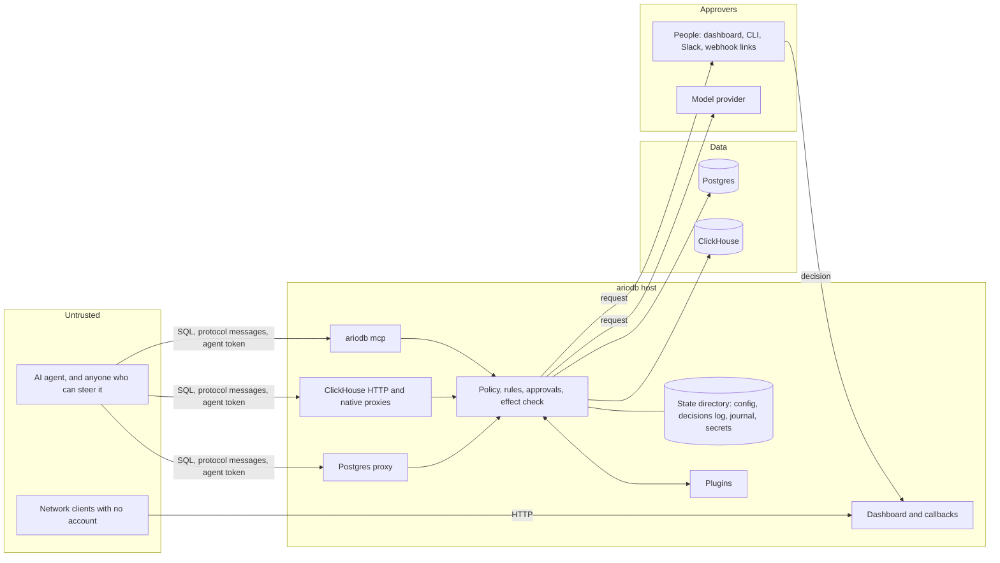

# Security model

This page sets out what ariodb defends against, what it guarantees, what it
deliberately does not, the risks accepted with reasons, the findings of the
October 2026 security review, and a hardening checklist for production
deployments. It is for whoever decides whether ariodb is fit to stand
between AI agents and a production database, and for whoever deploys it.
To report a vulnerability, see [SECURITY.md](../SECURITY.md).

## Where ariodb sits

The agent is on the untrusted side of every arrow it touches. The
database's own permissions sit behind ariodb as the last line.

## Who ariodb defends against

1. **An agent that sends hostile SQL.** Assume the agent, or whoever can
   steer it (a prompt injection in a ticket, a web page or a database row),
   writes every byte of every statement and every protocol message it
   sends to the Postgres proxy, the ClickHouse HTTP and native proxies, and
   the MCP server. It holds a valid agent token.
2. **Someone on the network who can reach the dashboard** and its callback
   endpoints (`/hooks/approvals/...`, `/slack/actions`), with no account,
   or with a stolen or phished link.
3. **Content that reaches a person or a model approver.** Agent SQL is
   shown in Slack, in webhook payloads, on the dashboard and to model
   approvers, and must not be able to change what they see or decide.

## What ariodb guarantees

- **Only allowed statements run.** An agent only runs statements the
  built-in policy and the rules allow, against the tables its allow-list
  names. Statements ariodb cannot see inside (`DO`, `CALL`, `EXECUTE`,
  `FETCH`) are refused, and so is anything it cannot parse or check: there
  is no fail-open mode for checks (`on_failure = "open"` is refused when
  the config loads).
- **Reads cannot write; writes are judged by their effect.** Reads run in
  `READ ONLY` transactions. Writes are measured before commit (rows
  changed and tables changed, including by triggers and cascades) and
  rolled back when over the row limit or outside the agent's tables. A
  refused write's results never reach the agent.
- **ariodb's controls are out of the agent's reach.** An agent cannot
  interfere with ariodb's own transaction control, the change journal, the
  decisions log, or approvals meant for someone else. Agent `BEGIN`,
  `COMMIT` and savepoints are refused, and so are session settings other
  than a short list of formatting and timeout settings drivers send (see
  [policy](policy.md#session-settings)), as are built-in functions that
  would get round ariodb's checks (see finding 3).
- **Nothing held for approval runs early.** A statement held for approval
  does not reach the database until every approver has allowed it; a deny,
  a timeout or a failure refuses it.
- **Dashboard changes need a person with the right role.** Every change
  needs a logged-in user whose role allows it, a CSRF token and a
  same-origin request, and passwords cannot be guessed at speed. Roles are
  checked by the server on every endpoint, not only hidden in the app (see
  [dashboard sign-in and roles](#dashboard-sign-in-and-roles)).
- **Agents never hold database credentials.** Agents authenticate to
  ariodb with their own tokens; database passwords stay with ariodb (but
  see [the MCP caveat](#what-ariodb-does-not-protect-against)).

## What ariodb does not protect against

- **The database role's privileges are the real boundary.** The table
  allow-list is checked against the tables a statement *names*. A view, a
  function or a `SECURITY DEFINER` function the gateway role may execute
  can read any table that role can read, and can do anything its owner can
  do (including calling `dblink` inside its body). Give the gateway role
  only the grants its agents need, do not install `dblink` or
  `postgres_fdw` in databases agents reach, and revoke `EXECUTE` on
  functions they should not call. ariodb refuses the built-in functions
  that would get round its own checks (finding 3), but it cannot see inside
  your functions.
- **Server files.** `pg_read_file`, `pg_ls_dir`, `lo_import` and similar
  need superuser or the `pg_read_server_files` family of roles. Do not
  grant those to the gateway role. `lo_*` is refused by ariodb; for the
  others, add a deny rule that matches schema-qualified names too, as in
  [policy](policy.md#blocked-functions). A rule that lists bare names
  (`sets.intersects(sql.functions, ['pg_read_file', ...])`, the form in the
  repository's example `ariodb.toml`) does not see
  `pg_catalog.pg_read_file(...)`, because `sql.functions` keeps the schema
  the statement wrote. The role's privileges are the boundary here; the
  rule is a second check.
- **The statement timeout is a default, not a ceiling.** `statement_timeout`
  and `lock_timeout` are among the settings agents may change, so an agent
  can send `SET statement_timeout = 0` with a slow statement and lift
  `[limits] statement_timeout_ms` for it. If you need a ceiling, add the
  rule in [statement timeouts](postgres.md#statement-timeouts). A timeout
  set on the gateway role in the database does not help, since a session
  `SET` overrides it.
- **User tables named `pg_*`.** Unqualified names starting `pg_` are
  treated as the system catalogue, which every agent may read. A table in
  `public` named, say, `pg_notes` is therefore readable by every agent,
  whatever its allow-list says. Do not give user tables such names.
- **`ca_file` on ariodb's own connections.** `[database] ca_file` is
  honoured on agents' connections but not on the connections `setup`,
  `doctor`, the journal and undo make, which verify against the public
  roots only. Against a database with a private CA, those connections fail
  under `tls = "verify"`. Switching to `tls = "require"` to get round this
  also stops agents' connections from checking the certificate; a tunnel
  that handles TLS itself is the better workaround. See
  [Postgres](postgres.md#between-ariodb-and-the-database).
- **Anyone who can write to the state directory or the config.** The
  decisions log is a hash chain without a key (accepted risk A1), the
  master key sits next to the encrypted secrets unless `ARIODB_MASTER_KEY`
  is set, and the config file is the policy. Protect the host and the state
  directory (ariodb creates it `0700` and warns when it is looser).
- **Agents that reach the database another way.** ariodb only sees what
  goes through it. Firewall the database so agents can reach it only via
  ariodb.
- **Agents that share a host and user with `ariodb mcp`.** The MCP server
  is started by the agent's MCP client, as the same OS user, with the
  database URL in its environment and the state directory open to it. An
  agent that can run shell commands or read files as that user can read
  those credentials. Use the MCP server for agents that can only call
  tools; give agents with a shell the Postgres proxy, run by another user
  or on another host. See [mcp.md](mcp.md#limits).
- **Effects outside the database** (emails, payments, webhooks fired by
  triggers) cannot be measured or undone.
- **ClickHouse writes** cannot be rolled back or undone; rules and
  approvals are the only control. ClickHouse reads run with
  `readonly = 2`, which still lets a query change most other settings
  (resource limits, for example); ariodb always sets `max_execution_time`
  itself.
- **Denial of service.** There are no connection limits or handshake
  timeouts on the listeners. Put them behind network controls.
- **Plugins are trusted code.** A plugin runs as ariodb's user, with that
  user's files and network. It sees the statements it is asked to approve
  or supply facts about, every event it is sent, and (as an audit sink) the
  whole decisions log, including literal values unless `redact_literals`
  is on. Its environment holds only `PATH`, `HOME` and what the config
  names, not ariodb's database URLs or tokens, but nothing stops it reading
  files ariodb's user can read, such as the state directory. Install
  plugins you would trust as much as ariodb, and keep them where only
  ariodb's owner can change them. What ariodb does guard against: an
  approver or facts plugin that is down, slow, crashing or answering
  nonsense refuses the statement; lines from a plugin are capped at 1 MiB;
  answers only reach the request whose ID they carry; every message ariodb
  writes is one serialised JSON value, so agent SQL cannot forge a message;
  each plugin has its own pipes; text from plugins has control characters
  removed. See [plugins.md](plugins.md).
- **A model approver is not a security boundary on its own.** Agent SQL is
  passed to the model as JSON data, with an instruction never to follow
  text inside it, and structured output limits the answer to allow or
  deny. A determined injection may still persuade a model. Use model
  approvers to save people time, not as the only check on high-risk rules,
  and keep `llm_fail_mode = "closed"`. See
  [approvals.md](approvals.md#limits-of-model-approvers).
- **Who may decide an approval.** Any signed-in dashboard user with the
  approver or admin role (within an approver's `groups`, if it sets them),
  anyone who can run `ariodb approve` against the state directory, and,
  with `approval_links = "signed"` (the default without single sign-on),
  anyone holding a decision link can decide a pending request. The
  approver type says where a request is announced, not who may answer it.
  Slack buttons are the exception: a Slack signature only decides requests
  waiting on that Slack approver.
- **Admins can change everything.** A dashboard admin can undo sessions,
  manage users and secrets and, with `config_writes = true`, change the
  policy. Give the admin role only to people trusted with all of that.

### Dashboard sign-in and roles

With `[dashboard.oidc]`, people sign in with an OpenID Connect provider:

- The authorisation code flow with PKCE (S256), a random `state` and a
  random `nonce` per sign-in. The pending sign-in is bound to the browser
  that started it by an `HttpOnly` cookie, used once, and forgotten after
  ten minutes, so a callback link sent to someone else, replayed, or with
  a changed `state` is refused.
- The ID token must be signed with RSA, RSA-PSS, ECDSA or EdDSA by a key
  from the provider's published key set, for that key's algorithm: `none`,
  HMAC (including HMAC keyed with a public key) and a key of the wrong
  type are refused. The issuer must be the one the discovery document
  names (which must match the configured issuer), the audience must
  include the client ID (and `azp` must be the client ID when present or
  when there are several audiences), `exp`, `nbf` and `iat` are checked
  with a minute's leeway, and the nonce must be this sign-in's. Keys are
  cached for an hour and fetched again when a token names an unknown key
  ID (at most every ten seconds), so the provider can rotate keys.
- The issuer and every address in its discovery document must be
  `https://` except on localhost; redirects are not followed when ariodb
  talks to the provider.
- The role (viewer, approver, admin) comes from the groups in the ID token
  and the current config on every request. No mapped group means no
  access; a config change that takes a group away ends that role at once.
  `allowed_email_domains` needs a verified email: `email_verified` must be
  true in the ID token, and a token without the claim does not count. A
  person is recorded as `sso:<email>` only when the email is verified;
  otherwise by user name or subject.
- Local passwords stay for break-glass use (`password_login =
  "break_glass"`) or are switched off (`"off"`), which also ends existing
  password sessions. Under single sign-on the first-run password page is
  off (accepted risk A4 does not apply).
- `[[approvers]]` of type `dashboard` or `webhook` may set `groups`; only
  members of those groups may then decide their requests, in the
  dashboard or through a link. A webhook approver with `groups` needs
  `approval_links = "sign_in"`, since a link followed without signing in
  has nobody whose groups could be checked.
- Approval links (`approval_links = "sign_in"`, the default under single
  sign-on) need a signed-in approver as well as the signed link, and the
  form on the confirmation page carries the session's CSRF token. The
  person, not the link, is recorded as the decider. A link opened from a
  chat app or email arrives without the `SameSite=Strict` session cookie,
  so the page reloads itself once as a same-site navigation (a meta
  refresh; the page has no script) before asking anyone to sign in.

Local users have roles too (see [dashboard](dashboard.md#users)), checked
the same way on every request.

### Where agent data is stored and sent

Statements, and the rows they change, end up in several places. Only the
decisions log, and the events and entries ariodb sends to notifier and
audit-sink plugins, honour `[audit] redact_literals`:

| Where | What | Redacted by `redact_literals` | Retention |
|---|---|---|---|
| Decisions log (`<state dir>/ariodb.db`) | Every statement and its verdict | Yes | `[audit] retention_days` (30 by default) |
| Approval records (`<state dir>/ariodb.db`) | Statements held for approval | No | Not pruned |
| Change journal (`<state dir>/journal.jsonl`) | Full before- and after-images of every changed row in protected tables, by anyone | No | Not pruned |
| Slack messages | Held statements (up to 2,500 characters) | No | Slack's |
| Webhook payloads | Held statements | No | The receiver's |
| Model providers | Held statements, agent, database, rule, policy | No | The provider's |
| Plugin notifications (`approval_requested` and others) and audit sinks | Statements | Yes | The plugin's |
| Plugin approvers and facts plugins | Statements, agent, database, rule | No | The plugin's |

See [undo.md](undo.md#operational-cautions) for the journal and
[approvals.md](approvals.md#what-data-is-sent-to-the-provider) for model
providers.

## Review of October 2026

A review of the proxy, wire protocol, executor, gate, classifiers and
policy, the ClickHouse proxies, MCP server, approvals, dashboard API,
secrets store, decisions log and undo, from the point of view of the
attackers above. Each fixed issue has a unit or end-to-end test that fails
without the fix.

### Fixed

| # | Severity | Area | Issue | Fix |
|---|---|---|---|---|
| 1 | Critical | Postgres proxy ([`proxy.rs`](../src/proxy.rs)) | With the extended protocol, an agent could Close one of ariodb's hidden statements (`__ariodb_begin_ro`, `__ariodb_effects`, `__ariodb_rollback` and the rest) and Parse its own statement under the same name. ariodb's transaction control would then silently stop working: reads outside a `READ ONLY` transaction, an effect check that measures nothing, a rollback that rolls nothing back. | Any Parse, Bind, Describe, Close or Execute naming a `__ariodb*` statement or portal is refused. |
| 2 | High | ClickHouse ([`chsql.rs`](../src/chsql.rs), [`clickhouse.rs`](../src/clickhouse.rs), [`clickhouse_native.rs`](../src/clickhouse_native.rs)) | The table allow-list could be bypassed: comma joins (`FROM events, secrets`) only saw the first table; `x IN secrets` was not seen; `INSERT INTO secrets (col) VALUES` took the column list for a function call; `merge()`, `dictionary()`, `cluster()`, `dictGet` and `joinGet` read tables named in strings; and the `database` parameter or native login database changed what unqualified names meant. | FROM lists, `IN` and column lists are tracked; only row-making table functions are allowed; dictionary and Join-table functions are refused; unqualified names are qualified with the session database, which ariodb now always names to ClickHouse. |
| 3 | High | Postgres policy ([`policy.rs`](../src/policy.rs)) | Built-in functions could get round ariodb's checks: `query_to_xml` and the rest of the `*_to_xml` family, `ts_stat` and `dblink` run SQL ariodb never sees (reading tables outside the allow-list); `set_config` changes settings for the rest of the session (undoing the refusal of `SET search_path`); large-object functions write where the effect check cannot measure; `pg_logical_emit_message` can forge the session tag the journal and undo rely on; replication-slot functions can disturb the journal; `pg_terminate_backend` can end other agents' sessions on the shared login. | Refused for every agent, whatever the rules say. |
| 4 | Medium | Postgres classifier ([`classify.rs`](../src/classify.rs)) | The parser's table and function lists stop at `PREPARE` and `DECLARE CURSOR`, so tables and functions named only inside them passed the allow-list and the rules unseen. | The wrapped query is printed back to SQL and read as well; failure to do so refuses the statement. |
| 5 | Medium | Postgres proxy ([`proxy.rs`](../src/proxy.rs)) | After a batch failed at the database, ariodb kept its old record of statement names the batch had parsed or closed, although the database may have changed them. A later Bind could be judged by the rules, approvals and the decisions log as the old statement. (`READ ONLY` and the effect check still applied.) | Those names are forgotten, so such a Bind is refused. |
| 6 | Medium | Dashboard login ([`dashboard.rs`](../src/dashboard.rs)) | No limit on password guesses; unknown user names answered faster than known ones. | Failures are counted per client address (5 per 15 minutes) and per existing user (20 per 15 minutes); past either, logins get 429 without a password check. Unknown users are verified against a dummy hash. |
| 7 | Medium | Webhook approvals ([`dashboard.rs`](../src/dashboard.rs)) | Decision links acted on GET. Chat apps and mail scanners fetch links to preview them, so a request could be approved or denied without anyone looking. | GET shows the request and a button; only POST decides. The page is never framed and sends no referrer. **Webhook receivers that followed links programmatically must now POST to them.** |
| 8 | Medium | Block-like-this ([`dashboard_api.rs`](../src/dashboard_api.rs)) | The generated deny rule embedded table names from agent SQL with incomplete escaping (backslashes and new lines in the condition, and nothing at all in the rule name). A crafted quoted identifier could end the TOML string early, so the saved config differed from the rule the operator previewed. | CEL string escaping for every value, the TOML library writes the strings, and the rule name is a slug. |
| 9 | Low | Slack approvals ([`approvals.rs`](../src/approvals.rs), [`dashboard.rs`](../src/dashboard.rs)) | A valid Slack signature could decide any approval, including ones waiting on the dashboard or another approver. | Only requests waiting on the Slack approver whose secret signed the callback. |
| 10 | Low | Slack approvals ([`approvals.rs`](../src/approvals.rs)) | Agent SQL was put in a Slack code block unescaped, so it could close the block and add links ("approve here") or mentions. | `&`, `<`, `>` escaped as Slack asks; backtick runs broken up. |
| 11 | Low | Model approver ([`approvals.rs`](../src/approvals.rs)) | The decision cache was keyed on approver, agent and SQL only: a changed policy kept old answers, and an outage under fail-open was cached as an allow for the whole window. The cache never shrank. | Keyed on approver, model, policy, agent, database, rule and SQL; only the model's own answers are cached; expired entries are swept. |
| 12 | Low | Undo ([`undo.rs`](../src/undo.rs)) | Recorded values were quoted as `'...'`, which is only safe while the server has `standard_conforming_strings` on. | Values containing a backslash are written as `E'...'` with backslashes doubled. |
| 13 | Low | ClickHouse native ([`clickhouse_native.rs`](../src/clickhouse_native.rs)) | Before authentication, each Hello field could make ariodb allocate up to 64 MiB. | Login fields capped at 64 KiB. |

### Accepted, with reasons

| # | Severity | Area | Issue | Why accepted, and mitigation |
|---|---|---|---|---|
| A1 | Medium | Decisions log ([`audit.rs`](../src/audit.rs)) | The chain is unkeyed SHA-256. Anyone who can write `ariodb.db` can rewrite every hash, or delete the newest entries, and `ariodb audit` will still pass; deleting the oldest entries looks like retention pruning. | It is tamper-evident against casual edits, not against the host's owner. A keyed chain needs a key the attacker cannot read, which on the same host is the same problem. Ship decisions to an external log store (an `audit_sink` [plugin](plugins.md) can), or record the head hash elsewhere, if you need more. |
| A2 | Medium | Postgres policy | Tables read through views and functions are not on the allow-list (see above). | Parsing cannot see inside functions; database grants are the boundary. |
| A3 | Medium | Model approver | Prompt injection through SQL text remains possible. | Mitigated (data passed as JSON, instruction to ignore it, structured output, fail-closed by default); do not rely on a model alone. |
| A4 | Low | Dashboard first run ([`dashboard.rs`](../src/dashboard.rs)) | The first password can be set by any request from a loopback address. Behind a reverse proxy on the same host, every request is from loopback. | Set the password with `ariodb dashboard-password` before exposing the dashboard. |
| A5 | Low | Listeners | No connection limits or handshake timeouts; slow clients can hold connections open. | Network controls; agents are authenticated before any database work. |
| A6 | Low | Postgres proxy auth | Unknown agent names fail slightly faster than known ones, and token guesses are not rate limited. | Tokens should be long random values, which makes guessing hopeless whatever the rate. |
| A7 | Low | ClickHouse HTTP | Agents may send their token as a `password` URL parameter, which intermediaries may log. | Supported for client compatibility; prefer Basic auth or `X-ClickHouse-Key`. |
| A8 | Low | Dashboard login limit | Twenty wrong passwords for a user, from anywhere, lock that user out for 15 minutes; the counts live in memory and reset on restart. Behind a reverse proxy, all clients share the proxy's address, so five wrong passwords from anyone block sign-in from everyone. | A deliberate trade-off against distributed guessing. Keep the dashboard off untrusted networks. |
| A9 | Medium | `write_check = "reported"` | Writes are judged by the row counts the database reports, so rows and tables changed by triggers, cascades and functions are not seen. | Off by default, for databases that cannot measure writes (YugabyteDB, CockroachDB); `ariodb doctor` and [compatibility.md](compatibility.md) say what it gives up. Database grants are the backstop. |
| A10 | Low | Dashboard single sign-on ([`oidc.rs`](../src/oidc.rs)) | Groups are read from the ID token at sign-in. Someone removed from a group at the provider keeps that group's role until their session ends (12 hours) or they sign out. Pending sign-ins live in memory, so a restart makes people start again. | A role mapping changed in the config applies at once, so take the group out of the mapping when someone must lose access before their session ends. |
| A11 | Low | Approval links with `approval_links = "signed"` | Without single sign-on (or with links set to `signed`), anyone holding a link can decide its request, and the decision is recorded as `webhook`. | Links are signed per request and verdict and only decide on POST (finding 7). Set `approval_links = "sign_in"` to tie each decision to a person. |

### Reviewed with no issue found

- Network-facing token and CSRF comparisons are constant-time; dashboard
  session tokens are stored only as SHA-256 hashes, with `HttpOnly`,
  `SameSite=Strict` cookies.
- Cancel requests: ariodb hands out its own random keys and maps them to
  the upstream key, so the database's own keys are never exposed.
- Frames over 1 MiB are drained and refused; the startup message is
  capped.
- The effect measurement is checked against the row counts the database
  reports for each statement; a measurement that comes up short (as on
  databases whose `pg_stat_xact_user_tables` stays empty, or for foreign
  tables) rolls the write back.
- Writes are held until the effect check passes; a refused write's results
  never reach the agent. `COPY FROM STDIN` is refused, and aborted if it
  slips through.
- `DO`, `CALL`, `EXECUTE`, `FETCH`, `LISTEN`, `NOTIFY`, `DEALLOCATE` and
  `DISCARD` are refused.
- Secrets are sealed with XChaCha20-Poly1305 with the name as associated
  data; the key file is created `0600`.
- Webhook links are HMAC-signed per approval and verdict; Slack callbacks
  check the signature and a five-minute timestamp window.
- The decisions log is written with parameterised SQL; filters are bound
  parameters.

Not reviewed in depth this time: [`tls.rs`](../src/tls.rs),
[`upstream.rs`](../src/upstream.rs), [`journal.rs`](../src/journal.rs),
[`pgoutput.rs`](../src/pgoutput.rs), [`rules.rs`](../src/rules.rs) and the
dashboard front end.

## Hardening checklist

Database:

- [ ] A least-privilege gateway role for each credential: only the grants
      its agents need; no superuser, no `REPLICATION`, no
      `pg_read_server_files` (or the rest of that family), no
      `pg_signal_backend`.
- [ ] No `dblink` or `postgres_fdw` in databases agents reach; `EXECUTE`
      revoked on functions agents should not call, especially
      `SECURITY DEFINER` ones.
- [ ] Agents can reach the database only through ariodb (firewall,
      security groups, `pg_hba.conf`).
- [ ] The journal role has `REPLICATION` and nothing more; `ariodb setup`
      runs once as a table owner (see
      [the journal role](postgres.md#the-journal-role)); the undo role
      (`ARIODB_ADMIN_URL`) can only select, insert, update and delete on
      the protected tables.
- [ ] Replication slot lag is monitored (see
      [undo.md](undo.md#operational-cautions)).

Network and TLS:

- [ ] TLS on the proxy with `require_tls = true` whenever agents connect
      over a network (tokens are sent as passwords).
- [ ] TLS to the database with `tls = "verify"` (the default for any
      host other than this one). `"require"` encrypts but accepts any
      certificate, so it does not stop a man in the middle.
- [ ] Listeners on loopback or private addresses, behind network controls
      (there are no connection limits).
- [ ] ClickHouse agents use Basic auth or `X-ClickHouse-Key`, not the
      `password` URL parameter.

Dashboard:

- [ ] The first password set with `ariodb dashboard-password` before the
      dashboard is reachable through any proxy.
- [ ] Served over HTTPS, with `public_url` starting `https://` so cookies
      are `Secure`; the proxy passes `Host` through unchanged.
- [ ] Not exposed to the internet without a reason; if Slack or outside
      webhook users need it, expose only `/slack/actions` and
      `/hooks/approvals/` (see
      [dashboard.md](dashboard.md#exposing-only-the-callbacks)).
- [ ] Each person given the lowest role that lets them do their job;
      admin only for people trusted with every action the dashboard
      offers.
- [ ] With single sign-on: only the groups that need each role are
      mapped; approvers' `groups` kept narrow for high-risk rules; the
      break-glass `root` password kept offline (or
      `password_login = "off"`); the client secret in `client_secret_env`
      or `client_secret_secret`.
- [ ] `approval_links = "sign_in"` wherever decisions must be tied to a
      person.
- [ ] `config_writes = false` unless people are meant to edit policy from
      the dashboard.

Secrets and state:

- [ ] Long random agent tokens (`openssl rand -hex 32`), one per agent.
- [ ] Credentials in environment variables or the secret store, never in
      `ariodb.toml`.
- [ ] `ARIODB_MASTER_KEY` set from a secrets manager, and kept out of the
      state directory's backups.
- [ ] The state directory `0700`, owned by ariodb's user, on encrypted
      storage; it holds the journal's full row images and approval records
      unredacted.
- [ ] `redact_literals = true` if statements may carry personal data and
      you do not need literal values in the decisions log.
- [ ] Decisions shipped to an external store (an `audit_sink` plugin) if
      you need a log the host's owner cannot rewrite.

Agents and approvers:

- [ ] Agents with shell or file access use the Postgres proxy from another
      user or host, not `ariodb mcp` under their own user.
- [ ] Model approvers never the only check on high-risk rules;
      `llm_fail_mode = "closed"`; a local model if statements must not
      leave your network.
- [ ] Webhook URLs use `https`; webhook links go only to people allowed to
      decide.
- [ ] Plugins only from sources you trust, owned by ariodb's user and not
      writable by others; their credentials through `pass_env` or
      `secret_env`, not `env` in the config file.
- [ ] `ariodb test` fixtures in CI for the rules you rely on (see
      [testing-policies.md](testing-policies.md)).

## Next

- [Approvals](approvals.md): approvers and their limits.
- [Dashboard](dashboard.md): sign-in protection and reverse proxies.
- [Postgres](postgres.md): database roles and the effect check.
- [Operations](operations.md): running ariodb in production.
- [SECURITY.md](../SECURITY.md): reporting a vulnerability.
