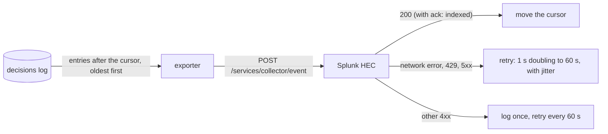

# Splunk

ariodb has a built-in exporter for Splunk. It sends every entry of the
decisions log to Splunk's HTTP Event Collector (HEC), in order and at least
once, with sourcetype `ariodb:decision`, and sends approval and undo events
on a best-effort basis with sourcetype `ariodb:event`. No plugin or
forwarder is needed: `ariodb serve` does it.

- [What is sent](#what-is-sent)
- [Setting up Splunk](#setting-up-splunk)
- [Configuring ariodb](#configuring-ariodb)
- [How delivery works](#how-delivery-works)
- [Indexer acknowledgement](#indexer-acknowledgement)
- [Watching the exporter](#watching-the-exporter)
- [Example searches](#example-searches)
- [A starter dashboard](#a-starter-dashboard)
- [Testing without Splunk](#testing-without-splunk)

## What is sent

**Decisions** (`sourcetype = ariodb:decision`): one Splunk event per entry
of the decisions log, that is, one per statement an agent sent. The event
time is the decision's time, in epoch seconds with milliseconds.

```json
{"time": 1791548400.123, "host": "gw-1", "source": "ariodb",
 "sourcetype": "ariodb:decision", "index": "ariodb",
 "event": {"id": 41, "agent": "coding-agent", "engine": "postgres", "database": "app",
           "session": "s-d4c9dddfdb", "outcome": "rolled_back", "rule": null,
           "deciders": [], "kind": "write", "tables": ["orders"], "rows": 50,
           "latency_ms": 7, "reason": "50 rows changed; the limit is 5",
           "sql": "UPDATE orders SET status = $1 WHERE id <= $2",
           "prev": "9b1f…", "hash": "c04e…"}}
```

| Field | Meaning |
|---|---|
| `id` | The entry's id in the decisions log. It increases by one per entry; use it to drop repeats (`dedup id`) and to look for gaps. |
| `agent`, `engine`, `database`, `session` | Who sent the statement, to which engine (`postgres`, `mysql` or `clickhouse`) and database, in which session (the session `ariodb undo` takes). |
| `outcome` | `allowed`, `refused`, `rolled_back` or `failed`. |
| `rule` | The rule that decided, or null for the built-in policy. |
| `deciders` | Who decided the approvals the statement asked for, in order (`dashboard:root`, `sso:pat@example.test`, `slack:pat`, `model:openai/<model>`, `plugin:<name>`, `cli:<user>`, `ariodb`). Empty when no approval was asked for. |
| `kind`, `tables` | How ariodb classified the statement, and the tables it names. |
| `rows`, `latency_ms`, `reason` | Rows changed (or returned), time taken, and why it was refused or rolled back. |
| `sql` | The statement as the decisions log stores it: with `[audit] redact_literals = true`, literal values are already `$1`, `$2`, ... |
| `prev`, `hash` | The entry's links in the decisions log's hash chain (see the [security model](security-model.md)). |

**Events** (`sourcetype = ariodb:event`): `approval_requested`,
`approval_decided` and `undo_applied`, with the details notifier plugins
get (see [plugins](plugins.md#event-notifier)), and the event's name in
`event`:

```json
{"time": 1791548460.512, "source": "ariodb", "sourcetype": "ariodb:event", "index": "ariodb",
 "event": {"event": "approval_decided", "rule": "ask", "approver": "ops",
           "approver_type": "dashboard", "agent": "coding-agent", "session": "s-d4c9dddfdb",
           "database": "app", "sql": "DELETE FROM orders WHERE id = $1",
           "reason": "deletes need a person", "verdict": "allow", "why": null}}
```

Refusals and rollbacks are decisions already, so they are not sent again as
events.

Every field is in the event's JSON, which Splunk extracts at search time;
lists appear as `tables{}` and `deciders{}`. ariodb sends no indexed
`fields`: a field both indexed and in the JSON would show each value twice.

## Setting up Splunk

You need a Splunk Enterprise or Splunk Cloud Platform deployment that you
are licensed to use.

1. **An index.** Create one for ariodb, for example `ariodb` (Settings >
   Indexes > New Index). Its retention is Splunk's; ariodb's own
   `[audit] retention_days` applies only to ariodb's copy.
2. **HEC on.** In Splunk Enterprise: Settings > Data inputs > HTTP Event
   Collector > Global Settings, set **All Tokens** to Enabled. HEC listens
   on port 8088, with SSL on by default. In Splunk Cloud Platform, HEC is
   on, at `https://http-inputs-<stack>.splunkcloud.com` (port 443).
3. **A token.** Settings > Data inputs > HTTP Event Collector > New Token.
   Name it `ariodb`. Leave **Source type** as Automatic: ariodb sets
   `ariodb:decision` and `ariodb:event` on each event. Under **Allowed
   indexes**, choose `ariodb`, and make it the default. Leave **Enable
   indexer acknowledgement** off unless you want it (see
   [below](#indexer-acknowledgement)).
4. **Store the token in ariodb's secret store**, on the machine that runs
   `ariodb serve`. `ariodb secret set` reads the value from stdin, so paste
   it there rather than typing it on the command line:

   ```bash
   ariodb secret set splunk-hec
   # paste the token, then Enter
   ```

   Or keep it in an environment variable of the service and use
   `token_env`. The token cannot be written in `ariodb.toml`: a `token` key
   there is refused when the config loads.

No `props.conf` is needed. The sourcetypes need no timestamp extraction
(the time is in each event's envelope) and no line breaking (each event is
its own JSON object).

## Configuring ariodb

```toml
[audit.splunk]
enabled = true
url = "https://splunk.example.com:8088"
token_secret = "splunk-hec"
index = "ariodb"
```

| Key | Type | Default | What it does |
|---|---|---|---|
| `enabled` | boolean | `false` | Turn the exporter on. |
| `url` | string | required | The collector's base address, such as `https://splunk.example.com:8088` or `https://http-inputs-<stack>.splunkcloud.com`. Without `/services/collector`: ariodb adds the paths. |
| `token_secret` | string | none | The name of a secret holding the HEC token. Set this or `token_env`. |
| `token_env` | string | none | Or: an environment variable holding it. |
| `index` | string | the token's default | The index to write to. It must be one the token allows. |
| `source` | string | `"ariodb"` | The `source` of every event. |
| `host` | string | this machine's host name | The `host` of every event. |
| `ca_file` | string | none | An extra trusted CA certificate (PEM), on top of the system's, for a collector with a private CA. |
| `accept_invalid_certificate` | boolean | `false` | Do not check the collector's certificate. For test setups only; ariodb logs a warning at startup and `doctor` shows one. |
| `ack` | boolean | `false` | Use [indexer acknowledgement](#indexer-acknowledgement). The token must have it on. |
| `ack_timeout_ms` | integer | `300000` | With `ack`, send a batch again if Splunk has not confirmed it within this time. |
| `events` | boolean | `true` | Send approval and undo events too. |
| `batch_size` | integer | `100` | The most decisions in one request. A request also stops at about 512 KiB of statements. |
| `flush_interval_ms` | integer | `1000` | How often to look for new decisions once everything is sent. |
| `timeout_ms` | integer | `10000` | The limit on each request to the collector. |

TLS certificates are checked by default, against the system's trusted roots
and `ca_file`. A plain `http://` URL works (for a collector on the same
host), but then the token and the decisions travel unencrypted, and
`ariodb doctor` warns about it unless the host is a loopback address.

Changes to `[audit.splunk]` take effect without a restart: `ariodb serve`
uses the new settings for the next batch, and reads the token again. The
value of a `token_env` variable is fixed when ariodb starts, so changing it
needs a restart; a secret changed with `ariodb secret set` is read again
when the settings change or after Splunk refuses the token.

## How delivery works



- **Decisions are read from the log, not queued.** The exporter keeps a
  cursor (`builtin:splunk` in `ariodb.db`, beside the plugins' cursors) and
  reads the next entries after it, up to `batch_size`. It moves the cursor
  only once Splunk has accepted the batch. Memory use does not grow with an
  outage; the backlog is the log itself.
- **In order, at least once.** Nothing is skipped or reordered across
  outages and restarts of ariodb or Splunk. A batch can arrive twice if
  Splunk accepted it but its answer was lost (a timeout, or ariodb stopping
  mid-request); `dedup id` removes repeats.
- **Retries.** Network errors, timeouts, 408, 429 (codes 26 and 27, queue
  or ack channel at capacity) and 5xx (code 8, internal error; 9, busy; 23,
  shutting down) are retried after 1 s, doubling to 60 s, each with jitter.
  Each failure is logged with the batch's ids.
- **Refusals.** Any other answer (a bad or disabled token, codes 1 to 4; an
  index the token may not use, code 7; acknowledgement on the token but not
  in ariodb, codes 10 and 11; a wrong URL, 404) will not change by itself.
  ariodb logs it once, with what to fix, keeps the decisions in the log,
  and tries again every 60 s, or at once when `[audit.splunk]` changes.
  Nothing is ever dropped.
- **Too large.** If Splunk answers 413, ariodb halves the batch until it
  fits. A single entry too large for the collector (its
  `max_content_length` in `limits.conf`) is treated as a refusal: raise the
  limit.
- **Which process sends.** Only `ariodb serve` sends decisions, including
  those written by `ariodb mcp` processes (they share the log). `ariodb mcp`
  and `ariodb undo --apply` send their own approval and undo events while
  they run, and wait up to five seconds on exit to finish sending them.
- **The first start** sends the whole log as it stands, oldest first,
  which may be up to `[audit] retention_days` of entries.
- **Retention.** Entries pruned by `[audit] retention_days` before they
  were delivered are lost to Splunk. Keep retention longer than any outage
  you expect; `doctor` and the dashboard show the backlog.
- **Events are best effort**, as for notifier plugins: up to 1,000 wait in
  memory while the collector is down, further ones are dropped and counted,
  and events still waiting when ariodb stops are lost. Use the decisions
  for a complete record.

## Indexer acknowledgement

By default, HEC answers 200 once the events look valid, before they are
indexed, and ariodb relies on that answer. With indexer acknowledgement
(Splunk Enterprise only; Splunk Cloud Platform supports it only for
Amazon Data Firehose), Splunk confirms each request once it is indexed:

1. Turn on **Enable indexer acknowledgement** for the token.
2. Set `ack = true`.

ariodb then creates its own channel (a random GUID per process) and sends
it with each request in `X-Splunk-Request-Channel`. Each answer carries an
`ackID`; ariodb asks `POST /services/collector/ack` about it, from every
250 ms up to every 5 s, and moves the cursor only when Splunk reports it
indexed. If Splunk has not confirmed it within `ack_timeout_ms` (5 minutes
by default, as Splunk suggests), the batch is sent again, so it may be
indexed twice. One batch is in flight at a time, so throughput is one batch
per indexing delay: raise `batch_size` if decisions arrive faster.

If `ack = true` but the token does not use acknowledgement, Splunk answers
without an `ackID`; ariodb logs that once and counts each accepted batch as
delivered. If the token uses acknowledgement and `ack` is false, Splunk
refuses every request (code 10, "Data channel is missing"), which ariodb
reports as a refusal saying to set `ack = true`.

## Watching the exporter

**The log.** Lines start `ariodb: Splunk exporter:`:

| Line | Meaning |
|---|---|
| `could not deliver decisions 6 to 8 (HTTP 503, code 9 (Server is busy)); trying again in 4 s` | A transient failure; it will retry. |
| `could not deliver ... (cannot reach the collector: ...)` | The network or the collector is down. |
| `Splunk refused decision 11: HTTP 403, code 4 (Invalid token): ... Nothing is dropped: ...` | A configuration problem, logged once until it changes. |
| `[audit.splunk]: token_env names X, which is not set. Decisions wait in the log; ...` | The token cannot be read. |
| `delivering again (decisions 6 to 8 accepted)` | Recovered after a failure. |
| `events are not being sent fast enough; N dropped so far` | The event queue was full. |

The token is never logged, and it never appears in a URL: ariodb sends it
only in the `Authorization: Splunk <token>` header.

**The dashboard API.** `GET /api/plugins` includes a `splunk` object while
`ariodb serve` runs (null otherwise):

```json
"splunk": {"state": "idle", "url": "https://splunk.example.com:8088", "decisions": true,
           "delivered_to": 412, "backlog": 0, "last_success_ms": 1791548400123,
           "last_error": null, "last_error_ms": null,
           "decisions_sent": 412, "events_sent": 37, "events_dropped": 0}
```

`state` is `disabled`, `starting`, `sending`, `idle` (everything sent),
`retrying` (the collector is down or busy) or `refused` (a configuration
problem: see `last_error`).

**`ariodb doctor`** adds a section when the exporter is enabled. It asks
the collector's health endpoint (`GET /services/collector/health`, no token
needed), checks the token with an empty request (Splunk answers "No data"
to a token it accepts, and nothing is indexed), and reports the backlog and
the exporter's last success and failure as `ariodb serve` recorded them:

```text
splunk: https://splunk.example.com:8088, index ariodb
  ok    the collector answers: HEC is healthy
  ok    the collector accepts the token
  ok    every decision is delivered (up to entry 412); the last batch was accepted 3 s ago
```

```text
splunk: https://splunk.example.com:8088, index ariodb
  ok    the collector answers: HEC is healthy
  FAIL  the token is not accepted: HTTP 403, code 4 (Invalid token): the collector does not accept this token (unknown or disabled): check token_env or token_secret
  warn  2 decisions wait to be delivered (delivered up to entry 410); the last batch was accepted 5 min ago
  warn  the last attempt failed (12 s ago): Splunk refused decision 411: HTTP 403, code 4 (Invalid token): ...
```

The health endpoint can check a token too, but only one passed in the
query string, where Splunk's access log would record it; ariodb does not
do that.

## Example searches

Refusals by agent and rule:

```spl
index=ariodb sourcetype="ariodb:decision" outcome=refused
| dedup id
| eval rule=coalesce(rule, "built-in policy")
| stats count by agent, rule
| sort - count
```

Rolled-back writes, newest first:

```spl
index=ariodb sourcetype="ariodb:decision" outcome=rolled_back
| dedup id
| table _time agent session database tables{} rows reason sql
```

Approvals and who decided them:

```spl
index=ariodb sourcetype="ariodb:event" event=approval_decided
| stats count by approver, verdict
```

```spl
index=ariodb sourcetype="ariodb:decision" deciders{}=*
| dedup id
| stats count by deciders{}
```

Per-agent activity, and the slowest statements:

```spl
index=ariodb sourcetype="ariodb:decision"
| dedup id
| timechart span=1h count by agent
```

```spl
index=ariodb sourcetype="ariodb:decision"
| dedup id
| stats count, perc95(latency_ms) as p95_ms by agent, engine
```

Everything one session did, then whether it was undone:

```spl
index=ariodb session="s-d4c9dddfdb"
| table _time sourcetype event outcome kind tables{} rows sql
```

Gaps in delivery (after `dedup`, the count should equal the span of ids,
unless retention pruned entries before they were sent):

```spl
index=ariodb sourcetype="ariodb:decision"
| dedup id
| stats min(id) as first, max(id) as last, dc(id) as received
| eval missing = last - first + 1 - received
```

## A starter dashboard

[`examples/splunk/ariodb_dashboard.xml`](../examples/splunk/ariodb_dashboard.xml)
is a Simple XML dashboard: counts of statements, refusals, rollbacks and
approvals, activity by agent, refusals by rule over time, and tables of
approvals, rolled-back writes and undos, with time, index and agent
pickers. To add it: Dashboards > Create New Dashboard > Classic
Dashboards, then **Source**, and paste the file.

## Testing without Splunk

`scripts/e2e-splunk.sh` runs ariodb against
[`scripts/hec_standin.py`](../scripts/hec_standin.py), a local stand-in for
HEC that follows Splunk's documented API and status codes and records what
it receives. It checks delivery in order and once, an outage and recovery,
a restart, a bad token, indexer acknowledgement, TLS checks, approval and
undo events, and that no token appears in ariodb's output. It does not use
Splunk's own image, which needs its licence accepted.

## Next

- [Configuration](configuration.md#auditsplunk): the `[audit.splunk]` keys
  with the rest of `ariodb.toml`.
- [Plugins](plugins.md): audit-sink plugins, for other destinations.
- [Operations](operations.md): logs, retention and what to watch.
- [Security model](security-model.md): what the decisions log's hash chain
  proves.
